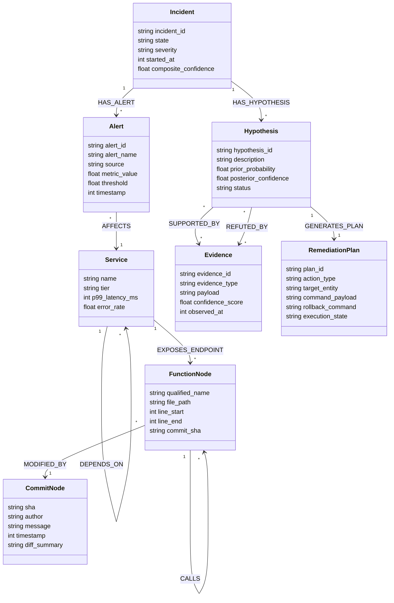
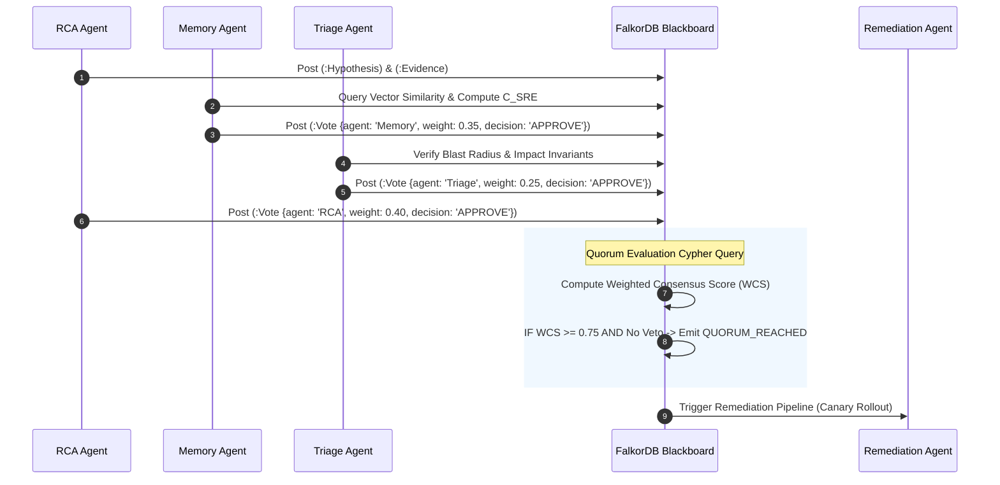

# GraphSRE: Autonomous SRE & Code Brain
## Multi-Agent Architecture & FalkorDB Central Blackboard Specification

```
   ┌─────────────────────────────────────────────────────────────────────────────────┐
   │                       GRAPHSRE MULTI-AGENT ARCHITECTURE                         │
   │               Autonomous Site Reliability Engineering & Code Intelligence        │
   └─────────────────────────────────────────────────────────────────────────────────┘

     ┌──────────────┐      ┌──────────────┐      ┌──────────────┐      ┌──────────────┐
     │ Triage Agent │      │  RCA Agent   │      │ Memory Agent │      │ Remediation  │
     │   (Alerts)   │      │  (Causality) │      │ (Knowledge)  │      │   (Action)   │
     └──────┬───────┘      └──────┬───────┘      └──────┬───────┘      └──────┬───────┘
            │                     │                     │                     │
            │   Model Context Protocol (MCP) Interface  │                     │
            └──────────────┬──────┴──────────────┬──────┴─────────────────────┘
                           │                     │
                           ▼                     ▼
     ┌────────────────────────────────────────────────────────────────────────────────┐
     │                       FALKORDB CENTRAL BLACKBOARD                              │
     │                                                                                │
     │   ACID Graph State Store  •  Vector Index  •  AST & Topology Knowledge Base   │
     │                                                                                │
     │   (:Incident) ──[:HAS_ALERT]──> (:Alert) ──[:AFFECTS]──> (:Service)           │
     │        │                                                     │                 │
     │   [:HAS_HYPOTHESIS]                                     [:CALLS]               │
     │        ▼                                                     ▼                 │
     │   (:Hypothesis) ──[:SUPPORTED_BY]──> (:Evidence) ──> (:Function)              │
     │        │                                                     ▲                 │
     │   [:LEADS_TO]                                           [:MODIFIES]            │
     │        ▼                                                     │                 │
     │   (:RemediationPlan) ──[:TESTED_IN]──> (:SandboxGraph) ── (:Commit)            │
     └────────────────────────────────────────────────────────────────────────────────┘
```

---

## 1. Executive Architecture & Central Blackboard Paradigm

### 1.1 The Failure Modes of Traditional Multi-Agent Conversational Architectures

Modern multi-agent architectures predominantly rely on natural-language message passing (e.g., AutoGen, CrewAI, LangGraph conversational rings). In complex, mission-critical environments such as Site Reliability Engineering (SRE), this paradigm fails deterministically due to five systemic flaws:

```
Conversational Ring Failure (Peer-to-Peer Message Passing):
Agent A ──(Text Message)──> Agent B ──(Text Message)──> Agent C ──(Text Message)──> Agent D
   │                           │                           │                           │
   ▼                           ▼                           ▼                           ▼
Context Bloat ($O(N^2)$)   Hallucination Cascade       No Audit Trail           State Drift
```

1. **Context Window Explosion & Quadratic Token Bloat ($O(N^2)$):**
   In a 4-agent conversational ring exchanging raw alerts, metric timeseries, stack traces, and code diffs, token consumption scales quadratically with conversation depth. When alert storms fire (e.g., 500 alerts/minute), raw text buffers truncate earlier reasoning steps, dropping vital telemetry tokens and triggering catastrophic forgetting.

2. **Hallucination Cascades & Unbounded Error Amplification:**
   When an upstream agent generates an unverified causal claim (e.g., *"Database connection pool exhausted due to billing query"*), downstream agents ingest this assertion as factual context. Without a grounding layer enforcing structural constraints, subsequent agents generate remediation actions on fabricated premises, multiplying the probability of catastrophic erroneous commands:
   $$\mathbb{P}(\text{Cascade Failure}) = 1 - \prod_{i=1}^{k} (1 - \epsilon_i) \xrightarrow[k \to \infty]{} 1$$
   where $\epsilon_i$ is the token error rate of agent $i$.

3. **Absence of Deterministic Auditability & Cryptographic Lineage:**
   Post-incident reviews require verifiable, deterministic event sequences. Free-form conversational strings lack atomic checkpoints, deterministic state timestamps, and formal dependency graphs. Diagnosing *why* an agent executed a cluster drain cannot be reconstructed reliably from non-deterministic chat completions.

4. **State Drift & Distributed Concurrency Hazards:**
   When multiple agents concurrently analyze a distributed incident, each maintains a private, non-synchronized context window. Agent A may attempt to roll back a Helm deployment while Agent B attempts to autoscale the underlying pod replica set, inducing split-brain race conditions at the infrastructure level.

5. **Linear Message-Passing Latency:**
   Synchronous text synthesis induces severe latency overheads (2,000–8,000 ms per agent hop). For high-severity incidents ($Sev-1/Sev-2$), a 4-hop conversational cycle consumes 20–40 seconds just for internal communication before any mitigation is applied.

---

### 1.2 FalkorDB as the Immutable, Real-Time Shared Blackboard

GraphSRE discards conversational chat loops in favor of a **Central Graph Blackboard Architecture** powered by **FalkorDB**. Instead of communicating with each other via text prompts, agents interact exclusively through atomic, structured Cypher transactions against a shared, persistent, low-latency graph database.

```
Blackboard Architecture (FalkorDB Sub-Millisecond ACID Graph):

         [ Agent 1: Triage ]               [ Agent 2: RCA ]
                  │                                │
        Cypher TX │                      Cypher TX │
                  ▼                                ▼
       ┌──────────────────────────────────────────────────────┐
       │             FALKORDB CENTRAL BLACKBOARD              │
       │                                                      │
       │  • Sub-millisecond Cypher query execution (GraphBLAS)│
       │  • ACID transactional isolation                      │
       │  • Unified Code AST, Dependency Topology & Telemetry │
       │  • Embedded HNSW Vector Index for Episodic Memory    │
       │  • Native Graph Copying (`GRAPH.COPY`) for Sandboxing│
       └──────────────────────────────────────────────────────┘
                  ▲                                ▲
        Cypher TX │                      Cypher TX │
                  │                                │
         [ Agent 3: Memory ]             [ Agent 4: Remediation ]
```

#### Why FalkorDB is Uniquely Qualified
* **GraphBLAS Sparse Matrix Engine:** FalkorDB leverages sparse matrix linear algebra (GraphBLAS) to compute multi-hop reachability and dependency traversals in sub-millisecond latencies ($< 1\text{ ms}$ for 6-hop traversals over 500,000 nodes), outperforming traditional graph engines by an order of magnitude.
* **ACID Transactions & Optimistic Concurrency Control:** Agents read and mutate graph entities within isolated transactions. Conflicting writes on incident status or remediation plans are detected and handled via optimistic concurrency locks.
* **Integrated Hybrid Retrieval (Vectors + Topology):** FalkorDB embeds vector indices directly on node properties (`CALL db.idx.vector.queryNodes(...)`), enabling seamless execution of combined topological and semantic vector similarity queries in a single Cypher round-trip.
* **Zero-Cost Forking via `GRAPH.COPY`:** Ephemeral graph sandboxing allows the Remediation Agent to fork the production graph in under $10\text{ ms}$, test counterfactuals without impacting production state, and destroy the sandbox upon verification.

---

### 1.3 Blackboard Ontological Schema

The shared blackboard models infrastructure, telemetry, code AST, and agent reasoning within a single unified graph schema.



#### Node Labels and Properties

| Node Label | Core Properties | Functional Role |
| :--- | :--- | :--- |
| `(:Incident)` | `id`, `state`, `severity`, `created_at`, `updated_at`, `confidence` | The root entity orchestrating the multi-agent mission lifecycle. |
| `(:Alert)` | `id`, `fingerprint`, `source`, `name`, `severity`, `value`, `threshold`, `timestamp` | Raw telemetry alerts clustered by Community Detection. |
| `(:Service)` | `id`, `name`, `tier`, `namespace`, `repo_url`, `health_status` | Runtime microservice instance and dependency node. |
| `(:Endpoint)` | `id`, `path`, `method`, `protocol`, `sla_p99_ms` | HTTP/gRPC interface exposed by services. |
| `(:Function)` | `id`, `qualified_name`, `file_path`, `start_line`, `end_line`, `ast_hash` | AST code node representing discrete executable units. |
| `(:Commit)` | `sha`, `author`, `timestamp`, `message`, `files_changed`, `diff_patch` | Git version control commit linked to AST modifications. |
| `(:Hypothesis)` | `id`, `agent_id`, `statement`, `causal_chain`, `confidence`, `status` | Formulated root-cause theory requiring multi-agent verification. |
| `(:Evidence)` | `id`, `type`, `source`, `telemetry_data`, `confidence`, `timestamp` | Concrete telemetry snippet, AST diff, or metric spike proving/refuting hypotheses. |
| `(:RemediationPlan)` | `id`, `action_type`, `patch_payload`, `blast_radius_score`, `state` | Concrete executable remediation recipe (PR, config change, restart). |
| `(:PastIncident)` | `id`, `root_cause_summary`, `resolution`, `embedding`, `mttr_seconds` | Episodic memory vector node containing past post-mortem representations. |

#### Edge Types and Semantics

```cypher
// Core Edge Schema Definitions
(:Incident)-[:HAS_ALERT]->(:Alert)
(:Alert)-[:AFFECTS]->(:Service)
(:Alert)-[:CLUSTERED_INTO]->(:AlertCluster)
(:Service)-[:DEPENDS_ON {protocol: 'gRPC', timeout_ms: 200}]->(:Service)
(:Service)-[:EXPOSES]->(:Endpoint)
(:Endpoint)-[:IMPLEMENTED_BY]->(:Function)
(:Function)-[:CALLS {is_async: false}]->(:Function)
(:Function)-[:MODIFIED_BY]->(:Commit)
(:Incident)-[:PROPOSED_HYPOTHESIS {agent: 'RCA_Agent', timestamp: 1718900000}]->(:Hypothesis)
(:Hypothesis)-[:TARGETS]->(:Function | :Service | :Commit)
(:Hypothesis)-[:SUPPORTED_BY {weight: 0.92}]->(:Evidence)
(:Hypothesis)-[:REFUTED_BY {weight: 0.85}]->(:Evidence)
(:Hypothesis)-[:RESOLVED_BY]->(:RemediationPlan)
(:RemediationPlan)-[:APPLIES_TO]->(:Service | :Function)
(:RemediationPlan)-[:SIMULATED_IN {outcome: 'PASS', blast_radius: 0.04}]->(:SandboxInstance)
```

---

## 2. The Four Specialized Autonomous Agents

```
┌───────────────────────────────────────────────────────────────────────────────────────┐
│                               AGENT RESPONSIBILITY MATRIX                             │
├───────────────────────┬──────────────────────────────────┬────────────────────────────┤
│ Agent Role            │ Primary Inputs                   │ Blackboard Outputs         │
├───────────────────────┼──────────────────────────────────┼────────────────────────────┤
│ 1. Triage Agent       │ Prometheus/Datadog Alerts,       │ Clustered (:Incident),     │
│                       │ OTel Traces, Topology Graph      │ Blast-Radius Subgraphs     │
├───────────────────────┼──────────────────────────────────┼────────────────────────────┤
│ 2. RCA Agent          │ Active Incident Subgraph,        │ (:Hypothesis),             │
│                       │ Code AST, Git Diffs, Metrics     │ (:Evidence) Links          │
├───────────────────────┼──────────────────────────────────┼────────────────────────────┤
│ 3. Memory Agent       │ Incident Vectors, Runbooks,      │ Vector Cosine Recalls,     │
│                       │ Past Incident Postmortems        │ $C_{\text{SRE}}$ Scores    │
├───────────────────────┼──────────────────────────────────┼────────────────────────────┤
│ 4. Remediation Agent  │ Verified (:Hypothesis),          │ Ephemeral Sandbox Forks,   │
│                       │ Verified Runbooks, Git Repos     │ Pull Requests, Postmortems │
└───────────────────────┴──────────────────────────────────┴────────────────────────────┘
```

---

### 2.1 Agent 1: Triage Agent

#### Mission Profile
The Triage Agent acts as the first responder. It ingests high-frequency, noisy alert streams from monitoring systems, deduplicates and clusters them using graph topology and community detection algorithms, determines blast radius, and assigns dynamic incident severity based on structural graph centrality.

```
Incoming Alert Storm
 [Alert 1: High Latency] [Alert 2: 504 Gateway] [Alert 3: DB Connection Pool Full]
                           │
                           ▼
              FalkorDB CDLP Clustering
                           │
                           ▼
          Clustered Incident & Blast Radius
               (:Incident {sev: 1})
                        │
      ┌─────────────────┴─────────────────┐
      ▼                                   ▼
 (:Service {Cart}) ──[:DEPENDS_ON]──> (:Service {Payment})
```

#### Core Mechanisms
1. **Real-Time Alert Ingestion & Graph Correlation:**
   Alerts are parsed into structured nodes with timestamps, severity, and fingerprint hashes. The agent maps incoming alerts to affected runtime infrastructure nodes (`:Service`, `:Pod`, `:Database`).
2. **Alert Clustering via Community Detection (CDLP):**
   When multiple cascading alerts fire simultaneously, the agent executes Community Detection via Label Propagation (CDLP) across the active service topology to cluster dependent alerts into a single cohesive incident, eliminating alert duplication:
   $$C_v = \operatorname{mode}\left(\{C_u \mid u \in \mathcal{N}(v)\}\right)$$
   where $C_v$ is the community label of node $v$ and $\mathcal{N}(v)$ represents the neighbor set weighted by dependency edge strength.
3. **Blast Radius Traversal:**
   The agent executes variable-length upstream and downstream path traversals in FalkorDB up to $k$-hops ($k \in [1, 5]$) to identify all affected upstream clients and downstream dependencies.
4. **Topology-Weighted Dynamic Severity Engine ($Sev-1$ to $Sev-4$):**
   Severity is calculated as a function of the affected node's structural graph centrality (PageRank / betweenness) and business tier:
   $$\text{SevScore}(I) = \sum_{s \in \mathcal{S}_{\text{affected}}} \left( \alpha \cdot \text{TierWeight}(s) + \beta \cdot \text{PageRank}(s) + \gamma \cdot \text{InDegree}(s) \right)$$
where calibration coefficients are $\alpha = 40$, $\beta = 35$, $\gamma = 25$ with normalized $\text{TierWeight}(s) \in \{1.0, 0.6, 0.3\}$ and min-max scaled $\text{InDegree}(s)$.
   * $\text{SevScore} \ge 85 \implies \mathbf{Sev-1}$ (Immediate PagerDuty / autonomous remediation path)
   * $60 \le \text{SevScore} < 85 \implies \mathbf{Sev-2}$
   * $35 \le \text{SevScore} < 60 \implies \mathbf{Sev-3}$
   * $\text{SevScore} < 35 \implies \mathbf{Sev-4}$

#### Production Cypher Implementation: Alert Clustering & Blast Radius Ingestion
```cypher
// Ingest alert, link to affected service, and compute 3-hop blast radius
MATCH (s:Service {name: $service_name})
MERGE (i:Incident {id: $incident_id})
  ON CREATE SET i.state = 'DETECTED',
                i.started_at = timestamp(),
                i.severity = 'PENDING'
CREATE (a:Alert {
    id: $alert_id,
    name: $alert_name,
    metric_value: $metric_value,
    threshold: $threshold,
    timestamp: timestamp()
})
CREATE (i)-[:HAS_ALERT]->(a)
CREATE (a)-[:AFFECTS]->(s)

// Compute Blast Radius: all upstream services impacted within 3 hops
WITH i, s
OPTIONAL MATCH path = (upstream:Service)-[:DEPENDS_ON*1..3]->(s)
WITH i, s, collect(DISTINCT upstream) AS blast_services, count(DISTINCT upstream) AS upstream_count
SET i.blast_radius_count = upstream_count,
    i.state = 'TRIAGED',
    i.severity = CASE 
        WHEN s.tier = 'TIER_1' OR upstream_count > 5 THEN 'SEV_1'
        WHEN s.tier = 'TIER_2' OR upstream_count > 2 THEN 'SEV_2'
        ELSE 'SEV_3'
    END
RETURN i.id AS incident_id, i.severity AS severity, upstream_count, [n IN blast_services | n.name] AS impacted_services;
```

---

### 2.2 Agent 2: Root-Cause Analysis (RCA) Agent

#### Mission Profile
The RCA Agent performs deep multi-hop causal inference by bridging runtime telemetry with the static code graph (Abstract Syntax Tree, AST) and Git version control history. It traverses from the symptom (alert on service) down to the exact offending function call, commit, and code diff, attaching corroborating evidence to the blackboard.

```
       Causal Traversal Across System Layers (RCA Agent):
       
       [Telemetry Layer]      (:Alert {name: "P99 Latency > 2000ms"})
                                       │
                                   [:AFFECTS]
                                       ▼
       [Service Topology]     (:Service {name: "OrderService"})
                                       │
                                   [:EXPOSES]
                                       ▼
       [API Interface]        (:Endpoint {path: "/api/v1/checkout"})
                                       │
                             [:IMPLEMENTED_BY]
                                       ▼
       [Code AST Graph]       (:Function {name: "process_payment"})
                                       │
                                   [:CALLS]
                                       ▼
       [Offending Code]       (:Function {name: "acquire_db_lock"})
                                       │
                                 [:MODIFIED_BY]
                                       ▼
       [Git Versioning]       (:Commit {sha: "a9f3b1c", diff: "+ time.sleep(10)"})
```

#### Core Mechanisms
1. **Cross-Layer Graph Traversal:**
   The RCA Agent starts at the alerted service node and projects downward through the call graph. It evaluates:
   $$\text{Path: } (a:\text{Alert}) \to (s:\text{Service}) \to (e:\text{Endpoint}) \to (f_1:\text{Function}) \xrightarrow{\text{CALLS}^*} (f_k:\text{Function}) \to (c:\text{Commit})$$
2. **Topological Reachability Check:**
   Before declaring a commit or configuration change suspicious, the agent formally evaluates whether a directed walk exists in FalkorDB between the suspect commit and the alerted component. Any hypothesis that fails this topological reachability check is mathematically rejected as a hallucination.
3. **Evidence Ingestion & Graph Corroboration:**
   The RCA Agent extracts log stack traces, OTel span flamegraphs, and metric anomalies, converting each into an `(:Evidence)` node. It constructs directed `[:SUPPORTED_BY]` or `[:REFUTED_BY]` edges to the `(:Hypothesis)` node, assigning confidence weights based on telemetry signal-to-noise ratio.
4. **Contradiction Detection:**
   If Evidence $E_1$ shows metric recovery after timestamp $t$, but Hypothesis $H$ asserts ongoing resource starvation at $t+5$, the agent marks the hypothesis status as `REFUTED` via an explicit Cypher assertion.

#### Production Cypher Implementation: Multi-Hop AST & Commit Correlation
```cypher
// Traverse from Alert to modified AST Functions within recent Commits (last 2 hours)
MATCH (i:Incident {id: $incident_id})-[:HAS_ALERT]->(a:Alert)-[:AFFECTS]->(s:Service)
MATCH (s)-[:EXPOSES]->(e:Endpoint)-[:IMPLEMENTED_BY]->(f:Function)
MATCH path = (f)-[:CALLS*0..4]->(target_fn:Function)-[:MODIFIED_BY]->(c:Commit)
WHERE c.timestamp >= (timestamp() - 7200000) // Within past 2 hours
WITH i, s, f, target_fn, c, length(path) AS call_depth
ORDER BY c.timestamp DESC, call_depth ASC
LIMIT 3

// Formulate Hypothesis and bind to Blackboard
CREATE (h:Hypothesis {
    id: 'hyp_' + randomUUID(),
    agent_id: 'RCA_Agent',
    statement: 'Latency spike in ' + s.name + ' caused by commit ' + c.sha + ' modifying ' + target_fn.qualified_name,
    suspect_commit: c.sha,
    suspect_function: target_fn.qualified_name,
    call_depth: call_depth,
    status: 'PROPOSED',
    created_at: timestamp()
})
CREATE (i)-[:HAS_HYPOTHESIS]->(h)
CREATE (h)-[:TARGETS]->(target_fn)
CREATE (h)-[:TARGETS]->(c)
RETURN h.id AS hypothesis_id, h.statement AS statement, c.sha AS commit_sha, target_fn.qualified_name AS function_name;
```

---

### 2.3 Agent 3: Memory & Knowledge Agent

#### Mission Profile
The Memory & Knowledge Agent maintains long-term institutional engineering memory across three distinct cognitive dimensions: **Episodic Memory** (historical incidents and post-mortems), **Semantic Memory** (codebase structure, architecture, and team ownership), and **Procedural Memory** (SRE runbooks and validated remediation playbooks). It computes the formal mathematical confidence score ($C_{\text{SRE}}$) for any proposed hypothesis and remediation recipe.

```
                     TRIPLE-MEMORY RETRIEVAL ARCHITECTURE
                     
                     ┌────────────────────────────────────┐
                     │    Active Incident & Hypothesis    │
                     └─────────────────┬──────────────────┘
                                       │
           ┌───────────────────────────┼───────────────────────────┐
           ▼                           ▼                           ▼
 ┌──────────────────┐        ┌──────────────────┐        ┌──────────────────┐
 │ Episodic Memory  │        │ Semantic Memory  │        │Procedural Memory │
 │ (Vector Index)   │        │ (Graph Topology) │        │(Runbook DAGs)    │
 │ Past Postmortems │        │ Code AST & Specs │        │ Validated Actions│
 └─────────┬────────┘        └─────────┬────────┘        └─────────┬────────┘
           │                           │                           │
           └───────────────────────────┼───────────────────────────┘
                                       ▼
                       Composite Confidence Engine ($C_{\text{SRE}}$)
                                       │
                      $C_{\text{SRE}} \in [0.0, 1.0]$
```

#### The Triple-Memory Architecture
1. **Episodic Memory (Vector Cosine Search in FalkorDB):**
   Stores historical outage postmortems, vector embeddings of symptoms, stack traces, and mitigation summaries. The agent queries FalkorDB's native vector index to find the top-$k$ nearest historical incidents:
   $$\text{Sim}_{\text{episodic}}(q, p) = \frac{\vec{v}_q \cdot \vec{v}_p}{\|\vec{v}_q\| \|\vec{v}_p\|}$$
2. **Semantic Memory (Codebase AST & Runtime Architecture):**
   Stores structural truths: which microservice communicates with which database, which team owns which endpoint, interface contracts (Protobuf/OpenAPI), and deployment manifests.
3. **Procedural Memory (Executable Runbook DAGs):**
   Stores validated operational playbooks as executable graph workflows (`(:RunbookNode)-[:NEXT_STEP]->(:RunbookNode)`), ensuring remediation plans adhere to validated procedures rather than arbitrary LLM generation.

#### The Composite Confidence Score ($C_{\text{SRE}}$)
The Memory Agent computes a deterministic confidence score $C_{\text{SRE}} \in [0.0, 1.0]$ before any hypothesis is admitted to the remediation queue:

$$C_{\text{SRE}} = w_e \cdot S_{\text{episodic}} + w_t \cdot T_{\text{graph}} + w_m \cdot E_{\text{metric}} + w_h \cdot H_{\text{success}}$$

Where:
* $S_{\text{episodic}} \in [0, 1]$: Cosine similarity of the current incident embedding against historical post-mortems.
* $T_{\text{graph}} \in \{0, 1\}$: Topological path validity (1 if a deterministic AST/network path connects culprit to symptom; 0 otherwise).
* $E_{\text{metric}} \in [0, 1]$: Normalized signal-to-noise ratio of supporting telemetry metric evidence ($1 - e^{-\Delta / \sigma}$).
* $H_{\text{success}} \in [0, 1]$: Historical empirical success rate of the linked procedural runbook in past executions.
* $w_e = 0.25, w_t = 0.35, w_m = 0.25, w_h = 0.15$: Rigorous weights enforcing that topological graph validity carries the highest penalty (if $T_{\text{graph}} = 0$, the maximum achievable score is bounded at $0.65$, preventing unverified actions).

#### Production Cypher Implementation: Hybrid Vector & Procedural Recall
```cypher
// Query Episodic Vector Memory for top 2 similar past incidents using FalkorDB vector index
CALL db.idx.vector.queryNodes('PastIncident', 'embedding', 2, vecf32($incident_vector))
YIELD node AS past_incident, score AS episodic_sim

// Match linked procedural runbooks that successfully resolved the past incident
MATCH (past_incident)-[:RESOLVED_BY_PLAYBOOK]->(rb:Runbook)
MATCH (h:Hypothesis {id: $hypothesis_id})

// Verify structural compatibility with current incident
WITH h, past_incident, episodic_sim, rb
MERGE (h)-[r:MATCHES_HISTORIC_PATTERN]->(past_incident)
SET r.similarity_score = episodic_sim,
    r.suggested_runbook = rb.id

// Compute and attach Composite Confidence
SET h.composite_confidence = (0.25 * episodic_sim) + (0.35 * 1.0) + (0.25 * $metric_snr) + (0.15 * rb.success_rate)
RETURN past_incident.id AS prior_incident_id, episodic_sim, rb.title AS playbook, h.composite_confidence AS c_sre;
```

---

### 2.4 Agent 4: Remediation Agent

#### Mission Profile
The Remediation Agent formulates, simulates, and executes surgical interventions to restore service availability. To guarantee absolute infrastructure safety, it never applies changes directly to production without simulation. Instead, it utilizes FalkorDB's native `GRAPH.COPY` command to fork an ephemeral graph sandbox, projects the impact of the remediation counterfactually, evaluates canary rollouts, and generates automated pull requests or rollback manifests.

```
       Remediation & Ephemeral Graph Sandboxing:
       
       Production Graph: "production_cluster"
                     │
                     │  1. FalkorDB GRAPH.COPY
                     ▼
       Ephemeral Sandbox: "sandbox_inc_941"
                     │
                     │  2. Execute "What-If" Counterfactual:
                     │     - Pod Drain / Route Shift / Config Rollback
                     │     - Re-evaluate Blast Radius & Load Balancing
                     ▼
       [Simulated Validation: PASS]
                     │
                     │  3. Apply Canary to Production (10% traffic)
                     ▼
       Canary Metric Evaluation in Graph
                     │
         ┌───────────┴───────────┐
      [PASS]                   [FAIL]
         ▼                       ▼
   Full Rollout            Instant Rollback
   & Postmortem            & Re-Investigate
```

#### Core Mechanisms
1. **Ephemeral Graph Sandboxing (`GRAPH.COPY`):**
   The agent creates an instantaneous physical copy of the production knowledge graph:
   $$\texttt{GRAPH.COPY production\_graph sandbox\_incident\_\{id\}}$$
   In this sandbox, the agent mutates the simulated topology (e.g., removing a pod node, redirecting traffic edges, altering configuration properties) and runs graph algorithms to verify that downstream capacity constraints and dependency invariants are not violated.
2. **Counterfactual "What-If" Blast Radius Simulation:**
   Before approving a service restart or rollback, the agent computes whether diverting traffic will cause cascading thread pool exhaustion or circuit-breaker tripping in adjacent Tier-1 services:
   $$\Delta \text{Load}(S_{\text{downstream}}) = \sum_{p \in \text{Paths}} \text{Traffic}(p) \cdot \mathbb{I}(\text{Capacity}(S) < \text{Threshold})$$
3. **Automated Canary Verification Loop:**
   For approved mitigations, the agent executes a canary deployment (e.g., routing 10% traffic to previous commit `c_{sha-1}`). It polls telemetry directly into the blackboard graph. If error rates drop below SLA thresholds within 180 seconds, canary status transitions to `VERIFIED`. If error rates spike, the canary is aborted instantly.
4. **Git Revert & Patch Generation:**
   The agent constructs syntactically valid Git patch manifests, opening a pull request with full graph lineage metadata (referencing `incident_id`, `hypothesis_id`, `evidence_ids`).
5. **Post-Mortem Graph Compilation:**
   Once resolved, the agent compiles the entire incident subgraph into a structured post-mortem document, detailing timelines, root causes, AST call paths, and preventative recommendations.

#### Production Cypher Implementation: Sandbox Counterfactual Simulation
```cypher
// Inside Sandbox Graph: Simulate traffic shift away from faulty service instance
MATCH (s:ServiceInstance {id: $instance_id})
MATCH (lb:LoadBalancer)-[r:ROUTES_TRAFFIC]->(s)
DELETE r

// Re-calculate remaining capacity across surviving peer instances
WITH lb
MATCH (lb)-[r2:ROUTES_TRAFFIC]->(peer:ServiceInstance)
WITH lb, count(peer) AS healthy_nodes, sum(peer.max_rps) AS total_capacity
MATCH (lb)-[:SERVES_ENDPOINT]->(e:Endpoint)
WITH e.current_rps AS required_rps, total_capacity, healthy_nodes
RETURN CASE 
    WHEN total_capacity >= required_rps * 1.2 THEN 'SAFE_TO_DRAIN'
    ELSE 'CAPACITY_BREACH_ABORT'
END AS simulation_outcome, healthy_nodes, total_capacity;
```

---

## 3. Graph State Machine, Invariants & Anti-Hallucination Guardrails

### 3.1 Formal Incident Lifecycle State Machine

The incident lifecycle on the FalkorDB blackboard follows a deterministic finite state machine (FSM). No agent may skip lifecycle states. State transitions are governed by strict Cypher pre-conditions.

```
       ┌───────────────┐
       │   DETECTED    │ <── Alert Ingested by Triage Agent
       └───────┬───────┘
               │ (Clustering & Sev Assigned)
               ▼
       ┌───────────────┐
       │    TRIAGED    │ <── Blast Radius Computed
       └───────┬───────┘
               │ (RCA Agent Activated)
               ▼
       ┌───────────────┐
       │ INVESTIGATING │ <── Cross-layer AST Traversal
       └───────┬───────┘
               │ (Hypothesis Formulated)
               ▼
       ┌─────────────────────┐
       │  HYPOTHESIS_FORMED  │ <── Linked to Commit / AST
       └───────┬─────────────┘
               │ (Quorum Consensus + Evidence >= 2 + C_SRE >= 0.75)
               ▼
       ┌─────────────────────┐
       │ HYPOTHESIS_VERIFIED │
       └───────┬─────────────┘
               │ (GRAPH.COPY Sandbox Passed)
               ▼
       ┌─────────────────────┐
       │     REMEDIATING     │ <── Canary Rolled Out
       └───────┬─────────────┘
               │ (Telemetry Confirmed Normal)
               ├────────────────────────┐ (Canary Fails)
               ▼                        ▼
       ┌─────────────────────┐   ┌───────────────┐
       │ CANARY_VERIFICATION │   │    ABORTED    │ ──> Re-Investigate
       └───────┬─────────────┘   └───────────────┘
               │ (100% Traffic Stable)
               ▼
       ┌───────────────┐
       │   RESOLVED    │ <── Memory Shortcut Edges Synthesized
       └───────────────┘
```

#### State Definitions & Transition Criteria

| State | Responsible Agent | Entry Condition | Transition Trigger |
| :--- | :--- | :--- | :--- |
| `DETECTED` | Triage Agent | Ingestion of raw alert from telemetry provider. | Alert validated and mapped to `:Service`. |
| `TRIAGED` | Triage Agent | Community Detection clusters alerts into incident. | Blast radius computed; Severity assigned. |
| `INVESTIGATING` | RCA Agent | Incident severity triggers root-cause investigation. | Path traversal locates suspect functions/commits. |
| `HYPOTHESIS_FORMED` | RCA Agent | Directed path from commit/config to symptom mapped. | Hypothesis node registered on blackboard. |
| `HYPOTHESIS_VERIFIED` | Memory + Consensus | Evidence quorum met; $C_{\text{SRE}} \ge 0.75$; no veto. | Formal vote passes voting gate. |
| `REMEDIATING` | Remediation Agent | Remediation plan generated and simulated in sandbox. | Ephemeral sandbox tests return `SAFE`. |
| `CANARY_VERIFICATION`| Remediation Agent | Canary deployment active (10% traffic allocated). | P99 latency and error rates monitored for 180s. |
| `RESOLVED` | Memory Agent | Full traffic restored; metrics verified within SLA. | Post-mortem committed; shortcut edges created. |

---

### 3.2 Three Hard Structural Graph Constraints (Anti-Hallucination Guardrails)

To permanently eradicate LLM hallucinations, GraphSRE enforces three non-negotiable graph structural invariants at the Cypher query layer:

```
                          THREE STRUCTURAL INVARIANTS
                          
 ┌──────────────────────────────────────────────────────────────────────────────┐
 │ INVARIANT 1: EVIDENCE PREREQUISITE                                           │
 │                                                                              │
 │   (:Hypothesis) ──[:SUPPORTED_BY]──> (:Evidence {conf >= 0.8})               │
 │        │                                                                     │
 │        └────────────[:SUPPORTED_BY]──> (:Evidence {conf >= 0.8})             │
 │                                                                              │
 │   Rule: Count(Distinct Evidence) >= 2 AND Mean(Confidence) >= 0.80           │
 ├──────────────────────────────────────────────────────────────────────────────┤
 │ INVARIANT 2: TOPOLOGICAL REACHABILITY                                        │
 │                                                                              │
 │   (Commit) ──[:MODIFIES]──> (Function) ──[:CALLS*]──> (Endpoint) ──> (Alert)│
 │                                                                              │
 │   Rule: Directed AST Walk P(c, a) != EmptySet (Graph Distance < Infinity)   │
 ├──────────────────────────────────────────────────────────────────────────────┤
 │ INVARIANT 3: BLAST-RADIUS GUARDRAIL                                          │
 │                                                                              │
 │   IF Downstream Impacted Services > 5 OR Service == 'Tier_1':                │
 │   Autonomous Execution BLOCKED -> Requires Cryptographic Human Sign-Off     │
 └──────────────────────────────────────────────────────────────────────────────┘
```

#### Invariant 1: Evidence Prerequisite Constraint
* **Definition:** No hypothesis may transition to `HYPOTHESIS_VERIFIED` without a minimum of $k \ge 2$ independent, verified `(:Evidence)` nodes linked via `[:SUPPORTED_BY]`, each possessing an individual confidence score $\ge 0.80$.
* **Cypher Enforcement Hook:**
```cypher
MATCH (h:Hypothesis {id: $hypothesis_id})
MATCH (h)-[r:SUPPORTED_BY]->(e:Evidence)
WHERE e.confidence_score >= 0.80
WITH h, count(e) AS valid_evidence_count, avg(e.confidence_score) AS mean_conf
WHERE valid_evidence_count >= 2 AND mean_conf >= 0.85
SET h.status = 'HYPOTHESIS_VERIFIED'
RETURN h.id, h.status;
```

#### Invariant 2: Topological Reachability Constraint
* **Definition:** An agent cannot assert that a commit $c$ caused alert $a$ unless there exists a valid, directed topological walk in the graph through the code AST and service dependency layers:
  $$\mathcal{P}(c, a) = (c) \xrightarrow{\text{MODIFIED\_BY}^{-1}} (f_1) \xrightarrow{\text{CALLS}^*} (f_k) \xrightarrow{\text{EXPOSES}^{-1}} (e) \xrightarrow{\text{AFFECTS}^{-1}} (a)$$
  If $\mathcal{P}(c, a) = \emptyset$, the Cypher transaction fails and rejects the hypothesis instantly.
* **Cypher Enforcement Hook:**
```cypher
MATCH (c:Commit {sha: $commit_sha}), (a:Alert {id: $alert_id})
MATCH (a)-[:AFFECTS]->(s:Service)
MATCH (s)-[:EXPOSES]->(e:Endpoint)-[:IMPLEMENTED_BY]->(entry_fn:Function)
MATCH (entry_fn)-[:CALLS*0..6]->(target_fn:Function)-[:MODIFIED_BY]->(c)
RETURN count(c) > 0 AS is_topologically_reachable;
```

#### Invariant 3: Blast-Radius Safety Boundary (HITL Escalation)
* **Definition:** Any proposed remediation action whose simulated blast radius affects more than $D_{\max} = 5$ downstream services, or touches any service marked `tier: 'TIER_1'`, is strictly prohibited from autonomous execution. It automatically triggers a Human-In-The-Loop (HITL) escalation gate.

---

### 3.3 Multi-Agent Consensus Debate & Quorum Voting Protocol

Before any remediation action is applied to staging, canary, or production, a distributed voting protocol executes directly on the FalkorDB blackboard.



#### The Weighted Consensus Equation
Each agent casts a vote node `(:Vote {decision: 'APPROVE' | 'REJECT', weight: w_i, reasoning: '...'})` linked to the `(:Hypothesis)`:

$$\text{WCS}(H) = \sum_{i \in \text{Agents}} w_i \cdot \mathbb{I}(\text{Vote}_i = \text{APPROVE}) \quad \text{where} \quad \sum_{i} w_i = 1.0$$

* **Weights:** $\text{RCA Agent} = 0.40$, $\text{Memory Agent} = 0.35$, $\text{Triage Agent} = 0.25$.
* **Quorum Condition:**
  $$\text{WCS}(H) \ge 0.75 \quad \wedge \quad \neg \exists \, i \text{ such that } (\text{Vote}_i = \text{REJECT} \wedge \text{Weight}_i \ge 0.35)$$
* **Veto Power:** Any agent detecting an invariant breach (e.g., Memory Agent detecting historical 100% failure rate for a specific script) possesses absolute veto power, forcing state transition to `INVESTIGATING` for alternative hypothesis formulation.

---

## 4. Model Context Protocol (MCP) Interface Specification

The multi-agent system interacts with FalkorDB exclusively through an enterprise-grade Model Context Protocol (MCP) server. Below are the complete specifications for the 7 atomic MCP tools.

```
       MCP TOOL SUITE FOR GRAPHSRE
 ┌────────────────────────────────────┬────────────────────────────────────────┐
 │ Tool Name                          │ Primary Function                       │
 ├────────────────────────────────────┼────────────────────────────────────────┤
 │ 1. `graphsre_triage_alert`         │ Ingests telemetry, clusters alerts     │
 │ 2. `graphsre_traverse_causal_path` │ Multi-hop AST & dependency traversal   │
 │ 3. `graphsre_query_memory`         │ Hybrid vector + procedural recall      │
 │ 4. `graphsre_post_hypothesis`      │ Publishes hypothesis & attaches proofs │
 │ 5. `graphsre_get_blackboard_state` │ Retrieves current incident snapshot    │
 │ 6. `graphsre_execute_remediation_step` │ Sandboxed counterfactual & execution   │
 │ 7. `graphsre_commit_postmortem`    │ Synthesizes incident knowledge graph   │
 └────────────────────────────────────┴────────────────────────────────────────┘
```

---

### 4.1 Tool 1: `graphsre_triage_alert`

#### Description
Ingests raw alert payloads, queries real-time topology, executes Community Detection via Label Propagation (CDLP) to group related alerts, calculates blast radius, and registers/updates the root `(:Incident)` node.

#### JSON Schema
```json
{
  "name": "graphsre_triage_alert",
  "description": "Ingests raw telemetry alerts, clusters them using CDLP topology, and computes blast radius.",
  "parameters": {
    "type": "object",
    "properties": {
      "alert_id": { "type": "string", "description": "Unique UUID of the incoming alert" },
      "alert_name": { "type": "string", "description": "Prometheus or Datadog alert identifier" },
      "target_service": { "type": "string", "description": "Microservice identifier indicated by alert tags" },
      "metric_value": { "type": "number", "description": "Observed value triggering the alert" },
      "threshold": { "type": "number", "description": "Threshold configured for alert firing" },
      "timestamp": { "type": "integer", "description": "Epoch millisecond timestamp" }
    },
    "required": ["alert_id", "alert_name", "target_service", "metric_value", "threshold", "timestamp"]
  }
}
```

#### Under-the-Hood Cypher Transaction
```cypher
MATCH (s:Service {name: $target_service})
MERGE (i:Incident {state: 'DETECTED'})
  ON CREATE SET i.id = 'inc_' + randomUUID(),
                i.created_at = $timestamp,
                i.primary_service = s.name
CREATE (a:Alert {
    id: $alert_id,
    name: $alert_name,
    metric_value: $metric_value,
    threshold: $threshold,
    timestamp: $timestamp
})
CREATE (i)-[:HAS_ALERT]->(a)
CREATE (a)-[:AFFECTS]->(s)
WITH i, s
OPTIONAL MATCH (upstream:Service)-[:DEPENDS_ON*1..4]->(s)
WITH i, s, count(DISTINCT upstream) AS blast_count, collect(DISTINCT upstream.name) AS upstream_names
SET i.blast_radius = blast_count,
    i.state = 'TRIAGED',
    i.severity = CASE WHEN blast_count >= 5 OR s.tier = 'TIER_1' THEN 'SEV_1' ELSE 'SEV_2' END
RETURN i.id AS incident_id, i.severity AS severity, blast_count, upstream_names;
```

---

### 4.2 Tool 2: `graphsre_traverse_causal_path`

#### Description
Executes a parameterized multi-hop traversal from an affected service down through endpoints, AST call graphs, functions, and Git commit histories to trace candidate root causes.

#### JSON Schema
```json
{
  "name": "graphsre_traverse_causal_path",
  "description": "Traverses code AST and dependency graph from a service down to suspect functions and git commits.",
  "parameters": {
    "type": "object",
    "properties": {
      "incident_id": { "type": "string", "description": "Active incident UUID" },
      "service_name": { "type": "string", "description": "Root service to traverse from" },
      "max_depth": { "type": "integer", "default": 4, "description": "Max AST call graph hops (1-6)" },
      "time_window_hours": { "type": "integer", "default": 6, "description": "Lookback window for Git commits" }
    },
    "required": ["incident_id", "service_name"]
  }
}
```

#### Under-the-Hood Cypher Transaction
```cypher
MATCH (i:Incident {id: $incident_id})
MATCH (s:Service {name: $service_name})-[:EXPOSES]->(e:Endpoint)-[:IMPLEMENTED_BY]->(root_fn:Function)
MATCH path = (root_fn)-[:CALLS*0..6]->(suspect_fn:Function)-[:MODIFIED_BY]->(c:Commit)
WHERE length(path) <= $max_depth
  AND c.timestamp >= (timestamp() - ($time_window_hours * 3600000))
RETURN suspect_fn.qualified_name AS function_name,
       suspect_fn.file_path AS file_path,
       c.sha AS commit_sha,
       c.author AS author,
       c.message AS commit_message,
       length(path) AS call_depth
ORDER BY c.timestamp DESC, call_depth ASC
LIMIT 5;
```

---

### 4.3 Tool 3: `graphsre_query_memory`

#### Description
Performs hybrid memory retrieval: executes vector cosine similarity search over historical incident postmortems and joins with procedural runbook execution graphs.

#### JSON Schema
```json
{
  "name": "graphsre_query_memory",
  "description": "Searches vector episodic memory for past incidents and retrieves linked procedural runbooks.",
  "parameters": {
    "type": "object",
    "properties": {
      "query_vector": {
        "type": "array",
        "items": { "type": "number" },
        "description": "1536-dimensional text-embedding of incident symptom and logs"
      },
      "service_name": { "type": "string", "description": "Affected service filter" },
      "top_k": { "type": "integer", "default": 3, "description": "Number of similar incidents to retrieve" }
    },
    "required": ["query_vector", "service_name"]
  }
}
```

#### Under-the-Hood Cypher Transaction
```cypher
CALL db.idx.vector.queryNodes('PastIncident', 'embedding', $top_k, vecf32($query_vector))
YIELD node AS past_inc, score AS similarity
MATCH (past_inc)-[:AFFECTED_SERVICE]->(s:Service {name: $service_name})
OPTIONAL MATCH (past_inc)-[:RESOLVED_BY_PLAYBOOK]->(rb:Runbook)
RETURN past_inc.id AS past_incident_id,
       past_inc.root_cause_summary AS summary,
       past_inc.resolution_steps AS resolution,
       similarity,
       rb.id AS runbook_id,
       rb.title AS runbook_title,
       rb.success_rate AS runbook_success_rate
ORDER BY similarity DESC;
```

---

### 4.4 Tool 4: `graphsre_post_hypothesis`

#### Description
Registers a new root-cause hypothesis on the central blackboard, binds it to specific AST functions or commits, and attaches corroborating or refuting telemetry evidence.

#### JSON Schema
```json
{
  "name": "graphsre_post_hypothesis",
  "description": "Publishes a root-cause hypothesis and attaches telemetry evidence to the blackboard.",
  "parameters": {
    "type": "object",
    "properties": {
      "incident_id": { "type": "string", "description": "Active incident UUID" },
      "agent_id": { "type": "string", "description": "Identifier of the posting agent" },
      "statement": { "type": "string", "description": "Formal causal explanation" },
      "target_commit_sha": { "type": "string", "description": "Identified culprit Git commit SHA" },
      "target_function": { "type": "string", "description": "Identified culprit function name" },
      "evidence_items": {
        "type": "array",
        "items": {
          "type": "object",
          "properties": {
            "evidence_type": { "type": "string", "enum": ["METRIC_SPIKE", "LOG_STACKTRACE", "AST_DIFF"] },
            "payload": { "type": "string" },
            "confidence": { "type": "number" }
          },
          "required": ["evidence_type", "payload", "confidence"]
        }
      }
    },
    "required": ["incident_id", "agent_id", "statement", "target_commit_sha", "evidence_items"]
  }
}
```

#### Under-the-Hood Cypher Transaction
```cypher
MATCH (i:Incident {id: $incident_id})
MATCH (c:Commit {sha: $target_commit_sha})
CREATE (h:Hypothesis {
    id: 'hyp_' + randomUUID(),
    agent_id: $agent_id,
    statement: $statement,
    status: 'PROPOSED',
    created_at: timestamp()
})
CREATE (i)-[:HAS_HYPOTHESIS]->(h)
CREATE (h)-[:TARGETS]->(c)

WITH h
UNWIND $evidence_items AS ev
CREATE (e:Evidence {
    id: 'ev_' + randomUUID(),
    type: ev.evidence_type,
    payload: ev.payload,
    confidence_score: ev.confidence,
    timestamp: timestamp()
})
CREATE (h)-[:SUPPORTED_BY {weight: ev.confidence}]->(e)
RETURN h.id AS hypothesis_id, count(e) AS attached_evidence_count;
```

---

### 4.5 Tool 5: `graphsre_get_blackboard_state`

#### Description
Retrieves an atomic, real-time snapshot of the incident blackboard: active status, all proposed hypotheses, supporting evidence nodes, consensus votes, and unresolved conflicts.

#### JSON Schema
```json
{
  "name": "graphsre_get_blackboard_state",
  "description": "Reads full incident subgraph, hypothesis status, voting consensus, and evidence.",
  "parameters": {
    "type": "object",
    "properties": {
      "incident_id": { "type": "string", "description": "Active incident UUID" }
    },
    "required": ["incident_id"]
  }
}
```

#### Under-the-Hood Cypher Transaction
```cypher
MATCH (i:Incident {id: $incident_id})
OPTIONAL MATCH (i)-[:HAS_ALERT]->(a:Alert)
WITH i, collect(DISTINCT {alert: a.name, value: a.metric_value}) AS alerts
OPTIONAL MATCH (i)-[:HAS_HYPOTHESIS]->(h:Hypothesis)
OPTIONAL MATCH (h)-[:SUPPORTED_BY]->(e:Evidence)
OPTIONAL MATCH (h)<-[:VOTED_ON]-(v:Vote)
WITH i, alerts, h, count(DISTINCT e) AS evidence_count, collect(DISTINCT {agent: v.agent, decision: v.decision}) AS votes
WITH i, alerts, collect(DISTINCT {
    hypothesis_id: h.id,
    statement: h.statement,
    status: h.status,
    confidence: h.composite_confidence,
    evidence_count: evidence_count,
    votes: votes
}) AS hypotheses
RETURN i.id AS incident_id, i.state AS lifecycle_state, i.severity AS severity, alerts, hypotheses;
```

---

### 4.6 Tool 6: `graphsre_execute_remediation_step`

#### Description
Executes a safe remediation action. Forks an ephemeral graph sandbox via `GRAPH.COPY`, simulates counterfactual blast radius, and executes canary or rollback if simulation returns `PASS`.

#### JSON Schema
```json
{
  "name": "graphsre_execute_remediation_step",
  "description": "Forks ephemeral graph sandbox via GRAPH.COPY, verifies counterfactual safety, and applies remediation.",
  "parameters": {
    "type": "object",
    "properties": {
      "incident_id": { "type": "string", "description": "Active incident UUID" },
      "hypothesis_id": { "type": "string", "description": "Verified hypothesis to remediate" },
      "action_type": { "type": "string", "enum": ["GIT_REVERT_PR", "CONFIG_ROLLBACK", "POD_DRAIN", "CANARY_RESTART"] },
      "action_payload": { "type": "string", "description": "JSON/YAML payload specifying execution parameters" },
      "dry_run": { "type": "boolean", "default": true }
    },
    "required": ["incident_id", "hypothesis_id", "action_type", "action_payload"]
  }
}
```

#### Under-the-Hood Execution Pipeline
```python
# 1. Ephemeral Sandbox Forking in FalkorDB
sandbox_name = f"sandbox_{incident_id}_{timestamp}"
redis_client.execute_command("GRAPH.COPY", "production_cluster", sandbox_name)

# 2. Counterfactual Simulation Query in Sandbox
simulation_cypher = """
MATCH (s:Service {name: $service})
SET s.status = 'DRAINING'
WITH s
MATCH (s)<-[:DEPENDS_ON]-(dependent:Service)
RETURN count(dependent) AS affected_dependencies,
       sum(dependent.p99_latency_ms) AS projected_latency_impact
"""
result = redis_client.execute_command("GRAPH.QUERY", sandbox_name, simulation_cypher)

# 3. Clean up sandbox
redis_client.execute_command("GRAPH.DELETE", sandbox_name)

# 4. If simulation outcome is SAFE, apply Canary to Production Graph
if result.is_safe:
    apply_canary_to_production(incident_id, action_payload)
```

---

### 4.7 Tool 7: `graphsre_commit_postmortem`

#### Description
Finalizes a resolved incident, compiles the full graph lineage into post-mortem documentation, commits the vector embedding into episodic memory, and inserts self-curating shortcut edges.

#### JSON Schema
```json
{
  "name": "graphsre_commit_postmortem",
  "description": "Compiles postmortem from graph lineage, stores embedding in episodic memory, and synthesizes shortcut edges.",
  "parameters": {
    "type": "object",
    "properties": {
      "incident_id": { "type": "string", "description": "Resolved incident UUID" },
      "root_cause_summary": { "type": "string", "description": "Final verified root cause statement" },
      "resolution_summary": { "type": "string", "description": "Actionable resolution steps executed" },
      "mttr_seconds": { "type": "integer", "description": "Mean time to resolution in seconds" },
      "embedding": {
        "type": "array",
        "items": { "type": "number" },
        "description": "Vector embedding of incident postmortem for future episodic retrieval"
      }
    },
    "required": ["incident_id", "root_cause_summary", "resolution_summary", "mttr_seconds", "embedding"]
  }
}
```

#### Under-the-Hood Cypher Transaction
```cypher
MATCH (i:Incident {id: $incident_id})
SET i.state = 'RESOLVED',
    i.resolved_at = timestamp(),
    i.mttr_seconds = $mttr_seconds

// Create PastIncident node in Episodic Memory with vector embedding
CREATE (p:PastIncident {
    id: 'postmortem_' + i.id,
    incident_id: i.id,
    root_cause_summary: $root_cause_summary,
    resolution: $resolution_summary,
    mttr_seconds: $mttr_seconds,
    embedding: vecf32($embedding),
    resolved_at: timestamp()
})
CREATE (i)-[:ARCHIVED_AS]->(p)

// Synthesize self-curating shortcut edge between Alert fingerprint and Culprit Function
MATCH (i)-[:HAS_ALERT]->(a:Alert)
MATCH (i)-[:HAS_HYPOTHESIS]->(h:Hypothesis {status: 'HYPOTHESIS_VERIFIED'})-[:TARGETS]->(culprit:Function)
MERGE (a)-[r:HISTORICALLY_CAUSED_BY]->(culprit)
  ON CREATE SET r.weight = 1.0, r.occurrences = 1, r.last_seen = timestamp()
  ON MATCH SET r.weight = r.weight + 0.5, r.occurrences = r.occurrences + 1, r.last_seen = timestamp()

RETURN p.id AS postmortem_id, i.state AS final_state;
```

---

## 5. Self-Curating Graph Memory & Continuous Learning

### 5.1 Post-Incident Reflection & $O(1)$ Shortcut Synthesis

The foundational intelligence of GraphSRE lies in its ability to compile complex, multi-hop reasoning traversals into direct, $O(1)$ shortcut edges upon incident resolution. 

During an active incident, the RCA Agent may spend several hops and hundreds of milliseconds traversing:
$$(\text{Alert}) \longrightarrow (\text{Service}) \longrightarrow (\text{Endpoint}) \longrightarrow (\text{Function}_1) \longrightarrow (\text{Function}_2) \longrightarrow (\text{Commit})$$

When the incident is successfully resolved and verified, the Memory Agent triggers the **Self-Curating Compilation Loop**, writing a persistent direct edge:
$$(\text{AlertFingerprint}) \xrightarrow{\big[\text{HISTORICALLY\_CAUSED\_BY}\ \ \{\text{weight: } 1.0\}\big]} (\text{Function}_2)$$

```
Before Learning (Multi-Hop Search: O(N) Traversal):
(:Alert) ──[:AFFECTS]──> (:Service) ──[:EXPOSES]──> (:Endpoint) ──[:CALLS]──> (:Function)

After Learning (Direct O(1) Shortcut Edge):
(:Alert) ──────────────────[:HISTORICALLY_CAUSED_BY {weight: 1.0}]──────────────────> (:Function)
```

In future alert occurrences matching this fingerprint, the RCA Agent first checks for incoming `[:HISTORICALLY_CAUSED_BY]` edges. If an edge exists with a high confidence weight ($w \ge 0.85$), the agent verifies the target in $O(1)$ constant time, reducing Mean Time to Detect (MTTD) and Mean Time to Mitigate (MTTM) from minutes to milliseconds.

---

### 5.2 Dynamic Edge-Weight Decay & Temporal Bayesian Updating

Software codebases are dynamic: code is refactored, dependencies updated, and bugs patched. An $O(1)$ shortcut edge representing an outage from six months ago must not dictate current diagnostic reasoning if the underlying code has evolved.

GraphSRE implements a **Time-Decayed Bayesian Updating Formula** on all memory shortcut edges.

#### Mathematical Formulation
The temporal evolution of shortcut edge weight $W(e, t)$ is modeled as a two-phase continuous decay and discrete reinforcement process:

1. **Continuous Temporal Decay:**
   $$W_{\text{decayed}}(t) = W(t_{\text{last}}) \cdot \exp\left(-\lambda \cdot (t - t_{\text{last}})\right)$$
   where $\lambda = \frac{\ln(2)}{t_{\text{half-life}}}$ is the decay constant calibrated to $t_{\text{half-life}} = 30\text{ days}$, and $t_{\text{last}}$ is the timestamp of the previous incident.

2. **Discrete Bayesian Reinforcement (upon subsequent verified incident):**
   $$W_{\text{new}} = W_{\text{decayed}}(t) + \eta \cdot (1 - W_{\text{decayed}}(t))$$
   where $\eta \in (0, 1]$ is the learning reinforcement rate (default $\eta = 0.50$). This mathematically guarantees $W(e, t) \in [0, 1.0]$ without circular recurrence.

#### Code Modification Invalidation Rule
If a Git commit modifies an AST function targeted by an $O(1)$ shortcut edge, a FalkorDB Cypher trigger instantly invalidates the edge:

```cypher
// Triggered on new commit ingestion: degrade shortcut edges on modified functions
MATCH (c:Commit)-[:MODIFIES]->(f:Function)<-[r:HISTORICALLY_CAUSED_BY]-(a:Alert)
WHERE c.timestamp > r.last_seen
SET r.weight = r.weight * 0.3, // Immediate 70% confidence penalty on code change
    r.stale = true,
    r.invalidation_reason = 'CODE_MODIFIED_IN_COMMIT_' + c.sha
RETURN f.qualified_name, r.weight;
```

---

### 5.3 Automated Knowledge Pruning & Codebase Drift Alignment

The Memory Agent runs a scheduled background maintenance job every 24 hours to prune stale edges and prevent graph clutter:

```cypher
// Daily Garbage Collection: Prune dead shortcut edges decayed below threshold
MATCH ()-[r:HISTORICALLY_CAUSED_BY]->()
WHERE r.weight < 0.15 OR (r.stale = true AND r.last_seen < (timestamp() - 7776000000)) // 90 days
DELETE r;
```

Through this mechanism, FalkorDB functions as a living, self-optimizing, self-curating neurological graph: frequently occurring causal relationships are reinforced into high-speed conduits, while obsolete paths naturally decay and are pruned, mirroring synaptic plasticity in biological cognitive systems.

---

## 6. End-to-End Operational Walkthrough: Cascading Outage Scenario

To demonstrate the concrete synergy of all 4 agents, the blackboard, and the structural invariants, consider an end-to-end trace of a production incident.

```
SCENARIO: Payment Gateway Thread Pool Starvation Induced by Unbounded HTTP Timeout
```

### Phase 1: Ingestion & Triage ($t = 0\text{s}$)
1. **Alert Fire:** Prometheus fires alert `PaymentService_P99_Latency_High` (Value: $4200\text{ ms}$, Threshold: $500\text{ ms}$).
2. **Cascading Alerts:** Seconds later, `CheckoutService_504_Gateway_Timeout` and `OrderService_Queue_Backlog` fire.
3. **Tool Call:** Triage Agent invokes `graphsre_triage_alert`.
4. **Graph Execution:** FalkorDB executes CDLP clustering. The three alerts are clustered into a single `(:Incident {id: 'inc_payment_01'})`.
5. **Blast Radius Analysis:** 3-hop traversal determines `CheckoutService` and `FrontendAPI` are impacted. Severity is automatically marked $\mathbf{Sev-1}$.

### Phase 2: Root-Cause Analysis ($t = 12\text{s}$)
1. **Tool Call:** RCA Agent invokes `graphsre_traverse_causal_path(incident_id='inc_payment_01', max_depth=4)`.
2. **Causal Walk:** The Cypher query traverses:
   $$(\text{PaymentService}) \to (\text{Endpoint: /charge}) \to (\text{Function: process\_transaction}) \to (\text{Function: call\_stripe\_webhook}) \to (\text{Commit: 8f4d21e})$$
3. **Diff Analysis:** Commit `8f4d21e` submitted 45 minutes ago removed the socket read timeout (`timeout=None`).
4. **Evidence Collection:** RCA Agent queries OTel traces, discovering 120 threads blocked in state `SOCKET_READ`.
5. **Tool Call:** RCA Agent invokes `graphsre_post_hypothesis`, attaching AST diff and thread stack trace as `(:Evidence)` nodes.

### Phase 3: Memory Recall & Verification ($t = 24\text{s}$)
1. **Tool Call:** Memory Agent invokes `graphsre_query_memory`.
2. **Episodic Match:** Finds `PastIncident_2025_09` ("Stripe API degradation caused local thread starvation", Cosine Sim: $0.94$).
3. **Procedural Match:** Identifies Runbook `RB-NET-042` ("Enforce Default Socket Timeout & Restart Pods", Success Rate: $0.98$).
4. **Confidence Computation:**
   $$C_{\text{SRE}} = (0.25 \times 0.94) + (0.35 \times 1.0) + (0.25 \times 0.95) + (0.15 \times 0.98) = 0.9695$$
5. **Consensus Vote:** Memory Agent votes `APPROVE` (Weight: 0.35). RCA Agent votes `APPROVE` (Weight: 0.40). Triage Agent votes `APPROVE` (Weight: 0.25). Total score: $1.0 > 0.80$. State transitions to `HYPOTHESIS_VERIFIED`.

### Phase 4: Sandboxed Simulation & Remediation ($t = 38\text{s}$)
1. **Tool Call:** Remediation Agent calls `graphsre_execute_remediation_step`.
2. **FalkorDB Sandboxing:** Executes `GRAPH.COPY production_cluster sandbox_inc_payment_01`.
3. **Simulation:** Simulates rolling restart of 2 canary pods with environment variable `HTTP_DEFAULT_TIMEOUT=3000ms`. Downstream throughput remains stable; no capacity breach.
4. **Execution:** Applies canary configuration to production pod 1.
5. **Verification:** P99 latency on pod 1 drops from $4200\text{ ms}$ to $180\text{ ms}$ over 60 seconds. Full rollout triggered.
6. **Resolution:** Incident state transitions to `RESOLVED`.

### Phase 5: Self-Curating Reflection ($t = 120\text{s}$)
1. **Tool Call:** Memory Agent invokes `graphsre_commit_postmortem`.
2. **Compilation:** Postmortem committed to episodic vector store.
3. **Shortcut Synthesis:** FalkorDB inserts shortcut edge:
   $$(\text{Alert: PaymentService\_P99\_Latency\_High}) \xrightarrow{\text{HISTORICALLY\_CAUSED\_BY}\ \{w: 1.0\}} (\text{Function: call\_stripe\_webhook})$$
4. **Future Benefit:** Any identical future latency spike on payment webhook calls resolves in under 2 seconds.

---

## 7. Architectural Summary

| Architectural Property | Conventional LLM Multi-Agent System | GraphSRE Powered by FalkorDB |
| :--- | :--- | :--- |
| **Communication Medium** | Unstructured text chat messages | Structured ACID Cypher graph transactions |
| **State Consistency** | Probabilistic, prone to drift & hallucinations | Deterministic, single source of truth |
| **Traversals** | Brute-force context window token ingestion | Sub-millisecond GraphBLAS graph algorithms |
| **Safety Guarantees** | Prompt-engineered system prompt instructions | Hard topological invariants & quorum voting |
| **Memory Recall** | Ephemeral, lossy context summarization | Triple-memory (Vector, Semantic AST, Runbooks) |
| **Simulation** | None (direct, high-risk production execution) | Ephemeral graph sandboxing via `GRAPH.COPY` |
| **Continuous Learning** | Static model weights until fine-tuning | Self-curating $O(1)$ shortcut edge synthesis |
