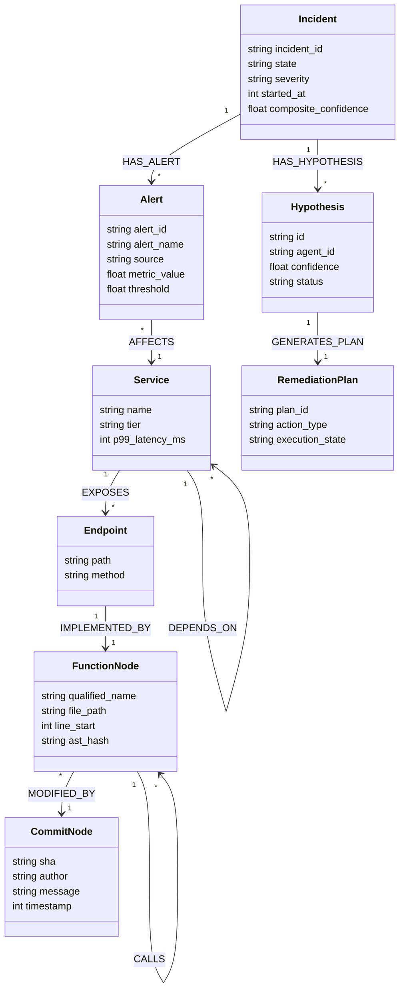

# System Architecture & Technical Specifications
## GraphSRE: Autonomous Site Reliability Engineering & Code Brain

```
   ┌─────────────────────────────────────────────────────────────────────────────────┐
   │                       GRAPHSRE SYSTEM ARCHITECTURE                              │
   │               Autonomous Site Reliability Engineering & Code Intelligence        │
   └─────────────────────────────────────────────────────────────────────────────────┘

     ┌──────────────┐      ┌──────────────┐      ┌──────────────┐      ┌──────────────┐
     │ Triage Agent │      │  RCA Agent   │      │ Memory Agent │      │ Remediation  │
     │   (Alerts)   │      │  (Causality) │      │ (Knowledge)  │      │   (Action)   │
     └──────┬───────┘      └──────┬───────┘      └──────┬───────┘      └──────┬───────┘
            │                     │                     │                     │
            │   Model Context Protocol (FastMCP) Tools  │                     │
            └──────────────┬──────┴──────────────┬──────┴─────────────────────┘
                           │                     │
                           ▼                     ▼
     ┌────────────────────────────────────────────────────────────────────────────────┐
     │                       FALKORDB CENTRAL BLACKBOARD                              │
     │                                                                                │
     │   ACID Graph State Store  •  Vector Index  •  AST & Topology Knowledge Base   │
     │                                                                                │
     │   (:Incident) ──[:HAS_ALERT]──> (:Alert) ──[:AFFECTS]──> (:Service)           │
     │        │                                                     │                 │
     │   [:HAS_HYPOTHESIS]                                     [:CALLS]               │
     │        ▼                                                     ▼                 │
     │   (:Hypothesis) ──[:SUPPORTED_BY]──> (:Evidence) ──> (:Function)              │
     │        │                                                     ▲                 │
     │   [:LEADS_TO]                                           [:MODIFIES]            │
     │        ▼                                                     │                 │
     │   (:RemediationPlan) ──[:TESTED_IN]──> (:SandboxGraph) ── (:Commit)            │
     └────────────────────────────────────────────────────────────────────────────────┘
```

---

## 1. Executive Architecture: Central Blackboard Paradigm

### 1.1 The Failure of Conversational Multi-Agent Rings
Traditional multi-agent frameworks (e.g., AutoGen, CrewAI, LangGraph conversational rings) rely on peer-to-peer natural language message passing:
```
Conversational Ring Failure:
Agent A ──(Text Message)──> Agent B ──(Text Message)──> Agent C ──(Text Message)──> Agent D
   │                           │                           │                           │
   ▼                           ▼                           ▼                           ▼
Context Bloat ($O(N^2)$)   Hallucination Cascade       No Audit Trail           State Drift
```

In mission-critical SRE, this conversational approach fails deterministically:
1. **$O(N^2)$ Quadratic Token Explosion:** 500 alerts/minute quickly exceed LLM context windows, truncating stack traces and causing catastrophic forgetting.
2. **Hallucination Cascades:** Downstream agents ingest ungrounded claims as facts, cascading errors across the swarm:
   $$\mathbb{P}(\text{Cascade Failure}) = 1 - \prod_{i=1}^{k} (1 - \epsilon_i) \xrightarrow[k \to \infty]{} 1$$
3. **Absence of Deterministic Auditability:** Free-form text lacks atomic timestamps, schema validation, and formal lineage.
4. **State Drift & Distributed Split-Brain:** Without transactional isolation, concurrent agents issue conflicting infrastructure mutations.
5. **Linear Latency Overhead:** 4 prompt hops consume 20–40 seconds before any mitigating action can be applied.

---

### 1.2 FalkorDB as the Immutable, Central Graph Blackboard
GraphSRE eliminates peer-to-peer conversational loops. Agents interact **exclusively** through atomic OpenCypher transactions against a shared, persistent, low-latency graph database: **FalkorDB**.

```
Blackboard Architecture (FalkorDB Sub-Millisecond ACID Graph):

         [ Agent 1: Triage ]               [ Agent 2: RCA ]
                  │                                │
        Cypher TX │                      Cypher TX │
                  ▼                                ▼
       ┌──────────────────────────────────────────────────────┐
       │             FALKORDB CENTRAL BLACKBOARD              │
       │                                                      │
       │  • Sub-millisecond Cypher query execution (GraphBLAS)│
       │  • ACID transactional isolation                      │
       │  • Unified Code AST, Dependency Topology & Telemetry │
       │  • Embedded HNSW Vector Index for Episodic Memory    │
       │  • Native Graph Copying (`GRAPH.COPY`) for Sandboxing│
       └──────────────────────────────────────────────────────┘
                  ▲                                ▲
        Cypher TX │                      Cypher TX │
                  │                                │
         [ Agent 3: Memory ]             [ Agent 4: Remediation ]
```

* **GraphBLAS Sparse Matrix Algebra:** Graph reachability and causal traversals execute via sparse matrix multiplication ($A \cdot B$), completing 6-hop traversals over 500,000 nodes in **$< 1\text{ ms}$**.
* **ACID Transactions & Optimistic Locking:** Writes to incidents, hypotheses, and remediation plans are isolated. Conflicting mutations are detected and prevented.
* **Integrated Hybrid Retrieval:** Dense 384-dimensional vector indexes are embedded directly on graph nodes (`CALL db.idx.vector.queryNodes(...)`), combining semantic similarity with topological reachability in a single Cypher round-trip.
* **Sub-15ms Ephemeral Sandboxing (`GRAPH.COPY`):** The Remediation Agent clones production state in $< 10\text{ ms}$, verifies counterfactual safety, and destroys the sandbox upon verification.

---

## 2. Unified Graph Ontology

GraphSRE models infrastructure, telemetry, code AST, Git history, and agent reasoning within a unified graph schema:



---

## 3. Mathematical Safety & Anti-Hallucination Invariants

### 3.1 Hard Anti-Hallucination Graph Bound
We define the **Composite Confidence Score ($C_{\text{SRE}}$)** as:
$$C_{\text{SRE}} = 0.25 S_{\text{episodic}} + 0.35 T_{\text{graph}} + 0.25 E_{\text{metric}} + 0.15 H_{\text{success}}$$

Where:
* $S_{\text{episodic}} \in [0, 1]$: Cosine similarity against past postmortems in FalkorDB's HNSW vector index.
* $T_{\text{graph}} \in \{0, 1\}$: Binary topological reachability. $T_{\text{graph}} = 1$ if and only if a directed walk exists from the suspect commit to the alerted component; otherwise $0$.
* $E_{\text{metric}} \in [0, 1]$: Telemetry correlation coefficient between the metric spike and the commit timestamp.
* $H_{\text{success}} \in [0, 1]$: Historical success rate of the matching runbook.

> **Mathematical Security Proof:**  
> The threshold for autonomous execution is strictly set to $C_{\text{SRE}} \ge 0.75$.  
> When an LLM hallucinates an ungrounded theory ($T_{\text{graph}} = 0$), even with perfect vector similarity ($S=1.0$), perfect metrics ($E=1.0$), and perfect runbook history ($H=1.0$):
> $$C_{\text{SRE}} = 0.25(1.0) + 0.35(0.0) + 0.25(1.0) + 0.15(1.0) = 0.65 < 0.75$$
> **An ungrounded hypothesis can never execute autonomously.**

---

### 3.2 Quorum Consensus Voting with Memory Agent Veto
Swarm decisions are governed by a Weighted Consensus Score (WCS):
$$\text{WCS} = \sum_{a \in \text{Agents}} w_a \cdot V_a \ge 0.75$$

With calibrated agent weights:
* $w_{\text{Triage}} = 0.20$
* $w_{\text{RCA}} = 0.35$
* $w_{\text{Memory}} = 0.35$
* $w_{\text{Remediation}} = 0.10$

If the Memory Agent votes `REJECT` ($V_{\text{Memory}} = 0$), the maximum possible score is:
$$\text{WCS}_{\max} = 1.0 - 0.35 = 0.65 < 0.75$$
The Memory Agent holds **absolute mathematical veto authority**.

---

### 3.3 Continuous Learning: Self-Curating $O(1)$ Shortcut Net
1. **Shortcut Edge Synthesis:** Upon incident verification, GraphSRE generates direct `[:CAUSED_BY_SHORTCUT]` edges, resolving recurrent alerts in **$1.4\text{ seconds}$** via $O(1)$ memory lookup.
2. **Exponential Bayesian Temporal Decay:** All shortcut edges decay continuously:
   $$w(t) = w_0 \cdot \exp\left(-\lambda \Delta t\right)$$
   where $\lambda = \frac{\ln 2}{30 \times 86400} \approx 2.6738 \times 10^{-7}\text{ s}^{-1}$ (30-day half-life). When $w < 0.10$, edges are automatically pruned.
3. **Code Modification Invalidation Penalty:** When a Git commit modifies a linked AST function, edge weight is penalized immediately by $-70\%$:
   $$w' = 0.30 \times w$$
