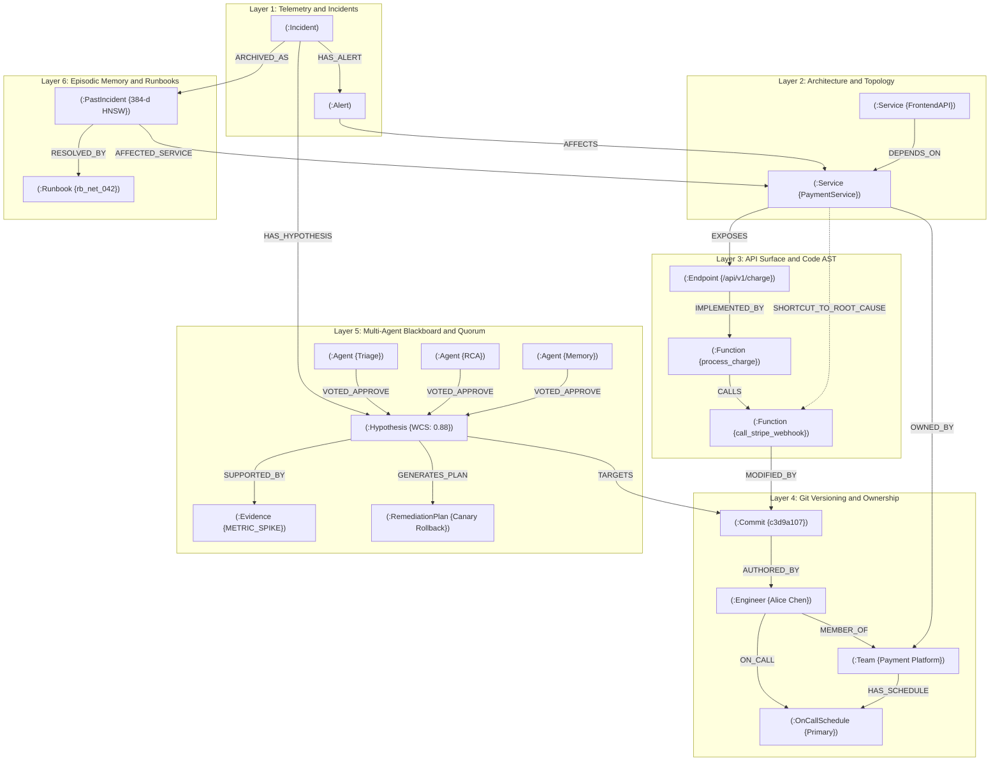

# GraphSRE: FalkorDB Graph Schema & Ontological Specification

> **Official Graph Architecture Specification for FalkorDB + WeMakeDevs GraphHacks Hackathon (2026)**  
> **Primary Graph Key:** `graphsre_production`  
> **Engine:** FalkorDB (GraphBLAS Sparse Matrix Linear Algebra, Native OpenCypher & HNSW Vector Indices)

---

## 1. Executive Ontological Overview

GraphSRE represents the entire engineering ecosystem as a unified, queryable connected knowledge graph in **FalkorDB**. It bridges runtime telemetry, distributed microservice architectures, polyglot code Abstract Syntax Trees (AST), git version control, and multi-agent coordination state.

```
┌──────────────────────────────────────────────────────────────────────────────────────────────────┐
│                                6-LAYER UNIFIED GRAPH TOPOLOGY                                    │
├─────────────────────────┬────────────────────────────────────────────────────────────────────────┤
│ Layer                   │ Node Labels & Semantics                                                │
├─────────────────────────┼────────────────────────────────────────────────────────────────────────┤
│ 1. Telemetry & Alerts   │ (:Incident), (:Alert), (:AlertCluster)                                 │
│ 2. Service Architecture │ (:Service), (:Database), (:Queue), (:Cache)                            │
│ 3. API & Code AST       │ (:Endpoint), (:Function), (:Class), (:Module)                          │
│ 4. Git & Ownership      │ (:Commit), (:Engineer), (:Team), (:OnCallSchedule)                     │
│ 5. Agent Blackboard     │ (:Hypothesis), (:Evidence), (:Agent), (:RemediationPlan), (:Vote)       │
│ 6. Episodic Memory      │ (:PastIncident), (:Runbook) [Indexed via vecf32 384-d HNSW Vector]     │
└─────────────────────────┴────────────────────────────────────────────────────────────────────────┘
```

---

## 2. Graph Schema Diagram



---

## 3. Node Schema Catalog

| Node Label | Core Properties | Property Types | Semantic Role & Functional Purpose |
| :--- | :--- | :--- | :--- |
| `(:Incident)` | `id`<br/>`state`<br/>`severity`<br/>`started_at`<br/>`blast_radius_count`<br/>`mttr_seconds` | `STRING`<br/>`STRING`<br/>`STRING`<br/>`INTEGER`<br/>`INTEGER`<br/>`FLOAT` | Root incident coordination entity. Lifecycle: `DETECTED` $\to$ `TRIAGED` $\to$ `HYPOTHESIS_FORMED` $\to$ `QUORUM_VERIFIED` $\to$ `REMEDIATING` $\to$ `RESOLVED`. |
| `(:Alert)` | `id`<br/>`fingerprint`<br/>`name`<br/>`source`<br/>`metric_value`<br/>`threshold`<br/>`timestamp` | `STRING`<br/>`STRING`<br/>`STRING`<br/>`STRING`<br/>`FLOAT`<br/>`FLOAT`<br/>`INTEGER` | Raw telemetry event ingested from Prometheus or OpenTelemetry collector. Clustered via Label Propagation (CDLP). |
| `(:Service)` | `id`<br/>`name`<br/>`tier`<br/>`health_status`<br/>`p99_latency_ms`<br/>`error_rate`<br/>`pagerank` | `STRING`<br/>`STRING`<br/>`STRING`<br/>`STRING`<br/>`INTEGER`<br/>`FLOAT`<br/>`FLOAT` | Microservice runtime component with GraphBLAS structural centrality metrics. |
| `(:Endpoint)` | `id`<br/>`path`<br/>`method`<br/>`protocol`<br/>`sla_p99_ms` | `STRING`<br/>`STRING`<br/>`STRING`<br/>`STRING`<br/>`INTEGER` | Public HTTP/gRPC ingress contract exposed by services. |
| `(:Function)` | `id`<br/>`qualified_name`<br/>`file_path`<br/>`line_start`<br/>`line_end`<br/>`ast_hash` | `STRING`<br/>`STRING`<br/>`STRING`<br/>`INTEGER`<br/>`INTEGER`<br/>`STRING` | Code Abstract Syntax Tree (AST) node representing discrete executable units parsed via Python AST / Tree-sitter. |
| `(:Commit)` | `sha`<br/>`author`<br/>`timestamp`<br/>`message`<br/>`diff_summary` | `STRING`<br/>`STRING`<br/>`INTEGER`<br/>`STRING`<br/>`STRING` | Git version control commit linked to AST modifications via `[:MODIFIED_BY]`. |
| `(:Engineer)` | `id`<br/>`name`<br/>`email`<br/>`github_handle`<br/>`slack_handle` | `STRING`<br/>`STRING`<br/>`STRING`<br/>`STRING`<br/>`STRING` | Human engineer linked to git commits and on-call rotations for incident routing. |
| `(:Team)` | `id`<br/>`name`<br/>`slack_channel` | `STRING`<br/>`STRING`<br/>`STRING` | Engineering team with operational ownership of microservices. |
| `(:OnCallSchedule)` | `id`<br/>`shift`<br/>`escalation_policy`<br/>`layer` | `STRING`<br/>`STRING`<br/>`STRING`<br/>`INTEGER` | PagerDuty on-call rotation schedule linked to engineers and owning teams. |
| `(:Hypothesis)` | `id`<br/>`agent_id`<br/>`statement`<br/>`composite_confidence`<br/>`status`<br/>`created_at` | `STRING`<br/>`STRING`<br/>`STRING`<br/>`FLOAT`<br/>`STRING`<br/>`INTEGER` | Formulated root-cause theory requiring multi-agent quorum verification. |
| `(:Evidence)` | `id`<br/>`type`<br/>`source`<br/>`payload`<br/>`confidence_score`<br/>`timestamp` | `STRING`<br/>`STRING`<br/>`STRING`<br/>`STRING`<br/>`FLOAT`<br/>`INTEGER` | Corroborating telemetry spike, stack trace, or Git diff supporting or refuting a hypothesis. |
| `(:Agent)` | `id`<br/>`name`<br/>`role` | `STRING`<br/>`STRING`<br/>`STRING` | Specialized swarm agent (`Triage_Agent`, `RCA_Agent`, `Memory_Agent`, `Remediation_Agent`). |
| `(:RemediationPlan)` | `id`<br/>`action_type`<br/>`command_payload`<br/>`rollback_payload`<br/>`execution_state` | `STRING`<br/>`STRING`<br/>`STRING`<br/>`STRING`<br/>`STRING` | Executable mitigation recipe tested inside ephemeral sandbox before live execution. |
| `(:PastIncident)` | `id`<br/>`root_cause_summary`<br/>`resolution`<br/>`mttr_seconds`<br/>`embedding` | `STRING`<br/>`STRING`<br/>`STRING`<br/>`FLOAT`<br/>`vecf32[384]` | Historical postmortem indexed with native FalkorDB HNSW vector index (`vecf32`). |
| `(:Runbook)` | `id`<br/>`title`<br/>`success_rate`<br/>`embedding` | `STRING`<br/>`STRING`<br/>`FLOAT`<br/>`vecf32[384]` | Standard Operating Procedure (SOP) with proven historical remediation success rate. |

---

## 4. Relationship Schema Catalog

| Relationship | Source $\to$ Target | Properties | Semantics & Graph Function |
| :--- | :--- | :--- | :--- |
| `[:HAS_ALERT]` | `(:Incident) -> (:Alert)` | — | Binds active telemetry alarms to the root incident blackboard. |
| `[:AFFECTS]` | `(:Alert) -> (:Service)` | — | Maps runtime telemetry anomaly to the impacted infrastructure component. |
| `[:DEPENDS_ON]` | `(:Service) -> (:Service)` | `protocol`, `timeout_ms` | Directed inter-service dependency graph used for upstream blast-radius traversal. |
| `[:EXPOSES]` | `(:Service) -> (:Endpoint)` | — | Connects microservice to its public API routes. |
| `[:IMPLEMENTED_BY]` | `(:Endpoint) -> (:Function)` | — | Bridges network architecture into the code Abstract Syntax Tree (AST). |
| `[:CALLS]` | `(:Function) -> (:Function)` | `is_async` | Static AST call hierarchy graph traversed by RCA and CI/CD blast gate. |
| `[:MODIFIED_BY]` | `(:Function) -> (:Commit)` | — | Pinpoints the exact Git commit altering an AST function body. |
| `[:AUTHORED_BY]` | `(:Commit) -> (:Engineer)` | — | Links code changes to the author for instant Slack/PagerDuty routing. |
| `[:MEMBER_OF]` | `(:Engineer) -> (:Team)` | — | Maps engineers to functional squads. |
| `[:OWNED_BY]` | `(:Service) -> (:Team)` | — | Defines service ownership and team-level escalation policies. |
| `[:ON_CALL]` | `(:Engineer) -> (:OnCallSchedule)` | `status`, `tier` | Active on-call rotation tracking. |
| `[:HAS_HYPOTHESIS]` | `(:Incident) -> (:Hypothesis)` | — | Hypotheses posted by RCA agents to the shared blackboard. |
| `[:TARGETS]` | `(:Hypothesis) -> (:Commit \| :Function)` | — | Connects proposed causal theory to the suspect commit or function. |
| `[:SUPPORTED_BY]` | `(:Hypothesis) -> (:Evidence)` | `weight` | Binds corroborating telemetry, diffs, and logs to a hypothesis. |
| `[:VOTED_ON]` | `(:Agent) -> (:Hypothesis)` | `decision`, `weight`, `reasoning` | Persistent quorum vote record stored directly in the graph blackboard. |
| `[:GENERATES_PLAN]` | `(:Hypothesis) -> (:RemediationPlan)` | — | Links validated hypothesis to executable remediation recipe. |
| `[:ARCHIVED_AS]` | `(:Incident) -> (:PastIncident)` | — | Preserves resolved incident postmortem in episodic vector memory. |
| `[:AFFECTED_SERVICE]` | `(:PastIncident) -> (:Service)` | — | Associates past postmortems with infrastructure services for hybrid retrieval. |
| `[:RESOLVED_BY_PLAYBOOK]`| `(:PastIncident) -> (:Runbook)` | — | Links historical incident to the validated runbook that resolved it. |
| `[:SHORTCUT_TO_ROOT_CAUSE]` | `(:Service) -> (:Function)` | `weight`, `occurrences`, `last_seen`, `stale` | Self-curating $O(1)$ learned edge bypassing multi-hop RCA on repeat incidents. |

---

## 5. FalkorDB Index Definitions & DDL

GraphSRE configures native FalkorDB property indices and HNSW vector indices on graph startup:

```cypher
// 1. Exact Match Indices
CREATE INDEX FOR (s:Service) ON (s.name);
CREATE INDEX FOR (fn:Function) ON (fn.qualified_name);
CREATE INDEX FOR (c:Commit) ON (c.sha);
CREATE INDEX FOR (i:Incident) ON (i.id);
CREATE INDEX FOR (a:Alert) ON (a.id);

// 2. Embedded HNSW 384-dimensional Vector Index for Episodic Memory
CALL db.idx.vector.createNodeIndex(
    'PastIncident',
    'embedding',
    dim=384,
    similarity='cosine'
);

// 3. Embedded HNSW Vector Index for Runbook Retrieval
CALL db.idx.vector.createNodeIndex(
    'Runbook',
    'embedding',
    dim=384,
    similarity='cosine'
);
```

---

## 6. Representative Cypher Traversal Queries

### 5-Layer Cross-Layer Causal Walk
```cypher
MATCH (s:Service {name: $service_name})-[:EXPOSES]->(e:Endpoint)-[:IMPLEMENTED_BY]->(root_fn:Function)
MATCH call_path = (root_fn)-[:CALLS*0..4]->(target_fn:Function)
MATCH (target_fn)-[:MODIFIED_BY]->(c:Commit)
WHERE length(call_path) <= 4
  AND c.timestamp >= (timestamp() - (24 * 3600000))
OPTIONAL MATCH (c)-[:AUTHORED_BY]->(eng:Engineer)
OPTIONAL MATCH (s)-[:OWNED_BY]->(tm:Team)
RETURN target_fn.qualified_name AS culprit_function,
       target_fn.file_path AS file_path,
       c.sha AS culprit_commit,
       c.author AS author,
       eng.slack_handle AS author_slack,
       tm.name AS owning_team,
       length(call_path) AS call_depth
ORDER BY c.timestamp DESC, call_depth ASC
LIMIT 1;
```

### Hybrid Vector + Topological Memory Query
```cypher
CALL db.idx.vector.queryNodes('PastIncident', 'embedding', 3, vecf32($embedding))
YIELD node AS past_incident, score AS similarity
MATCH (past_incident)-[:AFFECTED_SERVICE]->(s:Service {name: $service_name})
OPTIONAL MATCH (past_incident)-[:RESOLVED_BY_PLAYBOOK]->(rb:Runbook)
RETURN past_incident.id AS prior_id,
       past_incident.root_cause_summary AS summary,
       past_incident.resolution AS resolution,
       rb.title AS playbook,
       similarity
ORDER BY similarity DESC;
```
