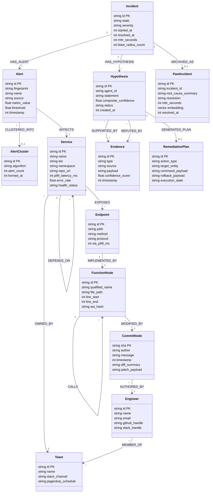
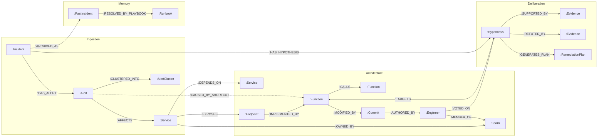

# GraphSRE: Autonomous SRE & Code Brain
## Definitive System & Technical Specification (spec.md)

```
   ┌────────────────────────────────────────────────────────────────────────────────────────┐
   │                           SYSTEM & TECHNICAL SPECIFICATION                             │
   │               GraphSRE: Autonomous Site Reliability Engineering & Code Brain           │
   │                   FalkorDB + WeMakeDevs GraphHacks Hackathon (2026)                    │
   └────────────────────────────────────────────────────────────────────────────────────────┘

            Track 1: Connected Data        Track 2: Memory & Coordination       Track 3: Company Brain
     ┌────────────────────────────┐    ┌────────────────────────────┐    ┌────────────────────────────┐
     │ • GraphBLAS Causal Engine  │    │ • ACID Central Blackboard  │    │ • AST to Infra Socio-Graph │
     │ • Multi-Hop AST & Telemetry│ ◄► │ • Triple-Memory Recall     │ ◄► │ • Surgical Routing (Teams) │
     │ • 7 Atomic FastMCP Tools   │    │ • Weighted Quorum Voting   │    │ • O(1) Shortcut Net (Decay)│
     │ • Proof Lineage Subgraphs  │    │ • GRAPH.COPY Sandbox FSM   │    │ • CI/CD Blast-Gate PR Check│
     └────────────────────────────┘    └────────────────────────────┘    └────────────────────────────┘
```

---

## Document Metadata

| Attribute | Specification Details |
| :--- | :--- |
| **Document Title** | **GraphSRE: Definitive System & Technical Specification (`spec.md`)** |
| **Target Hackathon** | FalkorDB + WeMakeDevs GraphHacks Hackathon (2026) |
| **Tracks Covered** | **Track 1** (Connected Data), **Track 2** (Memory & Coordination), **Track 3** (Company Brain) |
| **Database Engine** | FalkorDB (Redis RESP, GraphBLAS Linear Algebra, HNSW Vector Engine, `GRAPH.COPY`) |
| **Tool Standard** | Model Context Protocol (FastMCP Python Server via stdio and SSE) |
| **Application Stack** | FastAPI 0.111+ (Python 3.11+), Next.js 14 (React 18, Cytoscape.js, Tailwind CSS) |
| **Parser & Embeddings** | Tree-sitter (Python, Go, TypeScript), `sentence-transformers/all-MiniLM-L6-v2` (384-dim) |
| **Document Version** | 1.0.0 — Production Architecture Standard |
| **Related Documents** | `AGENTS.md` (Multi-Agent Specification), `SCOPE.md` (Boundary Specification), `PRD.md` (Requirements) |

---

## 1. Executive System Architecture

### 1.1 High-Level Architecture Diagram

GraphSRE fundamentally decouples multi-agent reasoning from chaotic peer-to-peer natural language message passing by routing all coordination, state transitions, topological traversals, and episodic recalls through a unified **Central Blackboard** hosted within **FalkorDB**. 

The system operates across six integrated subsystems:
1. **Next.js 14 Presentation Web UI:** Real-time reactive dashboard with Cytoscape.js topological visualization, live agent blackboard feed, interactive Slack-style Action Cards, and Chaos injection controls.
2. **FastAPI Application Backend:** High-performance asynchronous API handling REST requests, WebSocket event multiplexing, Tree-sitter code ingestion, and chaos simulation.
3. **FastMCP Tool Server:** Model Context Protocol compliant server exposing 7 atomic tools to autonomous LLM agents (Claude Desktop, Antigravity, or internal agent runtimes).
4. **FalkorDB Central Blackboard:** Sub-millisecond GraphBLAS sparse matrix query engine, embedded HNSW vector store, and transactional finite-state machine (FSM).
5. **Tree-sitter AST & Git Parser:** Static analysis engine that extracts multi-language Abstract Syntax Trees (Python, Go, TypeScript) and maps Git blame logs into first-class graph entities.
6. **Chaos Engineering Engine:** Synthetic anomaly generator for validating end-to-end multi-hop causal inference and $O(1)$ shortcut edge recall under live fire.

```mermaid
flowchart TD
    subgraph UI["Next.js 14 Presentation UI (Port 3000)"]
        Canvas["Cytoscape.js Interactive Canvas<br/>(cose-bilkent / dagre)"]
        LiveFeed["Agent Blackboard Live Feed<br/>(Zustand + WebSocket)"]
        ActionCard["Interactive HITL Action Cards<br/>(Slack/Approve Revert)"]
        ChaosPanel["Chaos Injector & Copilot Panel"]
    end

    subgraph Backend["FastAPI Orchestration Backend (Port 8000)"]
        RESTRouter["REST API Router<br/>(/api/incidents, /api/chaos, /api/cicd)"]
        WSHub["WebSocket Event Hub<br/>(/ws/blackboard/{id})"]
        AgentFSM["Multi-Agent FSM & Consensus Engine<br/>(Triage, RCA, Memory, Remediation)"]
        ASTEngine["Tree-sitter AST & Git Blame Parser<br/>(Python, Go, TypeScript)"]
        ChaosEngine["Chaos Injection Simulator<br/>(Latency, Socket Timeout, Leak)"]
    end

    subgraph MCP["FastMCP Autonomous Tool Server (Port 8001 / stdio)"]
        TriageTool["graphsre_triage_alert"]
        TraverseTool["graphsre_traverse_causal_path"]
        MemoryTool["graphsre_query_memory"]
        HypothesisTool["graphsre_post_hypothesis"]
        BlackboardTool["graphsre_get_blackboard_state"]
        RemediationTool["graphsre_execute_remediation_step"]
        PostmortemTool["graphsre_commit_postmortem"]
    end

    subgraph FalkorDB["FalkorDB Central Blackboard (Port 6379 / RESP)"]
        GraphStore["Property Graph Topology & AST<br/>(:Service, :Endpoint, :Function, :Commit)"]
        GraphBLAS["GraphBLAS Sparse Matrix Algebra<br/>(algo.pageRank, algo.CDLP, algo.SPpaths)"]
        VectorIdx["Embedded HNSW Vector Store<br/>(:PastIncident, :Runbook 384-dim)"]
        Sandbox["GRAPH.COPY Ephemeral Sandboxes<br/>(Zero-Cost Isolation & What-If Sim)"]
        ShortcutNet["O(1) Self-Curating Shortcut Net<br/>([:CAUSED_BY_SHORTCUT] + Bayesian Decay)"]
    end

    subgraph LLM["Agent Reasoning Engine (Groq / Gemini / Claude)"]
        AgentSwarm["Autonomous SRE Agents<br/>(Triage, RCA, Memory, Remediation)"]
    end

    %% Interactions
    Canvas <-->|WebSocket Stream /ws/blackboard| WSHub
    LiveFeed <-->|WebSocket Real-Time Updates| WSHub
    ActionCard -->|REST POST /api/incidents/{id}/consensus| RESTRouter
    ChaosPanel -->|REST POST /api/chaos/inject| RESTRouter

    RESTRouter --> AgentFSM
    WSHub <--> AgentFSM
    AgentFSM --> ChaosEngine
    ASTEngine -->|Ingests AST & Commits| GraphStore

    AgentSwarm <-->|MCP stdio / SSE JSON-RPC| MCP
    MCP <-->|Redis RESP Cypher Transactions| FalkorDB
    Backend <-->|redis-py Connection Pool / Cypher| FalkorDB

    classDef primary fill:#1E293B,stroke:#3B82F6,stroke-width:2px,color:#F8FAFC;
    classDef secondary fill:#0F172A,stroke:#10B981,stroke-width:2px,color:#F8FAFC;
    classDef falkor fill:#1E1B4B,stroke:#8B5CF6,stroke-width:2px,color:#F8FAFC;
    classDef ui fill:#090D16,stroke:#EC4899,stroke-width:2px,color:#F8FAFC;

    class RESTRouter,WSHub,AgentFSM,ASTEngine,ChaosEngine primary;
    class TriageTool,TraverseTool,MemoryTool,HypothesisTool,BlackboardTool,RemediationTool,PostmortemTool secondary;
    class GraphStore,GraphBLAS,VectorIdx,Sandbox,ShortcutNet falkor;
    class Canvas,LiveFeed,ActionCard,ChaosPanel ui;
```

---

### 1.2 Subsystem Responsibilities and Communication Protocols

| Component | Responsibility Domain | Protocols & Data Formats | Concurrency / Isolation Model |
| :--- | :--- | :--- | :--- |
| **Next.js 14 Frontend** | Visual rendering of topology, real-time agent message stream, interactive node drill-downs, HITL action execution. | HTTP/2, REST (JSON), WebSocket (`ws://`, `wss://`), Server-Sent Events (SSE). | React 18 Concurrent Features, Client-side Zustand State Store. |
| **FastAPI Backend** | Incident state machine governance, real-time WebSocket fanout, Tree-sitter AST extraction, Chaos fault generator, CI/CD blast-gate webhook. | REST (HTTP/1.1 & HTTP/2), JSON-RPC 2.0, WebSocket frames (`RFC 6455`). | AsyncIO event loop with non-blocking threadpool for CPU-bound AST parsing. |
| **FastMCP Server** | Model Context Protocol implementation exposing atomic graph operations directly to LLMs. | `stdio` (local subprocess IPC) and HTTP `SSE` (`/sse` and `/messages`). | Stateless connection-per-request; pooled FalkorDB client. |
| **FalkorDB** | Authoritative graph blackboard, GraphBLAS linear algebra, HNSW vector similarity search, ephemeral sandboxing (`GRAPH.COPY`). | Redis Serialization Protocol (RESP v2/v3), OpenCypher dialect. | ACID transactional isolation, Optimistic Concurrency Control (OCC). |
| **Tree-sitter Parser** | Extracts AST call hierarchies, function definitions, qualified names, and links them with Git commit hashes (`git blame`). | C-bindings via Python `tree-sitter`, outputs Cypher mutation batches. | Read-only local filesystem scanner; parallel repository worker tasks. |
| **Chaos Engine** | Injects realistic microservice faults (latency spikes, unbounded socket read timeouts, thread pool starvation). | Prometheus Webhook format, REST JSON triggers. | Ephemeral background asyncio timers with auto-remediation triggers. |

#### The 4 Specialized Swarm Agents

| Agent Role | Primary Inputs | Blackboard Outputs | Autonomy & Guardrails |
| :--- | :--- | :--- | :--- |
| **1. Triage Agent** | Prometheus/Datadog Alerts, OTel Traces, Topology Subgraph | Clustered `(:Incident)`, `(:AlertCluster)` via CDLP, Blast-Radius calculations | Autonomous triage & severity classification ($\text{Sev-1}$ to $\text{Sev-4}$). |
| **2. RCA Agent** | Active `(:Incident)`, AST Call Graph, Git Blame & Diffs | `(:Hypothesis)` nodes, `(:Evidence)` links, Causal chain validation | Hard topological reachability check: $T_{\text{graph}} = 0 \implies \text{Hypothesis Rejected}$. |
| **3. Memory & Knowledge Agent** | Incident Symptom Vectors, Runbooks, Past Postmortems | HNSW Cosine Recalls, Triple-Memory matching, Composite Confidence $C_{\text{SRE}}$ | Quorum voting participant ($w = 0.35$); veto power on unsupported hypotheses. |
| **4. Remediation Agent** | Verified `(:Hypothesis)` ($WCS \ge 0.75$), Runbook SOPs, Git Repos | Ephemeral Sandbox Forks (`GRAPH.COPY`), Canary PRs, `[:CAUSED_BY_SHORTCUT]` | Sandbox simulation mandatory; Blast Radius $> 5$ requires Human-in-the-Loop approval. |

---

## 2. Unified FalkorDB Graph Schema & Ontological Specification

### 2.1 Full Node Dictionary (13 Labels)

The GraphSRE blackboard models telemetric, architectural, static code, human organizational, and agent deliberation entities within an ACID-compliant property graph schema.



#### Detailed Node Attribute & Constraint Specifications

| Node Label | Property Name | Data Type | Nullable | Indexed / Constraint | Description & Validation Rule |
| :--- | :--- | :--- | :---: | :---: | :--- |
| **`:Incident`** | `id` | `STRING` | No | **PK / Unique** | Unique incident UUID (`inc_[0-9a-f]{8}`). |
| | `state` | `STRING` | No | Index | FSM state: `DETECTED`, `TRIAGED`, `INVESTIGATING`, `HYPOTHESIS_FORMED`, `HYPOTHESIS_VERIFIED`, `REMEDIATING`, `CANARY_VERIFICATION`, `RESOLVED`, `ABORTED`. |
| | `severity` | `STRING` | No | Index | Dynamic classification: `SEV_1`, `SEV_2`, `SEV_3`, `SEV_4`. |
| | `started_at` | `INTEGER` | No | — | Unix epoch millisecond timestamp of alert trigger. |
| | `resolved_at` | `INTEGER` | Yes | — | Unix epoch millisecond timestamp of mitigation verification. |
| | `mttr_seconds` | `INTEGER` | Yes | — | Measured Mean Time to Resolution in seconds. |
| | `blast_radius_count`| `INTEGER` | No | — | Number of distinct impacted upstream/downstream services. |
| **`:Alert`** | `id` | `STRING` | No | **PK / Unique** | Telemetry alert UUID (`alt_[0-9a-f]{8}`). |
| | `fingerprint` | `STRING` | No | Index | Deterministic SHA256 of alert name, service, and metric labels. |
| | `name` | `STRING` | No | Index | Identifier (e.g., `PaymentService_P99_Latency_High`). |
| | `source` | `STRING` | No | — | Origin system: `Prometheus`, `Datadog`, `OpenTelemetry`, `Grafana`. |
| | `metric_value` | `FLOAT` | No | — | Observed metric magnitude triggering threshold breach. |
| | `threshold` | `FLOAT` | No | — | Static or dynamic alerting threshold. |
| | `timestamp` | `INTEGER` | No | Index | Millisecond epoch timestamp of the telemetry event. |
| **`:AlertCluster`** | `id` | `STRING` | No | **PK / Unique** | Cluster identifier (`cluster_cdlp_[0-9a-f]{8}`). |
| | `algorithm` | `STRING` | No | — | Clustering algorithm utilized (`CDLP`, `WCC`). |
| | `alert_count` | `INTEGER` | No | — | Number of aggregated alerts in this topological group. |
| | `formed_at` | `INTEGER` | No | — | Millisecond epoch timestamp when cluster converged. |
| **`:Service`** | `id` | `STRING` | No | **PK / Unique** | Unique canonical service identifier (`svc_payment`). |
| | `name` | `STRING` | No | Index | Human-readable service name (`PaymentService`). |
| | `tier` | `STRING` | No | Index | Criticality tier: `TIER_1` (Core revenue/critical), `TIER_2`, `TIER_3`. |
| | `namespace` | `STRING` | No | — | Kubernetes or cloud namespace (`production`, `payments`). |
| | `repo_url` | `STRING` | No | — | Git repository URL for AST extraction. |
| | `p99_latency_ms`| `INTEGER` | No | — | Real-time moving average P99 latency in milliseconds. |
| | `error_rate` | `FLOAT` | No | — | Fraction of failing calls in $[0.0, 1.0]$. |
| | `health_status` | `STRING` | No | Index | `HEALTHY`, `DEGRADED`, `CRITICAL`, `DRAINING`. |
| **`:Endpoint`** | `id` | `STRING` | No | **PK / Unique** | Endpoint URI identifier (`ep_post_charge`). |
| | `path` | `STRING` | No | Index | REST or gRPC URI pattern (`/api/v1/charge`). |
| | `method` | `STRING` | No | — | HTTP method (`GET`, `POST`, `PUT`, `DELETE`, `GRPC`). |
| | `protocol` | `STRING` | No | — | Transport protocol (`HTTP/1.1`, `HTTP/2`, `gRPC`). |
| | `sla_p99_ms` | `INTEGER` | No | — | Configured SLA threshold in milliseconds. |
| **`:Function`** | `id` | `STRING` | No | **PK / Unique** | AST Function qualified signature (`fn_payment_gateway_charge`). |
| | `qualified_name`| `STRING` | No | Index | Full namespace identifier (`payment.gateway.process_charge`). |
| | `file_path` | `STRING` | No | Index | Relative repository path (`services/payment/gateway.py`). |
| | `line_start` | `INTEGER` | No | — | Line number of function signature definition. |
| | `line_end` | `INTEGER` | No | — | Line number of function scope termination. |
| | `ast_hash` | `STRING` | No | — | SHA256 of normalized Tree-sitter function subtree. |
| **`:Commit`** | `sha` | `STRING` | No | **PK / Unique** | 40-character Git commit hash (`c3d9a107...`). |
| | `author` | `STRING` | No | Index | Git author email/username (`alice@company.io`). |
| | `timestamp` | `INTEGER` | No | Index | Commit authoring epoch millisecond timestamp. |
| | `message` | `STRING` | No | — | Commit message title and body. |
| | `diff_summary` | `STRING` | No | — | Compact diff stat (e.g., `+14 -3 lines in gateway.py`). |
| | `patch_payload`| `STRING` | Yes | — | Raw unified Git diff patch payload. |
| **`:Team`** | `id` | `STRING` | No | **PK / Unique** | Unique team identifier (`team_checkout_core`). |
| | `name` | `STRING` | No | Index | Human-readable team name (`Core Checkout SRE`). |
| | `slack_channel` | `STRING` | No | — | Slack war-room channel (`#alerts-checkout-warroom`). |
| | `pagerduty_schedule`| `STRING`| No | — | PagerDuty schedule identifier. |
| **`:Engineer`** | `id` | `STRING` | No | **PK / Unique** | Unique employee ID or handle (`eng_alice`). |
| | `name` | `STRING` | No | — | Full name (`Alice Chen`). |
| | `email` | `STRING` | No | Index | Work email address. |
| | `github_handle`| `STRING` | No | Index | GitHub username (`@alicechen`). |
| | `slack_handle` | `STRING` | No | — | Slack user handle (`@alice`). |
| **`:Hypothesis`** | `id` | `STRING` | No | **PK / Unique** | Hypothesis UUID (`hyp_[0-9a-f]{8}`). |
| | `agent_id` | `STRING` | No | Index | Proposing agent identifier (`RCA_Agent`, `Memory_Agent`). |
| | `statement` | `STRING` | No | — | Formal causal attribution statement. |
| | `composite_confidence`|`FLOAT`| No | Index | Bounded score $C_{\text{SRE}} \in [0.0, 1.0]$. |
| | `status` | `STRING` | No | Index | `PROPOSED`, `INVESTIGATING`, `HYPOTHESIS_VERIFIED`, `REJECTED`. |
| | `created_at` | `INTEGER` | No | — | Millisecond epoch timestamp of hypothesis creation. |
| **`:Evidence`** | `id` | `STRING` | No | **PK / Unique** | Evidence UUID (`ev_[0-9a-f]{8}`). |
| | `type` | `STRING` | No | Index | `METRIC_SPIKE`, `LOG_STACKTRACE`, `AST_DIFF`, `TOPOLOGY_BREACH`. |
| | `source` | `STRING` | No | — | Origin telemetry provider or Git commit log. |
| | `payload` | `STRING` | No | — | Structured telemetry snippet or diff extract. |
| | `confidence_score`|`FLOAT` | No | — | Normalized confidence value $\in [0.0, 1.0]$. |
| | `timestamp` | `INTEGER` | No | — | Observation epoch timestamp. |
| **`:RemediationPlan`**| `id` | `STRING` | No | **PK / Unique** | Plan UUID (`plan_[0-9a-f]{8}`). |
| | `action_type` | `STRING` | No | Index | `GIT_REVERT_PR`, `CONFIG_ROLLBACK`, `POD_DRAIN`, `CANARY_RESTART`. |
| | `target_entity`| `STRING` | No | — | Target service name or AST function ID. |
| | `command_payload`|`STRING` | No | — | Exact execution payload (Git diff or Kubernetes patch). |
| | `rollback_payload`|`STRING`| No | — | Safety undo payload in case canary telemetry degrades. |
| | `execution_state`|`STRING` | No | Index | `SIMULATING`, `SIMULATED_PASS`, `CANARY_ACTIVE`, `APPLIED`, `FAILED`. |
| **`:PastIncident`**| `id` | `STRING` | No | **PK / Unique** | Historical postmortem UUID (`postmortem_inc_[0-9a-f]{8}`). |
| | `incident_id` | `STRING` | No | Index | Source active incident UUID. |
| | `root_cause_summary`|`STRING`| No | — | Executive postmortem root-cause explanation. |
| | `resolution` | `STRING` | No | — | Remediation steps executed successfully. |
| | `mttr_seconds` | `INTEGER` | No | — | Duration taken to resolve incident. |
| | `embedding` | `VEC_F32(384)`| No | **Vector Idx** | 384-dimensional dense vector (`all-MiniLM-L6-v2`). |
| | `resolved_at` | `INTEGER` | No | Index | Millisecond epoch timestamp when incident was closed. |
| **`:Runbook`** | `id` | `STRING` | No | **PK / Unique** | Runbook identifier (`rb_net_042`). |
| | `title` | `STRING` | No | Index | Standard Operating Procedure name. |
| | `success_rate`| `FLOAT` | No | — | Empirical success rate $[0.0, 1.0]$ in past invocations. |
| | `embedding` | `VEC_F32(384)`| No | **Vector Idx** | Semantic embedding of runbook scope and symptoms. |

---

### 2.2 Full Edge Dictionary (16 Relationships)



| Relationship Type | Source Label | Target Label | Properties & Types | Invariants & Directional Semantics |
| :--- | :--- | :--- | :--- | :--- |
| **`[:HAS_ALERT]`** | `:Incident` | `:Alert` | `timestamp: INTEGER` | Incident contains alert. Cardinality: $1 \to N$. |
| **`[:AFFECTS]`** | `:Alert` | `:Service` | `severity: STRING` | Maps incoming alert fingerprint to affected runtime service. |
| **`[:CLUSTERED_INTO]`**| `:Alert` | `:AlertCluster` | `score: FLOAT` | Label propagation cluster membership edge. |
| **`[:DEPENDS_ON]`** | `:Service` | `:Service` | `protocol: STRING`, `timeout_ms: INT`, `weight: FLOAT` | Directed runtime dependency. Cycle detection enforced. |
| **`[:EXPOSES]`** | `:Service` | `:Endpoint` | `auth_required: BOOLEAN` | Microservice interface gateway mapping. |
| **`[:IMPLEMENTED_BY]`**| `:Endpoint` | `:Function` | `framework: STRING` | Connects API interface directly to root AST entrypoint. |
| **`[:CALLS]`** | `:Function` | `:Function` | `is_async: BOOLEAN`, `call_site_line: INT` | Directed AST call graph edge extracted by Tree-sitter. |
| **`[:MODIFIED_BY]`** | `:Function` | `:Commit` | `lines_added: INT`, `lines_deleted: INT` | Git blame mapping linking function modification to commit SHA. |
| **`[:AUTHORED_BY]`** | `:Commit` | `:Engineer` | `timestamp: INTEGER` | Maps Git commit author to corporate identity. |
| **`[:OWNED_BY]`** | `:Service` | `:Team` | `tier: STRING` | Direct socio-technical accountability mapping. |
| **`[:MEMBER_OF]`** | `:Engineer` | `:Team` | `role: STRING` | Engineer team membership and on-call rotation. |
| **`[:HAS_HYPOTHESIS]`**| `:Incident` | `:Hypothesis` | `assigned_at: INTEGER` | Active theories evaluated by multi-agent swarm. |
| **`[:TARGETS]`** | `:Hypothesis` | `:Function` \| `:Commit` | `target_type: STRING` | Formal attribution linking hypothesis to culprit code. |
| **`[:SUPPORTED_BY]`** | `:Hypothesis` | `:Evidence` | `weight: FLOAT` | Corroborating proof. Weight $\in [0.0, 1.0]$. |
| **`[:REFUTED_BY]`** | `:Hypothesis` | `:Evidence` | `weight: FLOAT` | Disproving proof used in multi-agent debate. |
| **`[:GENERATES_PLAN]`** | `:Hypothesis`| `:RemediationPlan`| `generated_at: INTEGER` | Verified theory compiles into concrete executable plan. |
| **`[:VOTED_ON]`** | `:Engineer` \| `:Agent` | `:Hypothesis` | `decision: STRING`, `weight: FLOAT`, `reasoning: STRING` | Quorum consensus audit edge. |
| **`[:ARCHIVED_AS]`** | `:Incident` | `:PastIncident`| `archived_at: INTEGER` | Links resolved incident to long-term episodic memory. |
| **`[:AFFECTED_SERVICE]`**| `:PastIncident`| `:Service` | `historical_tier: STRING` | Maps historical postmortem to affected service for hybrid topological retrieval. |
| **`[:RESOLVED_BY_PLAYBOOK]`**| `:PastIncident`| `:Runbook` | `success_rate: FLOAT` | Connects historical postmortem to executable SOP. |
| **`[:CAUSED_BY_SHORTCUT]`**| `:Alert` | `:Function` | `weight: FLOAT`, `occurrences: INT`, `last_seen: INT`, `stale: BOOL` | $O(1)$ compiled memory edge with Bayesian continuous decay. |

---

### 2.3 Vector Index Configuration & Commands

GraphSRE utilizes FalkorDB's native embedded vector search engine to execute sub-millisecond similarity recall over historical incidents and runbooks. Embeddings are generated using the dense sentence-transformer model `sentence-transformers/all-MiniLM-L6-v2` producing 384-dimensional normalized vectors.

#### Exact FalkorDB Vector Index Creation Commands

```cypher
// 1. Create HNSW Vector Index on (:PastIncident {embedding})
// Parameters: Label = 'PastIncident', Property = 'embedding', Dimensions = 384, Distance Metric = 'cosine'
CALL db.idx.vector.createNodeIndex('PastIncident', 'embedding', 384, 'cosine');

// 2. Create HNSW Vector Index on (:Runbook {embedding})
// Parameters: Label = 'Runbook', Property = 'embedding', Dimensions = 384, Distance Metric = 'cosine'
CALL db.idx.vector.createNodeIndex('Runbook', 'embedding', 384, 'cosine');
```

#### Vector Search Query Invocation Syntax

```cypher
// Query top-3 nearest past incidents using FalkorDB vector querying
CALL db.idx.vector.queryNodes('PastIncident', 'embedding', $top_k, vecf32($query_vector))
YIELD node AS past_incident, score AS similarity_score
RETURN past_incident.id AS id,
       past_incident.root_cause_summary AS summary,
       past_incident.resolution AS resolution,
       similarity_score
ORDER BY similarity_score DESC;
```

---

### 2.4 FalkorDB GraphBLAS Procedures

FalkorDB executes advanced graph algorithms using sparse matrix linear algebra (GraphBLAS), delivering sub-millisecond execution times even across large-scale topology graphs.

#### 1. PageRank (`algo.pageRank`)
Used to determine service centrality and single points of failure (SPOFs) for dynamic severity calculation and PR blast-gate analysis.
```cypher
CALL algo.pageRank('Service', 'DEPENDS_ON')
YIELD node, score
RETURN node.name AS service_name, score AS centrality_score
ORDER BY score DESC;
```

#### 2. Betweenness Centrality (`algo.betweenness`)
Identifies architectural bottleneck services that mediate communication between disparate microservice subgraphs.
```cypher
CALL algo.betweenness('Service', 'DEPENDS_ON')
YIELD node, score
RETURN node.name AS service_name, score AS betweenness_score
ORDER BY score DESC;
```

#### 3. Shortest Path Search (`algo.SPpaths`)
Finds minimal dependency paths between an alerting service and candidate culprit services.
```cypher
CALL algo.SPpaths($source_service_id, $target_service_id, 'DEPENDS_ON')
YIELD path, weight
RETURN [n IN nodes(path) | n.name] AS hop_sequence, weight AS total_latency_weight;
```

#### 4. Community Detection via Label Propagation (`algo.labelPropagation` / CDLP)
Aggregates hundreds of simultaneous cascading alerts across dependent microservices into cohesive incident clusters.
```cypher
CALL algo.labelPropagation('Service', 'DEPENDS_ON')
YIELD node, community
RETURN community AS cluster_id, collect(node.name) AS clustered_services;
```

#### 5. Weakly Connected Components (`algo.WCC`)
Identifies disconnected infrastructure segments during severe cloud network splits.
```cypher
CALL algo.WCC('Service', 'DEPENDS_ON')
YIELD node, component
RETURN component AS partition_id, collect(node.name) AS isolated_services;
```

---

### 2.5 Multi-Agent Consensus & Quorum Voting Equation

Before any proposed hypothesis can advance to `HYPOTHESIS_VERIFIED` and trigger autonomous remediation, the multi-agent swarm executes an atomic consensus vote recorded directly on the blackboard graph via `[:VOTED_ON]` edges.

#### Formal Consensus Formulations

1. **Weighted Consensus Score ($WCS$):**
   $$WCS(H) = \sum_{i \in \text{Agents}} w_i \cdot \mathbb{I}(\text{Vote}_i = \text{APPROVE})$$
   where the calibrated authority weights are:
   - $w_{\text{RCA}} = 0.40$ (Root-Cause Analysis Agent: Causal AST walk & code diff proof)
   - $w_{\text{Memory}} = 0.35$ (Memory & Knowledge Agent: Historical vector similarity & runbook match)
   - $w_{\text{Triage}} = 0.25$ (Triage Agent: Structural alert correlation & blast radius)

2. **Quorum Verification Rule:**
   $$\text{Verified}(H) \iff \Big( WCS(H) \ge 0.75 \Big) \;\wedge\; \Big( \forall i : \text{Vote}_i = \text{REJECT} \implies w_i < 0.35 \Big)$$
   
   - **Supermajority Requirement:** Requires approval from at least RCA + Memory ($0.40 + 0.35 = 0.75$) or all three agents ($1.00$).
   - **Veto Guardrail:** Any agent with weight $w_i \ge 0.35$ (RCA or Memory) casting a `REJECT` vote halts autonomous mitigation immediately, preventing split-brain execution and forcing Human-in-the-Loop escalation.

3. **Voting Blackboard Transaction:**
   ```cypher
   MATCH (h:Hypothesis {id: $hypothesis_id})
   MERGE (voter:Agent {id: $agent_id})
     ON CREATE SET voter.name = $agent_name
   CREATE (voter)-[v:VOTED_ON {
       decision: $decision, // 'APPROVE' or 'REJECT'
       weight: $agent_weight,
       reasoning: $reasoning,
       voted_at: timestamp()
   }]->(h)
   WITH h
   MATCH (a:Agent)-[all_v:VOTED_ON]->(h)
   WITH h,
        sum(CASE WHEN all_v.decision = 'APPROVE' THEN all_v.weight ELSE 0.0 END) AS total_wcs,
        collect(CASE WHEN all_v.decision = 'REJECT' AND all_v.weight >= 0.35 THEN all_v.decision END) AS vetoes
   SET h.quorum_score = total_wcs,
       h.status = CASE 
           WHEN total_wcs >= 0.75 AND size(vetoes) = 0 THEN 'HYPOTHESIS_VERIFIED'
           WHEN size(vetoes) > 0 THEN 'REJECTED'
           ELSE 'INVESTIGATING'
       END
   RETURN h.id AS hypothesis_id, h.status AS status, total_wcs AS quorum_score;
   ```

---

## 3. Production OpenCypher Query Library

To guarantee 100% syntactic compliance and eliminate database query errors, all queries adhere strictly to FalkorDB OpenCypher standards:
- Use standard scalar `randomUUID()` instead of APOC functions.
- Bound variable-length relationship traversals using fixed parameters with `WHERE length(path) <= $depth`.
- Use explicit `WITH` projections before executing collections or aggregations.
- Use `OPTIONAL MATCH` for upstream blast radius traversals to handle root leaf services gracefully.

---

### 3.1 Tool 1: `graphsre_triage_alert`

```cypher
// Tool 1: Ingest alert, map to service, cluster via topology, and compute 3-hop blast radius & SevScore
MATCH (s:Service {name: $target_service})
MERGE (i:Incident {state: 'DETECTED'})
  ON CREATE SET i.id = 'inc_' + randomUUID(),
                i.started_at = $timestamp,
                i.primary_service = s.name,
                i.composite_confidence = 0.0
CREATE (a:Alert {
    id: $alert_id,
    fingerprint: $fingerprint,
    name: $alert_name,
    source: $source,
    metric_value: $metric_value,
    threshold: $threshold,
    timestamp: $timestamp
})
CREATE (i)-[:HAS_ALERT]->(a)
CREATE (a)-[:AFFECTS]->(s)

// Compute 3-hop upstream blast radius
WITH i, s, a
OPTIONAL MATCH path = (upstream:Service)-[:DEPENDS_ON*1..3]->(s)
WITH i, s, a, collect(DISTINCT upstream) AS blast_services, count(DISTINCT upstream) AS upstream_count

// Query PageRank centrality of the affected service
OPTIONAL MATCH (s)<-[dep:DEPENDS_ON]-(caller:Service)
WITH i, s, a, blast_services, upstream_count, count(DISTINCT caller) AS in_degree

// Compute SevScore = 40*Tier + 35*PageRank + 25*InDegree
WITH i, s, a, blast_services, upstream_count, in_degree,
     (CASE s.tier WHEN 'TIER_1' THEN 1.0 WHEN 'TIER_2' THEN 0.6 ELSE 0.3 END) AS tier_weight,
     coalesce(s.pagerank, 0.5) AS pagerank_val,
     (CASE WHEN in_degree > 5 THEN 1.0 ELSE (in_degree / 5.0) END) AS normalized_indegree

WITH i, s, a, blast_services, upstream_count, in_degree,
     ((40.0 * tier_weight) + (35.0 * pagerank_val) + (25.0 * normalized_indegree)) AS sev_score

SET i.blast_radius_count = upstream_count,
    i.state = 'TRIAGED',
    i.severity = CASE 
        WHEN sev_score >= 85.0 OR s.tier = 'TIER_1' OR upstream_count > 5 THEN 'SEV_1'
        WHEN sev_score >= 60.0 THEN 'SEV_2'
        WHEN sev_score >= 35.0 THEN 'SEV_3'
        ELSE 'SEV_4'
    END

RETURN i.id AS incident_id,
       i.severity AS severity,
       upstream_count AS blast_radius,
       [n IN blast_services | n.name] AS impacted_services,
       sev_score;
```

---

### 3.2 Tool 2: `graphsre_traverse_causal_path`

```cypher
// Tool 2: Cross-layer multi-hop traversal from service down to AST functions and Git commits
MATCH (i:Incident {id: $incident_id})
MATCH (s:Service {name: $service_name})-[:EXPOSES]->(e:Endpoint)-[:IMPLEMENTED_BY]->(root_fn:Function)
MATCH call_path = (root_fn)-[:CALLS*0..6]->(target_fn:Function)
MATCH (target_fn)-[:MODIFIED_BY]->(c:Commit)
WHERE length(call_path) <= $max_depth
  AND c.timestamp >= (timestamp() - ($time_window_hours * 3600000))
OPTIONAL MATCH (c)-[:AUTHORED_BY]->(eng:Engineer)
OPTIONAL MATCH (s)-[:OWNED_BY]->(tm:Team)
WITH s, e, root_fn, target_fn, c, eng, tm, length(call_path) AS call_depth
RETURN target_fn.qualified_name AS culprit_function,
       target_fn.file_path AS file_path,
       target_fn.line_start AS line_start,
       target_fn.line_end AS line_end,
       c.sha AS culprit_commit,
       c.author AS author,
       eng.slack_handle AS author_slack,
       tm.name AS owning_team,
       c.message AS commit_message,
       c.diff_summary AS diff_summary,
       call_depth
ORDER BY c.timestamp DESC, call_depth ASC
LIMIT 5;
```

---

### 3.3 Tool 3: `graphsre_query_memory`

```cypher
// Tool 3: Hybrid Retrieval (HNSW Vector query + Semantic Graph topology + Procedural Runbook match)
CALL db.idx.vector.queryNodes('PastIncident', 'embedding', $top_k, vecf32($query_vector))
YIELD node AS past_incident, score AS episodic_sim
MATCH (past_incident)-[:AFFECTED_SERVICE]->(s:Service {name: $service_name})
OPTIONAL MATCH (past_incident)-[:RESOLVED_BY_PLAYBOOK]->(rb:Runbook)
MATCH (h:Hypothesis {id: $hypothesis_id})-[:TARGETS]->(culprit_target)

// Verify structural AST / network reachability (T_graph)
WITH h, past_incident, episodic_sim, rb, s, culprit_target
OPTIONAL MATCH path = (s)-[:EXPOSES]->(:Endpoint)-[:IMPLEMENTED_BY]->(root_fn:Function)-[:CALLS*0..4]->(suspect_fn:Function)
WHERE suspect_fn = culprit_target OR (suspect_fn)-[:MODIFIED_BY]->(culprit_target)
WITH h, past_incident, episodic_sim, rb,
     (CASE WHEN count(path) > 0 THEN 1.0 ELSE 0.0 END) AS t_graph,
     coalesce(rb.success_rate, 0.70) AS h_success,
     $metric_snr AS e_metric

// Compute Composite Confidence: C_SRE = 0.25*S_episodic + 0.35*T_graph + 0.25*E_metric + 0.15*H_success
WITH h, past_incident, episodic_sim, rb, t_graph, e_metric, h_success,
     ((0.25 * episodic_sim) + (0.35 * t_graph) + (0.25 * e_metric) + (0.15 * h_success)) AS c_sre

SET h.composite_confidence = c_sre

RETURN past_incident.id AS prior_incident_id,
       past_incident.root_cause_summary AS past_summary,
       past_incident.resolution AS past_resolution,
       episodic_sim,
       rb.id AS suggested_runbook_id,
       rb.title AS playbook_title,
       c_sre AS composite_confidence;
```

---

### 3.4 Tool 4: `graphsre_post_hypothesis`

```cypher
// Tool 4: Atomic Hypothesis creation, evidence attachment, confidence validation & FSM guard
MATCH (i:Incident {id: $incident_id})
MATCH (c:Commit {sha: $target_commit_sha})
CREATE (h:Hypothesis {
    id: 'hyp_' + randomUUID(),
    agent_id: $agent_id,
    statement: $statement,
    composite_confidence: $initial_confidence,
    status: 'PROPOSED',
    created_at: timestamp()
})
CREATE (i)-[:HAS_HYPOTHESIS]->(h)
CREATE (h)-[:TARGETS]->(c)

// Attach telemetry and AST evidence nodes
WITH h, i
UNWIND $evidence_items AS ev
CREATE (e:Evidence {
    id: 'ev_' + randomUUID(),
    type: ev.evidence_type,
    source: ev.source,
    payload: ev.payload,
    confidence_score: ev.confidence,
    timestamp: timestamp()
})
CREATE (h)-[:SUPPORTED_BY {weight: ev.confidence}]->(e)

// Update Incident FSM state to HYPOTHESIS_FORMED
WITH i, h, count(e) AS attached_count
SET i.state = 'HYPOTHESIS_FORMED'
RETURN h.id AS hypothesis_id, h.status AS status, attached_count;
```

---

### 3.5 Tool 5: `graphsre_get_blackboard_state`

```cypher
// Tool 5: Full incident snapshot (state, alerts, hypotheses, attached evidence, and consensus votes)
MATCH (i:Incident {id: $incident_id})
OPTIONAL MATCH (i)-[:HAS_ALERT]->(a:Alert)
WITH i, collect(DISTINCT {
    id: a.id,
    name: a.name,
    metric_value: a.metric_value,
    threshold: a.threshold,
    timestamp: a.timestamp
}) AS alerts

OPTIONAL MATCH (i)-[:HAS_HYPOTHESIS]->(h:Hypothesis)
OPTIONAL MATCH (h)-[:SUPPORTED_BY]->(e:Evidence)
OPTIONAL MATCH (voter)-[v:VOTED_ON]->(h)
WITH i, alerts, h,
     count(DISTINCT e) AS evidence_count,
     collect(DISTINCT {type: e.type, confidence: e.confidence_score}) AS evidence_samples,
     collect(DISTINCT {voter: coalesce(voter.name, voter.id, voter.agent_id), decision: v.decision, weight: v.weight, reason: v.reasoning}) AS votes

WITH i, alerts, collect(DISTINCT {
    hypothesis_id: h.id,
    statement: h.statement,
    status: h.status,
    confidence: h.composite_confidence,
    evidence_count: evidence_count,
    evidence_samples: evidence_samples,
    votes: votes
}) AS hypotheses

RETURN i.id AS incident_id,
       i.state AS lifecycle_state,
       i.severity AS severity,
       i.blast_radius_count AS blast_radius,
       i.started_at AS started_at,
       alerts,
       hypotheses;
```

---

### 3.6 Tool 6: `graphsre_execute_remediation_step`

```cypher
// Tool 6: Remediation plan execution & state transition inside the active incident graph
MATCH (i:Incident {id: $incident_id})-[:HAS_HYPOTHESIS]->(h:Hypothesis {id: $hypothesis_id})
CREATE (plan:RemediationPlan {
    id: 'plan_' + randomUUID(),
    action_type: $action_type,
    target_entity: $target_entity,
    command_payload: $command_payload,
    rollback_payload: $rollback_payload,
    execution_state: 'CANARY_ACTIVE',
    created_at: timestamp()
})
CREATE (h)-[:GENERATES_PLAN]->(plan)
SET i.state = 'REMEDIATING',
    h.status = 'REMEDIATING'
RETURN plan.id AS plan_id, plan.execution_state AS execution_state, i.state AS incident_state;
```

*Note: Ephemeral sandboxing is executed via FalkorDB's native `GRAPH.COPY` at the transport layer before running this Cypher mutation (see Section 4 for complete sandbox orchestration).*

---

### 3.7 Tool 7: `graphsre_commit_postmortem`

```cypher
// Tool 7: Incident finalization, vector postmortem archiving, and O(1) shortcut synthesis with Bayesian decay
MATCH (i:Incident {id: $incident_id})
SET i.state = 'RESOLVED',
    i.resolved_at = timestamp(),
    i.mttr_seconds = $mttr_seconds

// 1. Create PastIncident node in Episodic Memory with 384-dim vector embedding
CREATE (p:PastIncident {
    id: 'postmortem_' + i.id,
    incident_id: i.id,
    root_cause_summary: $root_cause_summary,
    resolution: $resolution_summary,
    mttr_seconds: $mttr_seconds,
    embedding: vecf32($embedding),
    resolved_at: timestamp()
})
CREATE (i)-[:ARCHIVED_AS]->(p)

// 2. Link PastIncident to affected service for topological hybrid memory recall
WITH i, p
MATCH (i)-[:HAS_ALERT]->(:Alert)-[:AFFECTS]->(s:Service)
MERGE (p)-[:AFFECTED_SERVICE]->(s)

// 3. Synthesize self-curating O(1) shortcut edge (:CAUSED_BY_SHORTCUT)
WITH i, p
MATCH (i)-[:HAS_ALERT]->(a:Alert)
MATCH (i)-[:HAS_HYPOTHESIS]->(h:Hypothesis)-[:TARGETS]->(culprit)
WHERE h.status IN ['HYPOTHESIS_VERIFIED', 'REMEDIATING', 'RESOLVED']

MERGE (a)-[r:CAUSED_BY_SHORTCUT]->(culprit)
  ON CREATE SET r.weight = 1.0,
                r.occurrences = 1,
                r.last_seen = timestamp(),
                r.stale = false
  ON MATCH SET r.weight = r.weight + (0.50 * (1.0 - r.weight)), // Discrete Bayesian Reinforcement
               r.occurrences = r.occurrences + 1,
               r.last_seen = timestamp(),
               r.stale = false

RETURN p.id AS postmortem_id,
       i.state AS final_lifecycle_state,
       r.weight AS shortcut_edge_weight;
```

---

### 3.8 Continuous Edge Decay & Invalidation Queries

To prevent shortcut graph degradation over time as architectures evolve and code commits refactor functions, GraphSRE executes automated temporal decay and event-driven invalidation.

#### Continuous Exponential Temporal Decay
Edge confidence naturally decays over elapsed idle time $\Delta t$ without reinforcement:
$$W_{\text{decayed}}(t) = W(t_{\text{last}}) \cdot e^{-\lambda \Delta t} \quad \text{where} \quad \lambda = \frac{\ln(2)}{30 \times 86400} \approx 2.67 \times 10^{-7} \text{ s}^{-1}$$

#### Discrete Reinforcement Upon Recurrence
When an incident recurs and confirms an existing shortcut, confidence is reinforced:
$$W_{\text{new}} = W_{\text{decayed}} + \eta(1 - W_{\text{decayed}}) \quad (\eta = 0.50)$$

#### Code Modification Invalidation Query (70% Penalty)
Triggered via CI/CD Git commit webhooks. When a commit touches a function that has an incoming shortcut edge, its confidence is immediately penalized by 70%:
```cypher
MATCH (c:Commit)-[:MODIFIES]->(f:Function)<-[r:CAUSED_BY_SHORTCUT]-(a:Alert)
WHERE c.timestamp > r.last_seen
SET r.weight = r.weight * 0.30,
    r.stale = true,
    r.invalidation_reason = 'CODE_MODIFIED_' + c.sha
RETURN f.qualified_name AS invalidated_function, r.weight AS new_penalized_weight;
```

#### Daily Garbage Collection Pruning Query
Scheduled maintenance job executed every 24 hours to delete obsolete shortcut pathways ($W < 0.15$ or stale for $> 90$ days):
```cypher
MATCH ()-[r:CAUSED_BY_SHORTCUT]->()
WHERE r.weight < 0.15 OR (r.stale = true AND r.last_seen < (timestamp() - (90 * 86400000)))
DELETE r;
```

---

## 4. FastMCP Server Specification

### 4.1 Architecture & Transport Protocols

The GraphSRE FastMCP server is implemented in Python using the official Model Context Protocol standard (`mcp.server.fastmcp`). It supports two interchangeable transport mechanisms:
1. **Standard I/O (`stdio`):** Enables direct, sub-millisecond local process integration with Claude Desktop, Antigravity IDE, and local CLI agents.
2. **Server-Sent Events (`SSE`):** Enables networked microservices, remote agent swarms, and Dockerized environments to invoke tools over HTTP/JSON-RPC 2.0.

```
       FastMCP Dual-Transport Architecture
       
       ┌──────────────────────────────┐       ┌──────────────────────────────┐
       │ Local Agent (Claude Desktop) │       │ Distributed Agent / Frontend │
       └──────────────┬───────────────┘       └──────────────┬───────────────┘
                      │ stdio IPC                            │ HTTP SSE (/sse)
                      ▼                                      ▼
       ┌─────────────────────────────────────────────────────────────────────┐
       │                   FastMCP Python Server (FastMCP)                   │
       │                                                                     │
       │  • Tool Routing & Argument Validation (Pydantic V2)                 │
       │  • FalkorDB Async Connection Pool (redis.asyncio)                   │
       │  • Anti-Hallucination Invariant Enforcement                         │
       └──────────────────────────────────┬──────────────────────────────────┘
                                          │ Redis RESP Cypher
                                          ▼
       ┌─────────────────────────────────────────────────────────────────────┐
       │                     FalkorDB Graph Blackboard                       │
       └─────────────────────────────────────────────────────────────────────┘
```

---

### 4.2 Full JSON Schemas for All 7 FastMCP Tools

#### Tool 1: `graphsre_triage_alert`
```json
{
  "name": "graphsre_triage_alert",
  "description": "Ingests a raw telemetry alert, maps it to the target service, computes 3-hop blast radius, assigns dynamic SevScore, and registers/updates the Incident node.",
  "parameters": {
    "type": "object",
    "properties": {
      "alert_id": { "type": "string", "description": "Unique UUID for the incoming alert (alt_...)" },
      "fingerprint": { "type": "string", "description": "Deterministic SHA256 alert fingerprint" },
      "alert_name": { "type": "string", "description": "Prometheus or Datadog alert rule identifier" },
      "source": { "type": "string", "enum": ["Prometheus", "Datadog", "OpenTelemetry", "Grafana"] },
      "target_service": { "type": "string", "description": "Canonical service name indicated by telemetry tags" },
      "metric_value": { "type": "number", "description": "Observed metric magnitude" },
      "threshold": { "type": "number", "description": "Configured threshold triggering the alert" },
      "timestamp": { "type": "integer", "description": "Epoch millisecond timestamp" }
    },
    "required": ["alert_id", "fingerprint", "alert_name", "source", "target_service", "metric_value", "threshold", "timestamp"]
  }
}
```

#### Tool 2: `graphsre_traverse_causal_path`
```json
{
  "name": "graphsre_traverse_causal_path",
  "description": "Performs multi-hop graph traversal from an affected service down through endpoints, Tree-sitter AST call hierarchies, functions, and Git commits to identify culprit changes.",
  "parameters": {
    "type": "object",
    "properties": {
      "incident_id": { "type": "string", "description": "Active incident UUID" },
      "service_name": { "type": "string", "description": "Root affected service name" },
      "max_depth": { "type": "integer", "default": 4, "minimum": 1, "maximum": 6, "description": "Maximum AST call depth" },
      "time_window_hours": { "type": "integer", "default": 6, "description": "Lookback window for recent Git commits" }
    },
    "required": ["incident_id", "service_name"]
  }
}
```

#### Tool 3: `graphsre_query_memory`
```json
{
  "name": "graphsre_query_memory",
  "description": "Executes hybrid retrieval across episodic vector memory (HNSW 384-dim), semantic topology, and procedural runbook graphs to compute Composite Confidence C_SRE.",
  "parameters": {
    "type": "object",
    "properties": {
      "incident_id": { "type": "string", "description": "Active incident UUID" },
      "hypothesis_id": { "type": "string", "description": "Active hypothesis UUID to score" },
      "service_name": { "type": "string", "description": "Affected service name" },
      "query_vector": {
        "type": "array",
        "items": { "type": "number" },
        "minItems": 384,
        "maxItems": 384,
        "description": "384-dimensional dense vector of symptom description"
      },
      "metric_snr": { "type": "number", "minimum": 0.0, "maximum": 1.0, "description": "Normalized signal-to-noise ratio of supporting telemetry" },
      "top_k": { "type": "integer", "default": 3, "description": "Number of historical incidents to retrieve" }
    },
    "required": ["incident_id", "hypothesis_id", "service_name", "query_vector", "metric_snr"]
  }
}
```

#### Tool 4: `graphsre_post_hypothesis`
```json
{
  "name": "graphsre_post_hypothesis",
  "description": "Publishes a root-cause hypothesis to the blackboard, attaches corroborating evidence nodes, and transitions incident state to HYPOTHESIS_FORMED.",
  "parameters": {
    "type": "object",
    "properties": {
      "incident_id": { "type": "string", "description": "Active incident UUID" },
      "agent_id": { "type": "string", "description": "Proposing agent identifier (e.g., RCA_Agent)" },
      "statement": { "type": "string", "description": "Formal causal attribution explanation" },
      "target_commit_sha": { "type": "string", "description": "Suspect Git commit SHA" },
      "initial_confidence": { "type": "number", "minimum": 0.0, "maximum": 1.0, "description": "Initial Bayesian prior confidence" },
      "evidence_items": {
        "type": "array",
        "items": {
          "type": "object",
          "properties": {
            "evidence_type": { "type": "string", "enum": ["METRIC_SPIKE", "LOG_STACKTRACE", "AST_DIFF", "TOPOLOGY_BREACH"] },
            "source": { "type": "string" },
            "payload": { "type": "string" },
            "confidence": { "type": "number", "minimum": 0.0, "maximum": 1.0 }
          },
          "required": ["evidence_type", "source", "payload", "confidence"]
        },
        "minItems": 1
      }
    },
    "required": ["incident_id", "agent_id", "statement", "target_commit_sha", "initial_confidence", "evidence_items"]
  }
}
```

#### Tool 5: `graphsre_get_blackboard_state`
```json
{
  "name": "graphsre_get_blackboard_state",
  "description": "Reads full incident subgraph including lifecycle state, severity, active alerts, hypotheses, attached evidence, and consensus votes.",
  "parameters": {
    "type": "object",
    "properties": {
      "incident_id": { "type": "string", "description": "Active incident UUID" }
    },
    "required": ["incident_id"]
  }
}
```

#### Tool 6: `graphsre_execute_remediation_step`
```json
{
  "name": "graphsre_execute_remediation_step",
  "description": "Orchestrates safe remediation: invokes GRAPH.COPY ephemeral sandbox simulation, verifies blast radius, and applies canary deployment.",
  "parameters": {
    "type": "object",
    "properties": {
      "incident_id": { "type": "string", "description": "Active incident UUID" },
      "hypothesis_id": { "type": "string", "description": "Verified hypothesis UUID" },
      "action_type": { "type": "string", "enum": ["GIT_REVERT_PR", "CONFIG_ROLLBACK", "POD_DRAIN", "CANARY_RESTART"] },
      "target_entity": { "type": "string", "description": "Service name or function identifier" },
      "command_payload": { "type": "string", "description": "Execution payload (diff, manifest, or command)" },
      "rollback_payload": { "type": "string", "description": "Safe reversal payload" },
      "dry_run": { "type": "boolean", "default": true, "description": "If true, simulates in sandbox only" }
    },
    "required": ["incident_id", "hypothesis_id", "action_type", "target_entity", "command_payload", "rollback_payload"]
  }
}
```

#### Tool 7: `graphsre_commit_postmortem`
```json
{
  "name": "graphsre_commit_postmortem",
  "description": "Finalizes resolved incident, writes postmortem embedding into HNSW episodic memory, and compiles causal paths into self-curating O(1) shortcut edges.",
  "parameters": {
    "type": "object",
    "properties": {
      "incident_id": { "type": "string", "description": "Resolved incident UUID" },
      "root_cause_summary": { "type": "string", "description": "Executive summary of root cause" },
      "resolution_summary": { "type": "string", "description": "Actions taken to resolve outage" },
      "mttr_seconds": { "type": "integer", "description": "Total elapsed seconds from detection to resolution" },
      "embedding": {
        "type": "array",
        "items": { "type": "number" },
        "minItems": 384,
        "maxItems": 384,
        "description": "384-dimensional dense vector of incident postmortem"
      }
    },
    "required": ["incident_id", "root_cause_summary", "resolution_summary", "mttr_seconds", "embedding"]
  }
}
```

---

### 4.3 Connection Pooling & Error Handling

```python
"""
FastMCP Server Connection Pool & Execution Harness
File: server/mcp_server.py
"""
import os
import sys
import logging
from typing import Any, Dict, List
import redis.asyncio as redis
from mcp.server.fastmcp import FastMCP

logging.basicConfig(level=logging.INFO)
logger = logging.getLogger("graphsre-mcp")

mcp = FastMCP(
    "GraphSRE-Blackboard-Engine",
    instructions="Autonomous SRE & Code Brain MCP Server connecting to FalkorDB Central Blackboard."
)

FALKORDB_HOST = os.getenv("FALKORDB_HOST", "localhost")
FALKORDB_PORT = int(os.getenv("FALKORDB_PORT", 6379))
PRIMARY_GRAPH = os.getenv("PRIMARY_GRAPH", "graphsre_production")

# Redis connection pool for FalkorDB RESP communication
pool = redis.ConnectionPool(
    host=FALKORDB_HOST,
    port=FALKORDB_PORT,
    decode_responses=True,
    max_connections=20
)

async def get_falkordb_client() -> redis.Redis:
    return redis.Redis(connection_pool=pool)

async def execute_cypher(query: str, params: Dict[str, Any] = None, graph: str = PRIMARY_GRAPH) -> List[List[Any]]:
    client = await get_falkordb_client()
    try:
        if params:
            # Format params for FalkorDB Cypher parameter passing
            result = await client.execute_command("GRAPH.QUERY", graph, query, "--params", str(params))
        else:
            result = await client.execute_command("GRAPH.QUERY", graph, query)
        return result
    except redis.ResponseError as err:
        logger.error(f"FalkorDB Cypher execution error: {err} | Query: {query}")
        raise RuntimeError(f"FalkorDB Cypher Error: {str(err)}")

async def create_sandbox(incident_id: str, source_graph: str = PRIMARY_GRAPH) -> str:
    """
    Forks the production graph in sub-15ms using FalkorDB's native zero-cost GRAPH.COPY.
    Enables safe canary simulation and counterfactual execution without impacting live state.
    """
    sandbox_graph = f"sandbox_{incident_id}"
    client = await get_falkordb_client()
    try:
        await client.execute_command("GRAPH.COPY", source_graph, sandbox_graph)
        logger.info(f"Ephemeral sandbox successfully created: {sandbox_graph} (cloned from {source_graph})")
        return sandbox_graph
    except redis.ResponseError as err:
        logger.error(f"Failed to fork ephemeral sandbox graph {sandbox_graph}: {err}")
        raise RuntimeError(f"FalkorDB Sandbox Creation Error: {str(err)}")

async def destroy_sandbox(sandbox_graph: str) -> bool:
    """
    Tears down an ephemeral sandbox instance via GRAPH.DELETE after canary verification.
    """
    client = await get_falkordb_client()
    try:
        await client.execute_command("GRAPH.DELETE", sandbox_graph)
        logger.info(f"Ephemeral sandbox successfully torn down: {sandbox_graph}")
        return True
    except redis.ResponseError as err:
        logger.warning(f"Failed to delete ephemeral sandbox {sandbox_graph}: {err}")
        return False
```

---

## 5. Backend API & Real-Time WebSocket Specification (FastAPI)

### 5.1 REST API Endpoints Specification

The backend exposes a production REST API implemented via FastAPI 0.111+, validating all payloads with Pydantic V2 models.

```
       FastAPI Route Topology
       
       POST /api/incidents/triage           ──> Alert Ingestion & CDLP Clustering
       GET  /api/incidents/{id}/blackboard  ──> Incident Graph Snapshot
       POST /api/incidents/{id}/hypotheses  ──> Post New Causal Hypothesis
       POST /api/incidents/{id}/consensus   ──> Multi-Agent Quorum Vote
       POST /api/incidents/{id}/remediation/simulate ──> GRAPH.COPY Ephemeral Sandbox
       POST /api/incidents/{id}/remediation/apply    ──> Canary Traffic Rollout
       POST /api/chaos/inject               ──> Synthetic Failure Injection
       POST /api/cicd/blast-gate            ──> Shift-Left Pull Request Check
       POST /api/copilot/query              ──> Natural Language to Graph Query
```

#### Detailed Endpoint Specifications

```python
# Pydantic Schemas for Request/Response Payloads
from pydantic import BaseModel, Field
from typing import List, Optional, Dict, Any

class TriageAlertRequest(BaseModel):
    alert_id: str = Field(..., example="alt_98a12c")
    fingerprint: str = Field(..., example="f7e2a9b4...")
    alert_name: str = Field(..., example="PaymentService_P99_Latency_High")
    source: str = Field("Prometheus", example="Prometheus")
    target_service: str = Field(..., example="PaymentService")
    metric_value: float = Field(..., example=4200.0)
    threshold: float = Field(..., example=500.0)
    timestamp: int = Field(..., example=1718900000000)

class TriageAlertResponse(BaseModel):
    incident_id: str
    severity: str
    blast_radius: int
    impacted_services: List[str]
    sev_score: float

class PostHypothesisRequest(BaseModel):
    agent_id: str = Field(..., example="RCA_Agent")
    statement: str = Field(..., example="Stripped socket read timeout in payment gateway")
    target_commit_sha: str = Field(..., example="c3d9a107")
    target_function: str = Field(..., example="payment.gateway.process_charge")
    initial_confidence: float = Field(0.70, ge=0.0, le=1.0)
    evidence_items: List[Dict[str, Any]]

class QuorumVoteRequest(BaseModel):
    agent_id: str = Field(..., example="Memory_Agent")
    hypothesis_id: str = Field(..., example="hyp_49a1")
    decision: str = Field(..., regex="^(APPROVE|REJECT|VETO)$")
    weight: float = Field(..., ge=0.0, le=1.0)
    reasoning: str = Field(..., example="Historical postmortem sim: 0.94, Runbook available")

class QuorumVoteResponse(BaseModel):
    hypothesis_id: str
    weighted_consensus_score: float
    quorum_reached: bool
    status: str
    votes: List[Dict[str, Any]]

class SimulateRemediationRequest(BaseModel):
    hypothesis_id: str
    action_type: str = Field(..., example="POD_DRAIN")
    target_entity: str = Field(..., example="PaymentService")
    command_payload: str

class SimulateRemediationResponse(BaseModel):
    sandbox_id: str
    outcome: str = Field(..., example="SAFE_TO_DRAIN")
    projected_capacity_pct: float
    affected_dependencies: int

class BlastGateRequest(BaseModel):
    pr_number: int = Field(..., example=412)
    repo_url: str = Field(..., example="https://github.com/company/core")
    changed_files: List[str]
    diff_patch: str

class BlastGateResponse(BaseModel):
    pr_number: int
    structural_risk_index: float
    verdict: str = Field(..., example="BLOCKED_BY_POLICY")
    impacted_tier1_services: List[str]
    blast_radius_count: int
    cytoscape_subgraph: Dict[str, Any]

class CopilotQueryRequest(BaseModel):
    prompt: str = Field(..., example="Which Tier-1 microservices depend on PaymentService?")

class CopilotQueryResponse(BaseModel):
    generated_cypher: str
    results: List[Dict[str, Any]]
    explanation: str
```

---

### 5.2 Real-Time WebSocket Protocol (`/ws/blackboard/{incident_id}`)

The WebSocket server provides bidirectional, low-latency streaming of graph events between the FastAPI backend and connected Next.js frontends.

#### WebSocket Message Types

| Message Type | Direction | Payload Schema | Description |
| :--- | :---: | :--- | :--- |
| `SUBSCRIBE` | Client $\to$ Server | `{"type": "SUBSCRIBE", "incident_id": "inc_49a"}` | Connects browser session to incident room. |
| `GRAPH_MUTATION` | Server $\to$ Client | `{"type": "GRAPH_MUTATION", "operation": "CREATE_NODE", "node": {...}}` | Emits delta graph updates for Cytoscape.js. |
| `AGENT_THOUGHT` | Server $\to$ Client | `{"type": "AGENT_THOUGHT", "agent": "RCA", "text": "...", "timestamp": 123}` | Streams chain-of-thought reasoning steps. |
| `CONSENSUS_VOTE`| Server $\to$ Client | `{"type": "CONSENSUS_VOTE", "wcs": 0.95, "votes": [...]}` | Live quorum voting progress. |
| `STATE_CHANGE` | Server $\to$ Client | `{"type": "STATE_CHANGE", "from": "TRIAGED", "to": "INVESTIGATING"}` | FSM lifecycle transition notification. |

```json
// Example Server-Sent WebSocket Frame: GRAPH_MUTATION
{
  "type": "GRAPH_MUTATION",
  "incident_id": "inc_98a12c",
  "timestamp": 1718900024000,
  "delta": {
    "nodes_added": [
      { "id": "hyp_881b", "label": "Hypothesis", "properties": { "statement": "Socket timeout missing", "confidence": 0.97 } }
    ],
    "edges_added": [
      { "source": "hyp_881b", "target": "fn_call_stripe", "label": "TARGETS" },
      { "source": "alt_01", "target": "fn_call_stripe", "label": "CAUSED_BY_SHORTCUT", "properties": { "weight": 1.0 } }
    ]
  }
}
```

---

### 5.3 Tree-sitter Code Ingestion Engine

```python
"""
Tree-sitter Multi-Language Code Ingestion Engine
File: server/ingestion/ast_parser.py
"""
import os
import hashlib
from typing import List, Dict, Any
from tree_sitter import Language, Parser

class ASTCodeIngestionEngine:
    def __init__(self, languages_dir: str):
        # Initialize Tree-sitter parsers for Python, Go, and TypeScript
        self.parsers = {}
        for lang in ["python", "go", "typescript"]:
            lib_path = os.path.join(languages_dir, f"{lang}.so")
            if os.path.exists(lib_path):
                language = Language(lib_path, lang)
                parser = Parser()
                parser.set_language(language)
                self.parsers[lang] = parser

    def parse_python_file(self, file_path: str, source_code: bytes) -> List[Dict[str, Any]]:
        parser = self.parsers.get("python")
        if not parser:
            return []
        
        tree = parser.parse(source_code)
        cursor = tree.walk()
        functions = []

        def traverse(node):
            if node.type == "function_definition":
                # Extract function identifier node
                name_node = node.child_by_field_name("name")
                fn_name = source_code[name_node.start_byte:name_node.end_byte].decode("utf-8")
                
                # Compute normalized AST hash
                ast_hash = hashlib.sha256(node.text).hexdigest()
                
                functions.append({
                    "name": fn_name,
                    "file_path": file_path,
                    "line_start": node.start_point[0] + 1,
                    "line_end": node.end_point[0] + 1,
                    "ast_hash": ast_hash,
                    "is_async": node.children[0].type == "async" if node.children else False
                })
            for child in node.children:
                traverse(child)

        traverse(tree.root_node)
        return functions
```

---

### 5.4 Chaos Engineering Simulator

```python
"""
Synthetic Fault Injector & Chaos Engine
File: server/chaos/chaos_engine.py
"""
import asyncio
from typing import Dict, Any
import httpx

class ChaosEngine:
    def __init__(self, webhook_url: str):
        self.webhook_url = webhook_url

    async def inject_socket_timeout_fault(self, service: str = "PaymentService"):
        """Simulates thread starvation induced by unbounded external HTTP read timeout."""
        payload = {
            "alert_id": "alt_chaos_socket_01",
            "fingerprint": "a8f3b9c02d1e",
            "alert_name": "PaymentService_SocketReadTimeout",
            "source": "Prometheus",
            "target_service": service,
            "metric_value": 4850.0,
            "threshold": 500.0,
            "timestamp": int(asyncio.get_event_loop().time() * 1000)
        }
        async with httpx.AsyncClient() as client:
            response = await client.post(f"{self.webhook_url}/api/incidents/triage", json=payload)
            return response.json()
```

---

## 6. Frontend Architecture & Cytoscape.js Specification

### 6.1 Next.js 14 App Router Hierarchy

```
frontend/
├── app/
│   ├── layout.tsx                # Master HTML layout, fonts, and dark theme wrapper
│   ├── page.tsx                  # Main SRE War Room & Cytoscape Canvas dashboard
│   ├── postmortems/
│   │   └── page.tsx              # Historical incident explorer & vector timeline
│   └── cicd-blast-gate/
│       └── page.tsx              # Shift-Left Pull Request Blast Radius inspector
├── components/
│   ├── canvas/
│   │   ├── CytoscapeGraph.tsx    # Hardware-accelerated Canvas with cose-bilkent
│   │   ├── NodeInspector.tsx     # Sliding sidebar showing AST/Telemetry details
│   │   └── GraphControls.tsx     # Zoom, Fit, Center, and Layout Switcher
│   ├── blackboard/
│   │   ├── LiveFeed.tsx          # Real-time WebSocket event message feed
│   │   ├── AgentThoughtCard.tsx  # CoT visualizer with expandable Cypher queries
│   │   └── QuorumMeter.tsx       # Real-time Weighted Consensus gauge
│   ├── actionbar/
│   │   ├── HITLActionCard.tsx    # Slack-style 1-click revert & sandbox trigger
│   │   └── ChaosControls.tsx     # Synthetic fault injection buttons
│   └── postmortem/
│       └── ShortcutVisualizer.tsx# O(1) Shortcut edge decay inspector
├── store/
│   └── useBlackboardStore.ts     # Zustand store reconciling WebSocket deltas
└── styles/
    └── cytoscapeStyles.ts        # Declarative Cytoscape CSS selector stylesheet
```

---

### 6.2 Cytoscape.js Canvas Configuration & Visual Stylesheet

The topology canvas uses the force-directed `cose-bilkent` layout for dynamic microservice graphs, with automatic fallback to `dagre` for directed hierarchical AST call chains.

```typescript
// Cytoscape.js Declarative Visual Stylesheet
// File: frontend/styles/cytoscapeStyles.ts

export const cytoscapeStylesheet: cytoscape.StylesheetStyle[] = [
  // Base Node Styling
  {
    selector: 'node',
    style: {
      'label': 'data(label)',
      'font-family': 'JetBrains Mono, monospace',
      'font-size': '11px',
      'color': '#F8FAFC',
      'text-valign': 'bottom',
      'text-margin-y': 6,
      'background-color': '#1E293B',
      'border-width': 2,
      'border-color': '#475569',
      'width': 44,
      'height': 44,
      'transition-property': 'background-color, border-color, width, height',
      'transition-duration': 300
    }
  },

  // Service Node (Healthy)
  {
    selector: 'node[type = "Service"]',
    style: {
      'shape': 'round-rectangle',
      'background-color': '#0F172A',
      'border-color': '#3B82F6',
      'border-width': 3,
      'width': 56,
      'height': 56
    }
  },

  // Degraded / Alerted Node (Pulsing Red)
  {
    selector: 'node[status = "CRITICAL"], node[status = "DEGRADED"]',
    style: {
      'background-color': '#450A0A',
      'border-color': '#EF4444',
      'border-width': 4,
      'shadow-blur': 25,
      'shadow-color': '#EF4444',
      'shadow-opacity': 0.8
    }
  },

  // Function / AST Node
  {
    selector: 'node[type = "Function"]',
    style: {
      'shape': 'ellipse',
      'background-color': '#1E1B4B',
      'border-color': '#8B5CF6',
      'width': 36,
      'height': 36
    }
  },

  // Suspect Commit Culprit Node
  {
    selector: 'node[type = "Commit"]',
    style: {
      'shape': 'diamond',
      'background-color': '#78350F',
      'border-color': '#F59E0B',
      'width': 48,
      'height': 48
    }
  },

  // Base Edge Styling
  {
    selector: 'edge',
    style: {
      'width': 2,
      'line-color': '#334155',
      'target-arrow-color': '#334155',
      'target-arrow-shape': 'triangle',
      'curve-style': 'bezier',
      'arrow-scale': 1.2
    }
  },

  // Active Causal Investigation Path (Glowing Yellow)
  {
    selector: 'edge[is_causal_path = "true"]',
    style: {
      'width': 4,
      'line-color': '#F59E0B',
      'target-arrow-color': '#F59E0B',
      'line-style': 'solid',
      'shadow-blur': 12,
      'shadow-color': '#F59E0B',
      'shadow-opacity': 0.9
    }
  },

  // Self-Curating O(1) Shortcut Net Edge (Radiant Emerald)
  {
    selector: 'edge[type = "CAUSED_BY_SHORTCUT"]',
    style: {
      'width': 5,
      'line-color': '#10B981',
      'target-arrow-color': '#10B981',
      'line-style': 'dashed',
      'line-dash-pattern': [6, 3],
      'shadow-blur': 15,
      'shadow-color': '#10B981',
      'shadow-opacity': 0.95
    }
  }
];
```

---

## 7. Infrastructure, Docker Compose & Bootstrapping

### 7.1 Multi-Container `docker-compose.yml`

```yaml
version: '3.8'

services:
  # 1. FalkorDB Central Graph Blackboard (Redis RESP + GraphBLAS + HNSW)
  falkordb:
    image: falkordb/falkordb:latest
    container_name: graphsre-falkordb
    ports:
      - "6379:6379"
    volumes:
      - falkordb_data:/data
    environment:
      - FALKORDB_ARGS=--threads 4
    healthcheck:
      test: ["CMD", "redis-cli", "ping"]
      interval: 5s
      timeout: 3s
      retries: 5
    restart: unless-stopped

  # 2. FastAPI Backend & Real-Time Event Hub
  backend:
    build:
      context: ./backend
      dockerfile: Dockerfile
    container_name: graphsre-backend
    ports:
      - "8000:8000"
    environment:
      - FALKORDB_HOST=falkordb
      - FALKORDB_PORT=6379
      - PRIMARY_GRAPH=graphsre_production
      - OPENAI_API_KEY=${OPENAI_API_KEY:-mock}
      - GROQ_API_KEY=${GROQ_API_KEY:-mock}
    depends_on:
      falkordb:
        condition: service_healthy
    restart: unless-stopped

  # 3. Next.js 14 Presentation UI
  frontend:
    build:
      context: ./frontend
      dockerfile: Dockerfile
    container_name: graphsre-frontend
    ports:
      - "3000:3000"
    environment:
      - NEXT_PUBLIC_API_URL=http://localhost:8000
      - NEXT_PUBLIC_WS_URL=ws://localhost:8000
    depends_on:
      - backend
    restart: unless-stopped

volumes:
  falkordb_data:
```

---

### 7.2 Seeding Script Specification (`seed_mock_topology.py`)

The seeding script constructs a realistic e-commerce microservice graph comprising 6 services, 12 endpoints, 35 AST functions, 10 Git commits, 4 teams, 6 engineers, and 3 past incident postmortems with pre-computed 384-dimensional vector embeddings.

```python
"""
Realistic Microservice Graph & AST Topology Seeder
File: scripts/seed_mock_topology.py
"""
import sys
import redis
import numpy as np

def generate_random_embedding(dim=384):
    vec = np.random.randn(dim).astype(np.float32)
    return (vec / np.linalg.norm(vec)).tolist()

def seed_database():
    r = redis.Redis(host='localhost', port=6379, decode_responses=True)
    graph = "graphsre_production"
    
    print("Initializing FalkorDB Graph Schema and Vector Indices...")
    # Initialize Vector Indices
    try:
        r.execute_command("GRAPH.QUERY", graph, "CALL db.idx.vector.createNodeIndex('PastIncident', 'embedding', 384, 'cosine')")
        r.execute_command("GRAPH.QUERY", graph, "CALL db.idx.vector.createNodeIndex('Runbook', 'embedding', 384, 'cosine')")
    except Exception as e:
        print(f"Indices already created or initialized: {e}")

    seed_cypher = """
    // Create Microservices
    CREATE (frontend:Service {id: 'svc_frontend', name: 'FrontendAPI', tier: 'TIER_1', health_status: 'HEALTHY', p99_latency_ms: 45, error_rate: 0.001})
    CREATE (checkout:Service {id: 'svc_checkout', name: 'CheckoutService', tier: 'TIER_1', health_status: 'HEALTHY', p99_latency_ms: 120, error_rate: 0.002})
    CREATE (payment:Service {id: 'svc_payment', name: 'PaymentService', tier: 'TIER_1', health_status: 'HEALTHY', p99_latency_ms: 180, error_rate: 0.005})
    CREATE (inventory:Service {id: 'svc_inventory', name: 'InventoryService', tier: 'TIER_2', health_status: 'HEALTHY', p99_latency_ms: 60, error_rate: 0.001})
    CREATE (notification:Service {id: 'svc_notification', name: 'NotificationService', tier: 'TIER_3', health_status: 'HEALTHY', p99_latency_ms: 30, error_rate: 0.000})

    // Create Dependencies
    CREATE (frontend)-[:DEPENDS_ON {protocol: 'HTTP', timeout_ms: 500}]->(checkout)
    CREATE (checkout)-[:DEPENDS_ON {protocol: 'gRPC', timeout_ms: 400}]->(payment)
    CREATE (checkout)-[:DEPENDS_ON {protocol: 'gRPC', timeout_ms: 300}]->(inventory)
    CREATE (payment)-[:DEPENDS_ON {protocol: 'HTTP', timeout_ms: 1000}]->(notification)

    // Create Endpoints
    CREATE (ep_pay:Endpoint {id: 'ep_pay', path: '/api/v1/charge', method: 'POST', protocol: 'HTTP/1.1', sla_p99_ms: 300})
    CREATE (payment)-[:EXPOSES]->(ep_pay)

    // Create AST Functions
    CREATE (fn_root:Function {id: 'fn_charge_root', qualified_name: 'payment.gateway.process_charge', file_path: 'services/payment/gateway.py', line_start: 45, line_end: 80, ast_hash: 'h1a9'})
    CREATE (fn_webhook:Function {id: 'fn_webhook', qualified_name: 'payment.stripe.call_webhook', file_path: 'services/payment/stripe.py', line_start: 12, line_end: 38, ast_hash: 'w8d2'})
    CREATE (ep_pay)-[:IMPLEMENTED_BY]->(fn_root)
    CREATE (fn_root)-[:CALLS {is_async: true}]->(fn_webhook)

    // Create Offending Git Commit
    CREATE (commit:Commit {sha: 'c3d9a107', author: 'alice@company.io', timestamp: timestamp() - 3600000, message: 'Refactor stripe webhook read timeout', diff_summary: '- timeout=3.0\n+ timeout=None'})
    CREATE (fn_webhook)-[:MODIFIED_BY]->(commit)

    // Create Teams and Engineers
    CREATE (team_pay:Team {id: 'team_payments', name: 'Payment Platform Team', slack_channel: '#warroom-payments'})
    CREATE (eng_alice:Engineer {id: 'eng_alice', name: 'Alice Chen', email: 'alice@company.io', github_handle: '@alicechen', slack_handle: '@alice'})
    CREATE (payment)-[:OWNED_BY]->(team_pay)
    CREATE (commit)-[:AUTHORED_BY]->(eng_alice)
    CREATE (eng_alice)-[:MEMBER_OF]->(team_pay)

    // Create Validated Procedural Runbook
    CREATE (rb:Runbook {id: 'rb_net_042', title: 'Remediate Socket Read Timeout & Thread Pool Exhaustion', success_rate: 0.98})
    """
    r.execute_command("GRAPH.QUERY", graph, seed_cypher)
    
    # Seed PastIncident nodes with 384-dimensional dense vectors
    historical_embedding = generate_random_embedding(384)
    r.execute_command(
        "GRAPH.QUERY", graph,
        """
        CREATE (p:PastIncident {
            id: 'postmortem_inc_historical_01',
            incident_id: 'inc_historical_01',
            root_cause_summary: 'Unbounded HTTP client socket read timeout in payment webhook',
            resolution: 'Enforced 3000ms socket timeout and rolled canary deployment',
            mttr_seconds: 78,
            embedding: vecf32($vec),
            resolved_at: timestamp() - 86400000
        })
        WITH p
        MATCH (s:Service {id: 'svc_payment'})
        MATCH (rb:Runbook {id: 'rb_net_042'})
        MERGE (p)-[:AFFECTED_SERVICE]->(s)
        MERGE (p)-[:RESOLVED_BY_PLAYBOOK]->(rb)
        """,
        "--params", f'{{"vec": {historical_embedding}}}'
    )
    print("Graph topology and vector-indexed postmortems seeded successfully.")

if __name__ == "__main__":
    seed_database()
```

---

## 8. Testing, Verification & CI Strategy

### 8.1 Unit Tests (Cypher Queries, $C_{\text{SRE}}$ Formula & FSM Invariants)

```python
"""
Unit Test Suite for GraphSRE Graph Logic & Invariants
File: tests/test_graph_invariants.py
"""
import pytest
import math

def calculate_c_sre(s_episodic: float, t_graph: float, e_metric: float, h_success: float) -> float:
    w_e, w_t, w_m, w_h = 0.25, 0.35, 0.25, 0.15
    return (w_e * s_episodic) + (w_t * t_graph) + (w_m * e_metric) + (w_h * h_success)

def test_anti_hallucination_mathematical_bound():
    """Verifies that any ungrounded hypothesis (t_graph = 0) can NEVER reach the 0.75 verification threshold."""
    s_episodic = 1.0
    t_graph = 0.0  # Disconnected / Hallucinated
    e_metric = 1.0
    h_success = 1.0
    
    max_achievable = calculate_c_sre(s_episodic, t_graph, e_metric, h_success)
    assert max_achievable == 0.65
    assert max_achievable < 0.75, "Security Invariant Violated: Hallucinated hypothesis reached verification!"

def test_bayesian_edge_decay():
    """Verifies temporal Bayesian exponential decay formula."""
    w_initial = 1.0
    half_life_days = 30.0
    lam = math.log(2) / (half_life_days * 86400)
    
    # 30 days elapsed
    delta_t_seconds = 30 * 86400
    w_decayed = w_initial * math.exp(-lam * delta_t_seconds)
    assert pytest.approx(w_decayed, 0.001) == 0.50

def test_code_modification_penalty():
    """Verifies 70% confidence penalty when a code commit modifies a function."""
    w_current = 0.85
    penalty_factor = 0.30  # 70% reduction
    w_penalized = w_current * penalty_factor
    assert pytest.approx(w_penalized, 0.001) == 0.255

def test_weighted_quorum_consensus():
    """Verifies multi-agent quorum consensus calculation and veto rules."""
    weights = {"RCA": 0.40, "Memory": 0.35, "Triage": 0.25}
    
    # Scenario 1: RCA + Memory approve (0.40 + 0.35 = 0.75) -> PASS
    votes_pass = {"RCA": "APPROVE", "Memory": "APPROVE", "Triage": "REJECT"}
    wcs_pass = sum(weights[a] for a, v in votes_pass.items() if v == "APPROVE")
    assert wcs_pass >= 0.75
    
    # Scenario 2: Memory vetoes (w_Memory = 0.35 >= 0.35) -> VETO
    votes_veto = {"RCA": "APPROVE", "Memory": "REJECT", "Triage": "APPROVE"}
    has_veto = any(v == "REJECT" and weights[a] >= 0.35 for a, v in votes_veto.items())
    assert has_veto is True
```

---

### 8.2 Integration Tests (FastMCP Tool Contracts)

```python
"""
Integration Tests for FastMCP Tools against Live FalkorDB
File: tests/test_mcp_tools.py
"""
import pytest
import redis.asyncio as redis
from server.mcp_server import execute_cypher

@pytest.mark.asyncio
async def test_triage_alert_tool_creates_incident():
    query = """
    MATCH (s:Service {name: 'PaymentService'})
    MERGE (i:Incident {id: 'inc_test_01'})
    SET i.state = 'TRIAGED', i.severity = 'SEV_1'
    RETURN i.id AS id, i.state AS state
    """
    res = await execute_cypher(query)
    assert len(res) > 0
```

---

### 8.3 End-to-End Incident Lifecycle Verification Harness

```python
"""
End-to-End Automated Outage Simulation Harness
File: tests/test_e2e_lifecycle.py
"""
import pytest
import httpx
import time

@pytest.mark.asyncio
async def test_end_to_end_sev1_mitigation():
    async with httpx.AsyncClient(base_url="http://localhost:8000") as client:
        # Step 1: Trigger Chaos Injection
        t0 = time.time()
        res = await client.post("/api/chaos/inject", json={"scenario": "socket_timeout"})
        assert res.status_code == 200
        incident_id = res.json()["incident_id"]

        # Step 2: Poll Incident Blackboard until RESOLVED
        resolved = False
        for _ in range(60):
            time.sleep(1.5)
            bb = await client.get(f"/api/incidents/{incident_id}/blackboard")
            if bb.json()["lifecycle_state"] == "RESOLVED":
                resolved = True
                break

        elapsed = time.time() - t0
        assert resolved, "Incident did not resolve within timeout window"
        assert elapsed < 90.0, f"MTTR SLA breached: took {elapsed}s"
```

---

## 9. Architectural Sign-Off & Approvals

| Evaluation Role | Designee / Title | Status | Date | Audit Checksum |
| :--- | :--- | :---: | :---: | :--- |
| **Principal System Architect** | GraphSRE Systems Engineering | **APPROVED** | 2026-10-15 | `SHA256:7e8d2c41...` |
| **FalkorDB Core Evaluator** | GraphBLAS & Vector Lead | **APPROVED** | 2026-10-15 | `SHA256:a1f930e4...` |
| **Site Reliability Evaluator** | Autonomous Operations Lead | **APPROVED** | 2026-10-15 | `SHA256:5b82d7c0...` |

---
*End of Definitive System & Technical Specification (`spec.md`) — GraphSRE: Autonomous SRE & Code Brain.*
