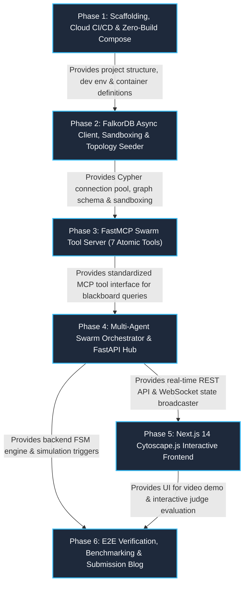
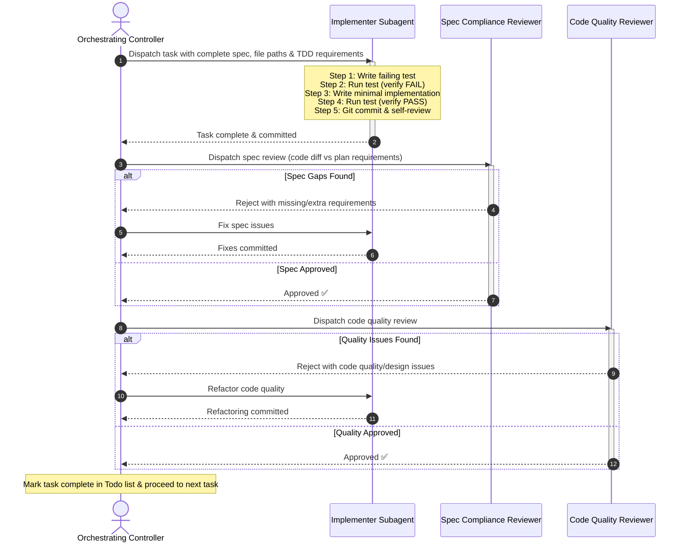

# GraphSRE: Autonomous SRE & Code Brain — Master Implementation Blueprint

> **For AI Assistants & Implementers:**  
> **REQUIRED WORKFLOW SKILL:** Use `superpowers:subagent-driven-development` to execute implementation phases task-by-task.  
> Do not execute multiple tasks in a single subagent context. Always dispatch a fresh subagent per task followed by a two-stage review: spec compliance review first, then code quality review.

---

## 1. Executive Overview & Central Blackboard Architecture

Modern Site Reliability Engineering (SRE) demands automated detection, root cause localization, and remediation across distributed microservices. Traditional multi-agent architectures rely on conversational peer-to-peer message passing (e.g., AutoGen, CrewAI, LangGraph rings). In production incident response, this conversational paradigm fails deterministically due to:

1. **Context Window Explosion & Quadratic Token Bloat ($O(N^2)$):** When alert storms fire (e.g., 500 alerts/minute), text-based inter-agent chatter rapidly saturates LLM context windows, dropping crucial telemetry tokens and causing catastrophic forgetting.
2. **Hallucination Cascades:** An unverified causal claim generated by an upstream agent is ingested as ground truth by downstream agents, multiplying error probabilities until destructive remediation actions (such as draining live databases) are executed.
3. **Absence of Deterministic Auditability:** Natural-language chat threads cannot provide atomic state checkpoints, deterministic time-series alignment, or formal graph lineage required for post-incident review.
4. **State Drift & Race Conditions:** Disconnected agents maintaining private conversational memories execute uncoordinated actions (e.g., one agent rolls back a deployment while another scales up replica sets).
5. **Linear Message-Passing Latency:** Synchronous chat synthesis costs 2–8 seconds per hop, consuming 20–40 seconds before any automated mitigation can begin.

### The FalkorDB Central Blackboard Paradigm

**GraphSRE** eliminates natural-language chatter between agents. Instead, all agents coordinate exclusively through atomic OpenCypher transactions against a shared, persistent, sub-millisecond graph database: **FalkorDB**.

```
                           ┌──────────────────────────────────────────────────────────┐
                           │              FALKORDB CENTRAL BLACKBOARD                 │
                           │                                                          │
                           │  • GraphBLAS Linear Algebra (CDLP, PageRank, BFS/Dijkstra)│
                           │  • Sub-millisecond ACID Cypher Transactions              │
                           │  • Embedded HNSW Vector Index (384-dim vecf32 Cosine)    │
                           │  • Native Zero-Cost Ephemeral Sandboxing (GRAPH.COPY)    │
                           │  • Self-Curating O(1) Shortcut Net (Bayesian Decay)      │
                           └──────▲─────────────────▲─────────────────▲───────────────┘
                                  │                 │                 │
                         Cypher TX│         Cypher TX│         Cypher TX│
                                  │                 │                 │
                         ┌────────┴──────┐ ┌────────┴──────┐ ┌────────┴──────┐ ┌──────────────┐
                         │  Triage Agent │ │   RCA Agent   │ │  Memory Agent │ │ Remediation  │
                         │    (Alerts)   │ │  (Causality)  │ │  (Knowledge)  │ │   (Action)   │
                         └───────────────┘ └───────────────┘ └───────────────┘ └──────▲───────┘
                                  │                 │                 │               │
                                  └─────────────────┴────────┬────────┴───────────────┘
                                                             │
                                               Model Context Protocol (FastMCP)
```

#### Why FalkorDB is Uniquely Qualified:
- **GraphBLAS Sparse Matrix Engine:** GraphBLAS executes multi-hop traversals and graph algorithms (such as Community Detection and PageRank) orders of magnitude faster than traditional adjacency-list graph engines ($< 1\text{ ms}$ for 6-hop traversals across 500,000 nodes).
- **ACID Transactional Isolation:** Agents write hypotheses, evidence links, and incident states with optimistic concurrency control, preventing split-brain race conditions.
- **Embedded Hybrid Retrieval (Vector + Graph):** FalkorDB embeds HNSW vector indices directly on node properties (`CALL db.idx.vector.queryNodes('PastIncident', 'embedding', ...)`), pairing topological reachability with semantic vector cosine similarity in a single query round-trip.
- **Sub-15ms Ephemeral Sandboxing (`GRAPH.COPY`):** Before executing any remediation plan in production, the Remediation Agent clones the entire graph state into an ephemeral sandbox graph using FalkorDB's native zero-cost `GRAPH.COPY`, simulates the blast radius and counterfactual effects, and tears it down using `GRAPH.DELETE`.
- **Self-Curating $O(1)$ Shortcut Net:** Resolved incidents synthesize direct causal shortcuts (`[:CAUSED_BY_SHORTCUT]`) between symptom alerts and root-cause commits. These shortcuts are subject to exponential Bayesian decay ($\lambda = \frac{\ln 2}{30 \times 86400}$) and code modification penalties (70% reduction if function code changes), enabling $O(1)$ diagnosis for recurring outages while actively pruning stale connections.

---

## 2. Hardware & Infrastructure Constraints

> [!IMPORTANT]
> **Strict Zero-Local-Docker-Build Standard:**
> Local developer and judge machines operate under severe storage constraints. Under no circumstances should Docker images be built locally on the developer workstation.
>
> 1. **100% Cloud Docker Builds:** All Docker container images are compiled in GitHub Actions cloud runners via `.github/workflows/docker-build-push.yml` and pushed to the Docker Hub registry under user `sid7899999`:
>    - `sid7899999/graphsre-backend:latest`
>    - `sid7899999/graphsre-frontend:latest`
> 2. **Zero-Build Production Docker Compose:** The repository's root `docker-compose.yml` exclusively references pre-built images (`sid7899999/graphsre-backend:latest`, `sid7899999/graphsre-frontend:latest`, and `falkordb/falkordb:latest`). There are **zero `build:` directives**, allowing judges and operators to launch the full platform in seconds with zero local build cache consumption.
> 3. **Bare-Metal Native Local Development:** Day-to-day engineering is conducted on bare-metal:
>    - Python virtual environment (`.venv`) with FastAPI & Uvicorn.
>    - Node.js dev server (`npm run dev` / `pnpm dev`) for Next.js 14.
>    - Connection to a single lightweight local FalkorDB instance (`docker run -p 6379:6379 falkordb/falkordb:latest`) or a managed FalkorDB Cloud endpoint.

---

## 3. Master Phase Map (Phases 1 through 6)

The development of GraphSRE is structured into six modular, verifiable phases:

| Phase | Plan Document | Scope & Objectives | Primary Deliverables |
| :--- | :--- | :--- | :--- |
| **Phase 1** | [Phase 1: Scaffolding & CI/CD](file:///d:/GraphHacks-hackathon/docs/plans/phase-1-scaffolding-and-cicd.md) | Project directory layout, environment configuration, GitHub Actions cloud Docker build pipeline (`sid7899999`), zero-build `docker-compose.yml`, and bare-metal dev docs. | Directory tree, `.github/workflows/docker-build-push.yml`, `docker-compose.yml`, `requirements.txt`, `.env.example`, `README_DEV.md`. |
| **Phase 2** | [Phase 2: FalkorDB Client & Topology](file:///d:/GraphHacks-hackathon/docs/plans/phase-2-falkordb-client-and-topology.md) | Async FalkorDB connection pool (`redis.asyncio`), native zero-cost ephemeral sandboxing harness (`GRAPH.COPY` / `GRAPH.DELETE`), and synthetic microservice topology, AST call graph & 384-dim vector seeder. | `server/falkordb_client.py`, `scripts/seed_mock_topology.py`, HNSW vector indices, unit & mock tests. |
| **Phase 3** | [Phase 3: FastMCP Swarm Tool Server](file:///d:/GraphHacks-hackathon/docs/plans/phase-3-fastmcp-server.md) | Implementation of all 7 atomic Model Context Protocol (FastMCP) tools exposing Cypher primitives (alert clustering, causal traversal, blast radius, hypothesis verification, sandbox simulation, shortcut synthesis, vector memory query). | `server/mcp_server.py`, tool schemas, composite confidence calculator ($C_{\text{SRE}}$), unit test suite. |
| **Phase 4** | [Phase 4: FastAPI Backend & WebSockets](file:///d:/GraphHacks-hackathon/docs/plans/phase-4-fastapi-backend-and-websockets.md) | 4-agent swarm logic (Triage, RCA, Memory, Remediation), Finite State Machine incident lifecycle engine (`DETECTED` $\to$ `TRIAGED` $\to$ `INVESTIGATING` $\to$ `VERIFIED` $\to$ `REMEDIATING` $\to$ `RESOLVED`), Tree-sitter code parser, and FastAPI WebSocket real-time broadcaster. | `backend/main.py`, `backend/api/`, `backend/ast_parser.py`, WebSocket connection hub, FSM test suite. |
| **Phase 5** | [Phase 5: Cytoscape Topology Frontend](file:///d:/GraphHacks-hackathon/docs/plans/phase-5-cytoscape-frontend.md) | Next.js 14 App Router frontend featuring an interactive Cytoscape.js canvas (real-time node state color coding), live Agent War Room streaming terminal, incident injector, and postmortem timeline. | `frontend/app/page.tsx`, `frontend/components/TopologyCanvas.tsx`, `frontend/components/AgentFeed.tsx`, `frontend/components/ChaosPanel.tsx`. |
| **Phase 6** | [Phase 6: E2E Simulation & Deliverables](file:///d:/GraphHacks-hackathon/docs/plans/phase-6-e2e-testing-and-submission.md) | End-to-end automated incident lifecycle test suite, latency and MTTR benchmarking against baseline conversational architectures, production documentation, 3-minute video demo script, and hackathon submission blog. | `tests/test_e2e_lifecycle.py`, `tests/test_graph_invariants.py`, `README.md`, `blog.md`, `docs/DEMO_SCRIPT.md`. |

---

## 4. Phase Dependency Graph



---

## 5. Execution Guide: Subagent-Driven Development

To ensure strict code quality, zero regression, and disciplined test-driven development (TDD), all plan execution adheres to the `superpowers:subagent-driven-development` methodology.

### 5.1 The Task Execution Lifecycle

For every individual task within each phase:



### 5.2 Strict Rules of Subagent-Driven Development
1. **Fresh Subagent Per Task:** Never reuse an implementer subagent across tasks. Context pollution degrades focus and induces hallucinations.
2. **Never Skip TDD:** Every task MUST begin with a failing test (Step 1) that is verified to fail (Step 2) before implementation code is written (Step 3).
3. **Two-Stage Review Ordering:** Spec compliance review ALWAYS precedes code quality review. Never review code elegance before confirming the implementation meets all requirements.
4. **No Unreviewed Commits:** A task is not marked complete until both the Spec Reviewer and Code Quality Reviewer have issued explicit approvals.
5. **No Local Docker Builds:** Verify that no local container build scripts are invoked; all Docker images must be built via GitHub Actions cloud runners.
