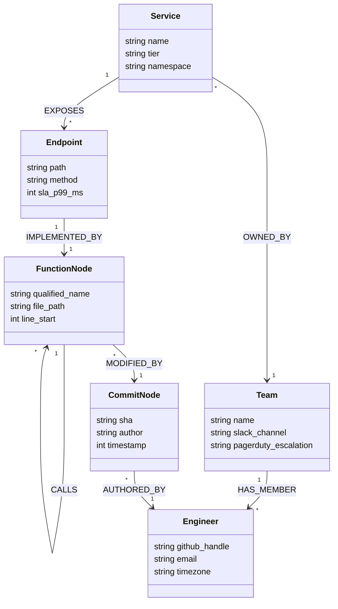

# GraphSRE: Autonomous SRE & Code Brain
## Project Scope & Architectural Boundary Specification

```
   ┌─────────────────────────────────────────────────────────────────────────────────┐
   │                               PROJECT SCOPE SPECIFICATION                       │
   │               GraphSRE: Autonomous Site Reliability Engineering & Code Brain     │
   │                  FalkorDB + WeMakeDevs GraphHacks Hackathon Submission           │
   └─────────────────────────────────────────────────────────────────────────────────┘

           Track 1                         Track 2                         Track 3
   ┌─────────────────────┐         ┌─────────────────────┐         ┌─────────────────────┐
   │ Agents That Act on  │         │  Agent Memory and   │         │    Company Brain    │
   │   Connected Data    │         │    Coordination     │         │   (Code AST + Ops)  │
   ├─────────────────────┤         ├─────────────────────┤         ├─────────────────────┤
   │ • GraphBLAS Algos   │         │ • Central Blackboard│         │ • Socio-Tech Graph  │
   │ • Multi-Hop RCA     │ ◄─────► │ • Triple-Memory     │ ◄─────► │ • Surgical Escalation│
   │ • 7 MCP Tools       │         │ • C_SRE Confidence  │         │ • O(1) Shortcut Net │
   │ • Proof Lineage     │         │ • GRAPH.COPY Sandbox│         │ • Bayesian Decay    │
   └─────────────────────┘         └─────────────────────┘         └─────────────────────┘
```

---

## 1. Executive Problem Statement & Motivation

### 1.1 The Context Disconnect in Modern Site Reliability Engineering
Modern cloud-native engineering architectures have reached a level of scale and distributed complexity that overwhelms human cognitive capacity during high-stress production outages:

1. **Siloed Operational Realities:**
   Operational knowledge is fragmented across four disconnected silos:
   * **Runtime Telemetry:** Metrics (Prometheus/Datadog), distributed traces (OpenTelemetry), and logs (Grafana Loki/Elasticsearch).
   * **Static Codebase Topology:** Abstract Syntax Trees (AST), package dependencies, and internal call graphs across polyglot microservice repositories.
   * **Deployment & Cloud Infrastructure:** Kubernetes manifests, service meshes (Istio/Envoy), cloud resource topologies (AWS/GCP), and virtual network overlays.
   * **Socio-Organizational Ownership:** `CODEOWNERS` definitions, Git commit histories, Slack team channels, and PagerDuty on-call escalation policies.

2. **The 80% Correlation Tax:**
   During a critical outage ($Sev-1/Sev-2$), SREs spend over **80% of Mean Time to Resolution (MTTR)** performing manual mental joins across these fragmented silos: *"Which pull request merged in the last two hours touches the function executing on this failing pod? Which downstream services depend on this degraded gRPC endpoint? Who is the actual code owner of this regression?"*

```
Fragmented Operational Silos (Conventional SRE):
┌────────────────┐      ┌────────────────┐      ┌────────────────┐      ┌────────────────┐
│  Metrics/Logs  │      │  Microservices │      │    Code AST    │      │   CODEOWNERS   │
│   (Telemetry)  │  ≠   │  (Kubernetes)  │  ≠   │  (Git Commits) │  ≠   │  (Teams/Slack) │
└────────────────┘      └────────────────┘      └────────────────┘      └────────────────┘
        │                       │                       │                       │
        └───────────────────────┼───────────────────────┴───────────────────────┘
                                ▼
         Manual Human Correlation (80% of MTTR Lost to Context Switching)
```

---

### 1.2 The Deterministic Failure of Vector RAG in Incident Response
The prevailing trend in generative AI is to apply **Retrieval-Augmented Generation (Vector RAG)** to operational telemetry and documentation. In mission-critical incident diagnosis, Vector RAG fails deterministically due to fundamental mathematical and structural limitations:

1. **Inability to Model Asymmetric, Directed Causality:**
   Vector embeddings project text chunks into metric spaces where distance is symmetric ($\text{dist}(u, v) = \text{dist}(v, u)$). However, failure propagation in distributed systems is asymmetric, directed, and transitive:
   $$\text{Service A} \xrightarrow{\text{CALLS}} \text{Service B} \xrightarrow{\text{QUERIES}} \text{Database C}$$
   If Database C exhausts its connection pool, Service B throws a connection timeout, and Service A returns an HTTP `504 Gateway Timeout`. An embedding query matching `"HTTP 504 Gateway Timeout"` retrieves Service A's documentation and error logs, completely masking Database C—the true causal origin.

2. **Chunking Destroys Call Hierarchy & AST Topology:**
   Vector RAG splits codebases into arbitrary text chunks (e.g., 500-token chunks with 50-token overlap). When a bug is introduced in a low-level utility function (`db_pool.py:acquire_connection()`), and that function is invoked four hops up the call tree by `checkout.py:process_payment()`, chunking severs the structural call path. The vector embedding of `process_payment()` exhibits zero semantic similarity to the commit diff in `db_pool.py`.

3. **Alert Storm Flooding & Catastrophic Forgetting:**
   During a cascading failure, monitoring systems fire hundreds of simultaneous alerts across dozens of services. Ingesting this alert storm into an LLM context window causes immediate token saturation, quadratic token bloat ($O(N^2)$), and catastrophic forgetting of earlier telemetry signals.

4. **Absence of Topological Reachability Verification:**
   Vector RAG cannot verify whether a candidate commit is physically capable of affecting an alerted endpoint. It generates hallucinated hypotheses linking unrelated commits to symptoms purely because of surface-level lexical similarity.

---

### 1.3 Why Causality is Fundamentally a Graph Problem
Failure propagation in software systems maps directly to directed, heterogeneous graph structures:

$$\mathcal{G} = (\mathcal{V}, \mathcal{E}, \mathcal{T}_v, \mathcal{T}_e)$$

Where vertices $\mathcal{V}$ comprise Services, Endpoints, AST Functions, Git Commits, Alert Events, and Engineering Teams, while edges $\mathcal{E}$ represent concrete architectural relations:
* $\text{CALLS} \subseteq \text{Function} \times \text{Function}$
* $\text{EXPOSES} \subseteq \text{Service} \times \text{Endpoint}$
* $\text{MODIFIED\_BY} \subseteq \text{Function} \times \text{Commit}$
* $\text{AFFECTS} \subseteq \text{Alert} \times \text{Service}$
* $\text{OWNED\_BY} \subseteq \text{Service} \times \text{Team}$

```
Unified Socio-Technical Causal Walk:
(:Alert {metric: "p99 > 2s"})
    │
[:AFFECTS]
    ▼
(:Service {name: "Payment"}) ──[:DEPENDS_ON]──> (:Service {name: "Database"})
    │
[:EXPOSES]
    ▼
(:Endpoint {path: "/checkout"})
    │
[:IMPLEMENTED_BY]
    ▼
(:Function {name: "handle_pay"}) ──[:CALLS*]──> (:Function {name: "acquire_lock"})
                                                     │
                                               [:MODIFIED_BY]
                                                     ▼
                                                (:Commit {sha: "c3d9a1"})
                                                     │
                                                [:AUTHORED_BY]
                                                     ▼
                                                (:Engineer {slack: "@alice"})
```

#### Graph Superiority over Vector Space
* **Exact Path Traversals:** Root-cause identification is a bounded path search from an alerted symptom to a modified AST node through directed call and dependency chains.
* **Topological Reachability:** Candidate root causes must satisfy directed reachability ($\text{Path}(c \to a) \ne \emptyset$), rejecting all ungrounded hallucinations.
* **Matrix-Accelerated Centrality:** Identifying single points of failure (SPOFs) and evaluating cascading blast radius requires sparse matrix linear algebra (GraphBLAS), executable in sub-millisecond latencies.

---

## 2. In-Scope Capabilities Across All 3 Hackathon Tracks

GraphSRE is explicitly architected to address and integrate all three official hackathon tracks into a cohesive, production-grade system:

```
┌────────────────────────────────────────────────────────────────────────────────────────┐
│                              HACKATHON TRACK MATRIX MAPPING                            │
├────────────────────┬──────────────────────────────────┬────────────────────────────────┤
│ Hackathon Track    │ Architectural Component          │ Core FalkorDB Capabilities     │
├────────────────────┼──────────────────────────────────┼────────────────────────────────┤
│ Track 1:           │ RCA Agent, Multi-Hop Traversal,  │ GraphBLAS Sparse Matrix Algos, │
│ Agents That Act on │ 7 Atomic MCP Tools, Explainable  │ Cypher Pattern Traversals,     │
│ Connected Data     │ Graph Lineage Subgraphs          │ Multi-Hop Causal Tracing       │
├────────────────────┼──────────────────────────────────┼────────────────────────────────┤
│ Track 2:           │ 4-Agent Central Blackboard,      │ Native HNSW Vector Index,      │
│ Agent Memory &     │ Deterministic State Machine,     │ ACID Concurrency Control,      │
│ Coordination       │ Triple-Memory, Quorum Consensus  │ Fast Sandboxing (`GRAPH.COPY`) │
├────────────────────┼──────────────────────────────────┼────────────────────────────────┤
│ Track 3:           │ Code AST to Cloud Infra Ontology,│ Dynamic Edge Synthesis,        │
│ Company Brain      │ CODEOWNERS Surgical Routing,     │ Temporal Bayesian Edge Decay,  │
│                    │ Self-Curating O(1) Shortcut Net  │ Automated Knowledge Pruning    │
└────────────────────┴──────────────────────────────────┴────────────────────────────────┘
```

---

### 2.1 Track 1: Agents That Act on Connected Data

#### Multi-Hop Causal Reasoning Across System Layers
The system executes parameterized, depth-bounded multi-hop traversals across heterogeneous entity layers to identify the exact code commit, configuration drift, or upstream dependency inducing an anomaly. The causal search traverses:

$$\text{Path}_{\text{causal}} = (a:\text{Alert}) \xrightarrow{\text{AFFECTS}} (s:\text{Service}) \xrightarrow{\text{EXPOSES}} (e:\text{Endpoint}) \xrightarrow{\text{IMPLEMENTED\_BY}} (f_1:\text{Function}) \xrightarrow{\text{CALLS}^*} (f_k:\text{Function}) \xrightarrow{\text{MODIFIED\_BY}} (c:\text{Commit})$$

```cypher
// Track 1 Core: Multi-Hop AST & Version Control Causal Traversal
MATCH (a:Alert {id: $alert_id})-[:AFFECTS]->(s:Service)
MATCH (s)-[:EXPOSES]->(e:Endpoint)-[:IMPLEMENTED_BY]->(root_fn:Function)
MATCH path = (root_fn)-[:CALLS*0..6]->(target_fn:Function)-[:MODIFIED_BY]->(c:Commit)
WHERE c.timestamp >= (timestamp() - ($lookback_hours * 3600000))
RETURN s.name AS service,
       e.path AS endpoint,
       target_fn.qualified_name AS culprit_function,
       c.sha AS culprit_commit,
       c.author AS author,
       length(path) AS call_depth
ORDER BY c.timestamp DESC, call_depth ASC
LIMIT 3;
```

#### FalkorDB GraphBLAS Native Graph Algorithms as Agent Tools
Rather than offloading graph computations to external Python graph libraries (which incur severe serialization latency and memory bloat), GraphSRE directly leverages FalkorDB's embedded **GraphBLAS sparse matrix linear algebra algorithms**:

```
                       FALKORDB GRAPHBLAS SUITE IN ACTION
 ┌───────────────────────┬───────────────────────────┬──────────────────────────────────┐
 │ GraphBLAS Algorithm   │ Mathematical Role         │ Autonomous SRE Operational Goal  │
 ├───────────────────────┼───────────────────────────┼──────────────────────────────────┤
 │ 1. `algo.pageRank`    │ Centrality Vector         │ Identify structurally critical   │
 │                       │ $p = \alpha A D^{-1} p$   │ microservices & choke points     │
 ├───────────────────────┼───────────────────────────┼──────────────────────────────────┤
 │ 2. `algo.betweenness` │ Shortest-Path Bridging    │ Pinpoint Single Points of Failure│
 │                       │ $g(v) = \sum \frac{\sigma│ (SPOFs) between clusters         │
 ├───────────────────────┼───────────────────────────┼──────────────────────────────────┤
 │ 3. `algo.SPpaths`     │ Shortest Path Directed    │ Trace minimum-hop causal failure │
 │                       │ Traversal (BFS/Dijkstra)  │ propagation from alert to commit │
 ├───────────────────────┼───────────────────────────┼──────────────────────────────────┤
 │ 4. `algo.labelProp`   │ Community Detection (CDLP)│ Group concurrent alert storms    │
 │                       │ $C_v = \text{mode}(C_u)$  │ into isolated incident clusters  │
 ├───────────────────────┼───────────────────────────┼──────────────────────────────────┤
 │ 5. `algo.WCC`         │ Weakly Connected          │ Compute disconnected partition   │
 │                       │ Components                │ boundaries for blast containment │
 └───────────────────────┴───────────────────────────┴──────────────────────────────────┘
```

1. **PageRank (`algo.pageRank`):**
   Evaluates structural authority across the runtime service mesh. Services with high PageRank that exhibit elevated latency automatically amplify incident severity, as downstream propagation probability is maximal.
2. **Betweenness Centrality (`algo.betweenness`):**
   Calculates the ratio of all-pairs shortest paths passing through a specific node. Used by the Triage Agent to detect unmonitored infrastructure bottlenecks and single-point-of-failure routing proxies.
3. **Shortest Paths (`algo.SPpaths`):**
   Executes directed BFS/Dijkstra matrix multiplications to discover the shortest path from symptom to offending node, prioritizing the most immediate causal chain.
4. **Community Detection via Label Propagation (`algo.labelPropagation` / CDLP):**
   Dynamically clusters hundreds of incoming alert notifications firing within a 60-second sliding window into discrete incidents by analyzing graph adjacency, eliminating alert fatigue.
5. **Weakly Connected Components (`algo.WCC`):**
   Partitions the dependency graph during network partitions or catastrophic failures to establish which service islands remain operational.

#### The 7 Model Context Protocol (MCP) Atomic Tools
GraphSRE equips its agents with 7 atomic, typed MCP tools interfacing with FalkorDB:

1. `graphsre_triage_alert`: Ingests raw telemetry events, executes CDLP alert clustering, and computes blast radius subgraphs.
2. `graphsre_traverse_causal_path`: Executes parameterized multi-hop traversals connecting alerts, endpoints, AST functions, and Git commits.
3. `graphsre_query_memory`: Performs hybrid vector cosine similarity queries against past postmortems joined with procedural runbooks.
4. `graphsre_post_hypothesis`: Publishes candidate causal hypotheses and attaches structured evidence nodes (`METRIC_SPIKE`, `LOG_STACKTRACE`, `AST_DIFF`).
5. `graphsre_get_blackboard_state`: Fetches the live, atomic state of the incident subgraph, active hypotheses, and voting tallies.
6. `graphsre_execute_remediation_step`: Forks an ephemeral sandbox via `GRAPH.COPY`, simulates counterfactual blast radius, and applies verified canary remediations.
7. `graphsre_commit_postmortem`: Finalizes the incident, saves post-mortem vector embeddings, and compiles $O(1)$ shortcut edges.

#### Explainability & Proof Lineage
Every diagnostic claim produced by GraphSRE is mathematically explainable. The system outputs a visual and cryptographic **Proof Lineage Subgraph**:
* No black-box answers: every hypothesis references the exact set of `(:Evidence)` nodes supporting or refuting it.
* Exact Cypher queries that discovered the path are preserved in the post-mortem report.
* Human operators can inspect, verify, or challenge any hop in the causal walk.

---

### 2.2 Track 2: Agent Memory and Coordination

#### 4-Agent Swarm over FalkorDB Central Blackboard
GraphSRE discards fragile conversational message-passing rings (e.g., AutoGen, CrewAI) where agents exchange unverified natural language strings. Instead, it deploys a 4-agent swarm operating over a **Central Graph Blackboard** hosted in FalkorDB:

```
                           THE 4-AGENT CENTRAL BLACKBOARD SWARM
                           
                     ┌──────────────────────────────────────────────┐
                     │          FalkorDB Central Blackboard         │
                     │                                              │
                     │  • Shared State: (:Incident)                 │
                     │  • Hypotheses & Evidence Graph               │
                     │  • Native Vector Index (HNSW)                │
                     │  • Transactional Cypher Engine               │
                     └──────▲────────────▲────────────▲───────────▲─┘
                            │            │            │           │
            ┌───────────────┘            │            │           └──────────────┐
            │ Cypher TX                  │ Cypher TX  │ Cypher TX                │ Cypher TX
            ▼                            ▼            ▼                          ▼
   ┌─────────────────┐         ┌─────────────────┐  ┌─────────────────┐ ┌─────────────────┐
   │ 1. Triage Agent │         │  2. RCA Agent   │  │ 3. Memory Agent │ │ 4. Remediation  │
   │                 │         │                 │  │                 │ │      Agent      │
   │ • Ingest Alerts │         │ • Cross-Layer   │  │ • Triple-Memory │ │ • GRAPH.COPY    │
   │ • CDLP Cluster  │         │   AST Traversal │  │ • Vector Recall │ │   Sandboxing    │
   │ • Blast Radius  │         │ • Diff Analysis │  │ • C_SRE Scoring │ │ • Canary Rollout│
   │ • Dynamic Sev   │         │ • Evidence Link │  │ • Quorum Gate   │ │ • Revert PRs    │
   └─────────────────┘         └─────────────────┘  └─────────────────┘ └─────────────────┘
```

#### Deterministic Finite State Machine (FSM)
The incident lifecycle is governed by an immutable finite state machine enforced via atomic Cypher transactions:

```
  ┌──────────────┐
  │   DETECTED   │ ── Ingestion of raw telemetry alert
  └──────┬───────┘
         │ (CDLP Clustering & Dynamic Severity Computed)
         ▼
  ┌──────────────┐
  │   TRIAGED    │ ── Blast radius evaluated; RCA Agent triggered
  └──────┬───────┘
         │ (Cross-Layer AST Traversal Commences)
         ▼
  ┌───────────────┐
  │ INVESTIGATING │ ── Path traversal maps suspect functions/commits
  └──────┬────────┘
         │ (Hypothesis Published to Blackboard)
         ▼
  ┌─────────────────────┐
  │  HYPOTHESIS_FORMED  │ ── Evidence linked; C_SRE confidence calculated
  └──────┬──────────────┘
         │ (Consensus Quorum Passed: WCS >= 0.75 AND Invariants Satisfied)
         ▼
  ┌─────────────────────┐
  │ HYPOTHESIS_VERIFIED │ ── Remediation plan constructed
  └──────┬──────────────┘
         │ (FalkorDB GRAPH.COPY Counterfactual Simulation Returns SAFE)
         ▼
  ┌─────────────────────┐
  │     REMEDIATING     │ ── Canary rollout initiated (10% traffic)
  └──────┬──────────────┘
         │ (Telemetry Verified Stable for 180s)
         ├──────────────────────────────┐ (Canary Metric Breach)
         ▼                              ▼
  ┌─────────────────────┐       ┌───────────────┐
  │ CANARY_VERIFICATION │       │    ABORTED    │ ── Immediate Rollback & Re-Investigate
  └──────┬──────────────┘       └───────────────┘
         │ (100% Traffic Restored)
         ▼
  ┌───────────────┐
  │   RESOLVED    │ ── Postmortem compiled; O(1) Shortcut Edges Synthesized
  └───────────────┘
```

#### Triple-Memory Architecture
The Memory Agent maintains three cognitive layers within FalkorDB:

```
                        TRIPLE-MEMORY ARCHITECTURAL BREAKDOWN
 ┌──────────────────┬─────────────────────────────┬─────────────────────────────────────┐
 │ Memory Type      │ FalkorDB Storage Mechanism  │ Retrieval & Reasoning Semantics     │
 ├──────────────────┼─────────────────────────────┼─────────────────────────────────────┤
 │ 1. Episodic      │ Native HNSW Vector Index    │ Semantic similarity matching over   │
 │    Memory        │ `db.idx.vector.queryNodes`  │ historical incident symptoms, logs, │
 │                  │ Node Label: `PastIncident`  │ and post-mortems ($S_{\text{episodic}}$)│
 ├──────────────────┼─────────────────────────────┼─────────────────────────────────────┤
 │ 2. Semantic      │ Property Graph Topology     │ Exact structural knowledge: service │
 │    Memory        │ AST, Endpoints, Network     │ meshes, interface contracts, call   │
 │                  │ Node Labels: `Service`, `Fn`│ trees, and code dependencies ($T_{\text{graph}}$)│
 ├──────────────────┼─────────────────────────────┼─────────────────────────────────────┤
 │ 3. Procedural    │ Executable Directed Graphs  │ Validated runbook DAGs defining safe│
 │    Memory        │ `(:Runbook)-[:NEXT_STEP]->` │ operational mitigation workflows    │
 │                  │ Node Label: `Runbook`       │ and historic success ($H_{\text{success}}$)│
 └──────────────────┴─────────────────────────────┴─────────────────────────────────────┘
```

#### Mathematical Composite Confidence Scoring ($C_{\text{SRE}}$)
No hypothesis is verified and no remediation is attempted without computing the deterministic Composite Confidence Score $C_{\text{SRE}} \in [0.0, 1.0]$:

$$C_{\text{SRE}} = w_e \cdot S_{\text{episodic}} + w_t \cdot T_{\text{graph}} + w_m \cdot E_{\text{metric}} + w_h \cdot H_{\text{success}}$$

Where:
* $S_{\text{episodic}} \in [0.0, 1.0]$: Vector cosine similarity between current incident symptoms and historic postmortems.
* $T_{\text{graph}} \in \{0.0, 1.0\}$: Binary topological reachability invariant. If no valid path connects the suspect change to the alerted service, $T_{\text{graph}} = 0.0$.
* $E_{\text{metric}} \in [0.0, 1.0]$: Normalized signal-to-noise ratio of supporting telemetry metric anomalies ($1 - e^{-\Delta / \sigma}$).
* $H_{\text{success}} \in [0.0, 1.0]$: Historical empirical success rate of the linked procedural runbook.
* **Calibrated Weights:** $w_e = 0.25$, $w_t = 0.35$, $w_m = 0.25$, $w_h = 0.15$ (Sum = $1.0$).
  > **Crucial Safety Property:** Because $w_t = 0.35$, if a hypothesis lacks a valid topological path in the graph ($T_{\text{graph}} = 0$), the maximum possible confidence score is strictly bounded at $1.0 - 0.35 = 0.65$. Since the verification threshold requires $C_{\text{SRE}} \ge 0.75$, **any topologically ungrounded hypothesis is mathematically blocked from verification.**

#### Distributed Quorum Consensus Gate
Before applying state transitions, agents register individual votes on the blackboard:

$$\text{WCS}(H) = \sum_{i \in \text{Agents}} W_i \cdot \mathbb{I}(\text{Vote}_i = \text{APPROVE}) \quad \text{where} \quad \sum W_i = 1.0$$

* Agent Vote Weights: RCA Agent = $0.40$, Memory Agent = $0.35$, Triage Agent = $0.25$.
* **Approval Gate:** $\text{WCS}(H) \ge 0.75$ and no agent registers a `VETO`.
* **Veto Enforcement:** If an invariant is violated (e.g., blast radius exceeds limits or runbook has historical failure), any agent can issue an absolute veto, forcing re-investigation.

#### Ephemeral Graph Sandboxing via `GRAPH.COPY`
Production graphs must never be mutated during speculative reasoning. GraphSRE utilizes FalkorDB's native high-speed copy command:

```cypher
GRAPH.COPY production_cluster sandbox_incident_842
```

In the sandbox graph:
1. The Remediation Agent simulates traffic shifts, pod drains, and configuration rollbacks.
2. Downstream capacity and dependency constraints are re-evaluated using graph traversals.
3. If the simulation results in a `CAPACITY_BREACH_ABORT`, production is untouched.
4. The ephemeral sandbox is deleted via `GRAPH.DELETE sandbox_incident_842` in $< 10\text{ ms}$.

---

### 2.3 Track 3: Company Brain

#### Unified Socio-Technical Ontology
GraphSRE builds a persistent, living graph uniting code, infrastructure, and human organizations into a singular queryable reality:



#### Surgical Ownership Escalation
Conventional alerting pages broad on-call rotation pools, waking engineers who have no context on the specific code that failed. GraphSRE executes **Surgical Ownership Routing**:

```cypher
// Track 3 Core: Surgical On-Call & Author Escalation Routing
MATCH (h:Hypothesis {id: $hypothesis_id, status: 'HYPOTHESIS_VERIFIED'})
MATCH (h)-[:TARGETS]->(target_fn:Function)-[:MODIFIED_BY]->(c:Commit)
MATCH (c)-[:AUTHORED_BY]->(author:Engineer)
MATCH (target_fn)<-[:IMPLEMENTED_BY]-(:Endpoint)<-[:EXPOSES]-(s:Service)-[:OWNED_BY]->(t:Team)
RETURN author.github_handle AS offending_author,
       author.slack_handle AS author_slack,
       t.name AS owning_team,
       t.slack_channel AS team_war_room,
       s.name AS affected_service,
       c.sha AS culprit_commit;
```
* Bypasses generic on-call queues.
* Opens an incident war room directly notifying the specific engineer who authored the regression and the designated technical lead of the owning team.

#### Self-Curating Memory & $O(1)$ Shortcut Synthesis
Upon incident resolution, GraphSRE executes the **Continuous Learning Compilation Loop**. It compresses multi-hop causal walks into direct, instant-lookup shortcut edges:

```
Multi-Hop Reasoning (Before Learning - 4 hops):
(:Alert {fingerprint: "P99_CHECKOUT"}) ──> (:Service) ──> (:Endpoint) ──> (:Function) ──> (:Culprit)

Direct O(1) Shortcut (After Learning - 1 hop):
(:Alert {fingerprint: "P99_CHECKOUT"}) ──[:HISTORICALLY_CAUSED_BY {weight: 1.0}]──> (:Culprit)
```

In future alert occurrences matching this fingerprint, the RCA Agent checks incoming `[:HISTORICALLY_CAUSED_BY]` edges. If an edge exists with weight $W \ge 0.85$, root cause verification is performed in $O(1)$ constant time, cutting MTTR from 15 minutes to under 2 seconds.

#### Temporal Bayesian Edge Decay & Automatic Invalidation
To prevent stale knowledge from corrupting future diagnoses, GraphSRE models memory dynamics via a continuous-discrete Bayesian framework:

1. **Continuous Temporal Decay:**
   $$W_{\text{decayed}}(t) = W(t_{\text{last}}) \cdot \exp\left(-\lambda \cdot (t - t_{\text{last}})\right)$$
   Where $\lambda = \frac{\ln(2)}{t_{\text{half-life}}}$ is calibrated to a half-life of $t_{\text{half-life}} = 30\text{ days}$.

2. **Discrete Bayesian Reinforcement:**
   When an incident recurs and confirms the same culprit, the edge weight is reinforced:
   $$W_{\text{new}} = W_{\text{decayed}}(t) + \eta \cdot (1 - W_{\text{decayed}}(t)) \quad (\eta = 0.50)$$

3. **Code Modification Invalidation:**
   If a new Git commit modifies a function targeted by a shortcut edge, an immediate **70% confidence penalty** is applied, marking the shortcut as stale:
   $$W(e) \leftarrow W(e) \times 0.30$$

4. **Automated Daily Pruning:**
   A background Cypher job runs every 24 hours, deleting shortcut edges where $W < 0.15$ or edges flagged stale for over 90 days.

---

## 3. Value-Add Production Capabilities

To provide immediate, enterprise-grade utility, GraphSRE includes three production capabilities extending beyond the reactive incident loop:

```
 ┌───────────────────────────────────────────────────────────────────────────────────────┐
 │                            VALUE-ADD PRODUCTION CAPABILITIES                          │
 ├───────────────────────────┬───────────────────────────────────────────────────────────┤
 │ Capability                │ Key Value Proposition                                     │
 ├───────────────────────────┼───────────────────────────────────────────────────────────┤
 │ 1. Pre-Incident CI/CD     │ Shift-left SRE: Evaluates PR blast radius in GitHub       │
 │    "Blast-Gate" PR Sim    │ Actions before code reaches production, blocking SPOFs.   │
 ├───────────────────────────┼───────────────────────────────────────────────────────────┤
 │ 2. Interactive Chaos      │ Controlled fault-injection engine to visually validate    │
 │    Monkey Simulator       │ multi-agent triage, RCA, and self-curating memory live.   │
 ├───────────────────────────┼───────────────────────────────────────────────────────────┤
 │ 3. 1-Click Slack War Room │ Real-time interactive causal incident cards with Human-  │
 │    & HITL Sign-Off        │ in-the-Loop approvals for high-blast-radius operations.   │
 └───────────────────────────┴───────────────────────────────────────────────────────────┘
```

---

### 3.1 Pre-Incident CI/CD "Blast-Gate" PR Simulation (Shift-Left SRE)
GraphSRE acts proactively before outages occur by embedding directly into the developer CI/CD pipeline (e.g., GitHub Actions, GitLab CI):

```
Developer Opens Pull Request
              │
              ▼
   GitHub Actions CI Step
              │
              ▼
    GraphSRE Blast-Gate
              │
    • Parse AST diff of PR
    • Map modified functions to FalkorDB Knowledge Graph
    • Execute GraphBLAS PageRank & Upstream Blast-Radius Traversal
              │
    ┌─────────┴─────────┐
    ▼                   ▼
[Blast Radius <= 2]   [Blast Radius > 5 OR Touches Tier-1 Service]
    │                   │
    ▼                   ▼
 PR Check PASS        PR Check FAIL / BLOCKED
 (Auto-merge safe)    (Requires Architect Sign-Off & Warning Annotation)
```

#### Operational Mechanics
1. On `pull_request` events, the Blast-Gate extracts modified files and function signatures using Tree-sitter.
2. It queries FalkorDB to discover all endpoints and upstream microservices calling the modified code.
3. It computes the **Structural Risk Index (SRI)**:
   $$\text{SRI} = \text{PageRank}(s_{\text{target}}) \times \sum_{u \in \text{Upstream}} \text{TierWeight}(u)$$
4. If $\text{SRI} > \text{Threshold}$, the GitHub Action posts an interactive markdown comment detailing the exact downstream blast radius graph and blocks merge until an engineering lead approves.

---

### 3.2 Interactive Chaos Monkey Simulator
To demonstrate the multi-agent system's resilience under realistic operational conditions, GraphSRE includes an integrated **Chaos Monkey Simulator**:

* **Injectable Failure Modes:**
  * *Unbounded Socket Timeout:* Simulates a commit stripping HTTP timeouts, inducing thread pool starvation in downstream payment gateways.
  * *Database Connection Pool Leak:* Simulates unclosed connections in ORM repositories triggering cascading HTTP 504 errors.
  * *Memory Leak in Auth Middleware:* Simulates gradual heap exhaustion causing Kubernetes OOMKills.
  * *Network Latency Spike:* Injects artificial 3000ms latency on critical gRPC inter-service communication edges.
* **Live Interactive Visualization:**
  * Operators trigger failures via a clean Web UI control panel.
  * Real-time graph visualization renders alerts firing, CDLP clustering nodes, agents debating on the blackboard, sandbox verification, and final $O(1)$ shortcut edge creation.

---

### 3.3 1-Click Slack War Room Synthesis & Human-in-the-Loop (HITL) Approvals
For mission-critical production systems, fully autonomous remediation can introduce unacceptable operational risk. GraphSRE integrates a strict **Human-in-the-Loop (HITL) Safety Boundary**:

```
                  HITL ESCALATION WORKFLOW (SLACK INTEGRATION)
                  
   Hypothesis Verified on Central Blackboard
                      │
                      ▼
            Check Invariant 3:
     Downstream Blast Radius > 5 OR Service Tier == 'TIER_1'
                      │
           ┌──────────┴──────────┐
           ▼                     ▼
        [ NO ]                [ YES ]
           │                     │
           ▼                     ▼
Autonomous Remediation   HITL Escalation Triggered:
via GRAPH.COPY Sandbox   1. Create Dedicated Slack Incident Channel (#inc-842)
                         2. Post Rich Interactive Diagnostic Graph Card
                         3. Ping Surgical Owner & On-Call Tech Lead
                                 │
                                 ▼
                     Interactive Slack Action Card:
                     ┌──────────────────────────────────────────────┐
                     │ 🚨 SEV-1 INCIDENT: PaymentService Degradation│
                     │ Causal Culprit: Commit c3d9a1 (Alice Chen)   │
                     │ Confidence C_SRE: 0.94 | Blast Radius: 7 Svc │
                     │                                              │
                     │ [✅ Approve Revert]  [🧪 Fork Sandbox]       │
                     │ [🛑 Reject / Reroute] [📋 View Full AST Lineage]
                     └──────────────────────────────────────────────┘
                                 │
                     User clicks [✅ Approve Revert]
                                 │
                                 ▼
           Cryptographic Sign-Off Committed to Blackboard
                                 │
                                 ▼
           Remediation Executed & Recorded in Post-Mortem
```

---

## 4. Explicit Non-Goals & Boundaries (Out-of-Scope Items)

To maintain razor-sharp engineering execution, architectural integrity, and hackathon delivery discipline, the following boundaries are formally established as **Out-of-Scope**:

```
 ┌────────────────────────────────────┬────────────────────────────────────────┐
 │ Category                           │ Explicit Non-Goal / Out-of-Scope Item  │
 ├────────────────────────────────────┼────────────────────────────────────────┤
 │ 1. Arbitrary Infrastructure Admin  │ Not an unconstrained bash/SSH root     │
 │                                    │ runner; actions restricted to audited  │
 │                                    │ procedural recipes & Git PR reverts.   │
 ├────────────────────────────────────┼────────────────────────────────────────┤
 │ 2. Custom APM Telemetry Agent      │ Does not build proprietary host kernel │
 │                                    │ eBPF probes; consumes open OTel,       │
 │                                    │ Prometheus, and Datadog webhooks.      │
 ├────────────────────────────────────┼────────────────────────────────────────┤
 │ 3. Line-by-Line Dynamic Debugger   │ Does not attach live GDB/PDB debuggers │
 │                                    │ to running container processes.        │
 ├────────────────────────────────────┼────────────────────────────────────────┤
 │ 4. Proprietary Graph Databases     │ Zero support for Neo4j, AWS Neptune,   │
 │                                    │ or TigerGraph; 100% FalkorDB exclusive.│
 ├────────────────────────────────────┼────────────────────────────────────────┤
 │ 5. Physical Hardware Failures      │ Does not resolve physical bare-metal   │
 │                                    │ severed fiber cables or datacenter     │
 │                                    │ power supply outages.                  │
 ├────────────────────────────────────┼────────────────────────────────────────┤
 │ 6. Multi-Tenant Enterprise RBAC    │ Single-organization enterprise scope;  │
 │                                    │ complex multi-tenant billing omitted.  │
 └────────────────────────────────────┴────────────────────────────────────────┘
```

1. **No Unconstrained Autonomous Shell Execution:**
   GraphSRE will never autonomously execute raw, arbitrary bash commands on production nodes. Remediation actions are strictly constrained to pre-validated procedural runbooks (e.g., Git revert pull requests, Kubernetes ConfigMap rollbacks, canary pod restarts).
2. **No Proprietary Telemetry Collectors:**
   GraphSRE does not reinvent telemetry ingestion. It relies on standard OpenTelemetry protocol (OTLP), Prometheus alert manager webhooks, and Datadog API schemas.
3. **No Dynamic Instruction-Level Tracing:**
   The RCA Agent traces causality down to the AST function, qualified name, line range, and commit diff level. It does not perform byte-level memory inspection or step-by-step assembly debugging.
4. **Strict FalkorDB Exclusivity:**
   To guarantee maximum performance, sub-millisecond sparse matrix computations, and native vector index integration, the system is engineered exclusively for FalkorDB and will not support generic or slower graph backends.

---

## 5. Technical Constraints & Free Open-Source Technology Stack

GraphSRE is constructed entirely from high-performance, accessible, and **100% free open-source software (FOSS)** or open-weight models, eliminating expensive commercial dependencies and proprietary vendor lock-in.

```
                  GRAPHSRE COMPONENT STACK ARCHITECTURE
                  
  ┌────────────────────────────────────────────────────────────────────────┐
  │                           PRESENTATION LAYER                           │
  │   Next.js 14 App Router  •  Tailwind CSS  •  Cytoscape.js / React Flow │
  │        Interactive Causal Graph Viewer  •  Live Blackboard Monitor     │
  └───────────────────────────────────▲────────────────────────────────────┘
                                      │ REST / WebSocket API
  ┌───────────────────────────────────▼────────────────────────────────────┐
  │                         AGENT COORDINATION LAYER                       │
  │   FastAPI Engine  •  AsyncIO Swarm  •  FastMCP (Model Context Protocol)│
  │        Triage Agent  •  RCA Agent  •  Memory Agent  •  Remediation     │
  │        LLM Engines: Groq (Llama 3.3 70B) / Google Gemini 2.0 Flash     │
  └───────────────────────────────────▲────────────────────────────────────┘
                                      │ Cypher Transactions / GraphBLAS
  ┌───────────────────────────────────▼────────────────────────────────────┐
  │                       CORE STATE & KNOWLEDGE BRAIN                     │
  │                            FALKORDB (Docker)                           │
  │   • GraphBLAS Linear Algebra Engine (Sparse Matrix Operations)          │
  │   • Native HNSW Vector Indexing (1536d / 384d Cosine Distance)        │
  │   • ACID Blackboard State Store  •  GRAPH.COPY Ephemeral Sandboxing    │
  └───────────────────────────────────▲────────────────────────────────────┘
                                      │ Ingestion / AST Parsing
  ┌───────────────────────────────────▼────────────────────────────────────┐
  │                        INGESTION & TELEMETRY MOCK                      │
  │   Tree-sitter AST Parser (Python/Go/TS)  •  OTel & Prometheus Generator│
  └────────────────────────────────────────────────────────────────────────┘
```

### Detailed Component Specifications

| Architecture Layer | Technology / Tool | Version / Specification | Rationale & Free/FOSS Tier |
| :--- | :--- | :--- | :--- |
| **Central Graph Blackboard** | **FalkorDB** | `falkordb/falkordb:latest` (Docker) | Open-source Redis-based graph database; GraphBLAS sub-millisecond sparse matrix engine; native vector indexing; `GRAPH.COPY` support. |
| **Graph Client** | **falkordb-python** | `>= 1.0.8` | Native Python SDK supporting parameterized Cypher execution and vector queries. |
| **Agent Coordination** | **Python AsyncIO + FastAPI** | Python `3.11+` | Ultra-fast asynchronous non-blocking event loop orchestrating concurrent agent Cypher transactions. |
| **Tool Protocol** | **FastMCP (Model Context Protocol)** | FastMCP v0.5+ | Standardized, open protocol for LLM tool invocation and context sharing. |
| **Reasoning LLMs** | **Groq (Llama 3.3 70B) / Gemini 2.0 Flash** | API (Free Tier) | Extremely fast inference ($< 500\text{ ms}$ TTFT), generous free tiers, and strong structured output compliance. |
| **Code AST Extraction**| **Tree-sitter** | `tree-sitter` (Python, Go, JS) | High-speed, deterministic AST parsing without token costs or LLM hallucination risk. |
| **Vector Embeddings** | **HuggingFace `all-MiniLM-L6-v2`** | 384-dim (Local, 0 cost) | Runs locally on CPU/GPU via `sentence-transformers`; zero API cost; ultra-low latency. |
| **Interactive UI** | **Next.js 14 + Cytoscape.js** | React 18, Tailwind CSS | Publication-grade real-time interactive causal graph exploration and blackboard visualization. |
| **Version Control** | **Git CLI & pygit2** | Native Git | Inspects commits, diffs, blame, and branch lineage directly. |

---

## 6. Hackathon Deliverables & Compliance Verification Matrix

To ensure total transparency, reproducibility, and compliance with the FalkorDB + WeMakeDevs hackathon guidelines, the deliverables and automated verification criteria are defined below:

```
┌────────────────────────────────────────────────────────────────────────────────────────┐
│                        HACKATHON CRITERIA VERIFICATION MATRIX                          │
├────────────────────┬──────────────────────────────────┬────────────────────────────────┤
│ Hackathon Feature  │ Concrete Implementation File     │ Verification Metric & Command  │
├────────────────────┼──────────────────────────────────┼────────────────────────────────┤
│ FalkorDB Central   │ `backend/db/falkor_client.py`    │ Sub-millisecond Cypher query   │
│ Blackboard Store   │ `backend/db/schema.cypher`       │ latency on 10,000-node graph;  │
│                    │                                  │ zero conversational drift.     │
├────────────────────┼──────────────────────────────────┼────────────────────────────────┤
│ GraphBLAS Native   │ `backend/tools/graph_algos.py`   │ Successful execution of:       │
│ Graph Algorithms   │                                  │ • CDLP alert clustering        │
│                    │                                  │ • PageRank severity weighting  │
│                    │                                  │ • Shortest-path causal walks   │
├────────────────────┼──────────────────────────────────┼────────────────────────────────┤
│ 7 Atomic MCP       │ `backend/mcp/server.py`          │ All 7 tools pass FastMCP       │
│ Tool Suite         │ `backend/mcp/tools/*.py`         │ compliance suite and schema    │
│                    │                                  │ JSON validation tests.         │
├────────────────────┼──────────────────────────────────┼────────────────────────────────┤
│ Triple-Memory &    │ `backend/agents/memory_agent.py` │ Hybrid query returns top-2     │
│ C_SRE Scoring      │ `backend/core/confidence.py`     │ vector matches + runbook;      │
│                    │                                  │ C_SRE computed deterministically.│
├────────────────────┼──────────────────────────────────┼────────────────────────────────┤
│ Ephemeral Sandbox  │ `backend/agents/remediation.py`  │ `GRAPH.COPY` forks sandbox in  │
│ via `GRAPH.COPY`   │ `backend/tools/sandbox.py`       │ $< 15\text{ ms}$; verifies     │
│                    │                                  │ counterfactual; deletes cleanly│
├────────────────────┼──────────────────────────────────┼────────────────────────────────┤
│ Socio-Technical    │ `backend/ingestion/ast_loader.py`│ Unified graph traverses from   │
│ AST & CODEOWNERS   │ `backend/ingestion/git_loader.py`│ Alert -> Service -> Endpoint   │
│                    │                                  │ -> Function -> Commit -> Team. │
├────────────────────┼──────────────────────────────────┼────────────────────────────────┤
│ O(1) Shortcut Net  │ `backend/core/reflection.py`     │ Synthesizes shortcut edge upon │
│ & Bayesian Decay   │ `backend/core/decay_engine.py`   │ resolve; verifies 30-day decay │
│                    │                                  │ and commit invalidation.       │
├────────────────────┼──────────────────────────────────┼────────────────────────────────┤
│ CI/CD Blast-Gate   │ `.github/workflows/blast_gate.yml│ PR simulation evaluates blast  │
│ PR Simulation      │ `backend/cli/blast_gate.py`      │ radius and posts GitHub check. │
├────────────────────┼──────────────────────────────────┼────────────────────────────────┤
│ Interactive Chaos  │ `frontend/components/Chaos.tsx`  │ 1-click trigger injects alert; │
│ Simulator & UI     │ `frontend/components/Graph.tsx`  │ live Cytoscape renders swarm.  │
└────────────────────┴──────────────────────────────────┴────────────────────────────────┘
```

### Reproducible One-Command Launch Architecture
To guarantee effortless judging and reproducibility, the entire system launches via a single Docker Compose invocation:

```bash
# Clone repository
git clone https://github.com/GraphSRE/graphsre.git
cd graphsre

# Launch FalkorDB, Backend Swarm, MCP Server, and Next.js Frontend
docker-compose up --build -d

# Verify system health and run end-to-end chaos test
python -m pytest tests/test_e2e_blackboard_lifecycle.py -v
```

---

## 7. Architectural Scope Summary

| Dimension | Out-of-Scope (Non-Goals) | In-Scope (GraphSRE Guarantee) |
| :--- | :--- | :--- |
| **Agent Communication** | Free-form natural language chat rings | Structured, ACID Cypher transactions over FalkorDB |
| **Causal Analysis** | Surface-level vector similarity search | Multi-hop cross-layer topological AST and Git walks |
| **Alert Management** | Raw, unclustered alert notification spam | GraphBLAS Community Detection (CDLP) clustering |
| **Safety Invariants** | Unverified, hallucinated LLM remediation | Ephemeral graph sandboxing via `GRAPH.COPY` |
| **Incident Memory** | Ephemeral, lossy context window history | Triple-Memory (Episodic Vector, Semantic AST, Runbooks) |
| **Knowledge Evolution**| Static prompts with no learning loop | Self-curating $O(1)$ shortcut synthesis with Bayesian decay |
| **Shift-Left SRE** | Post-outage firefighting only | Pre-incident CI/CD "Blast-Gate" PR simulation |
| **Human Escalation** | Broad, noisy on-call pager blasts | Surgical routing to the exact code author & team lead |
